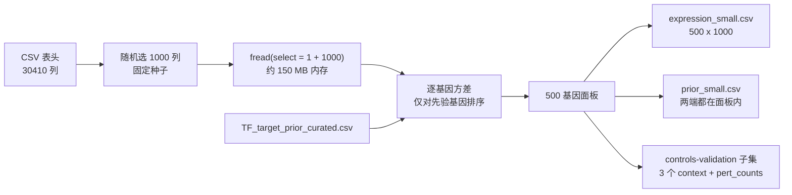
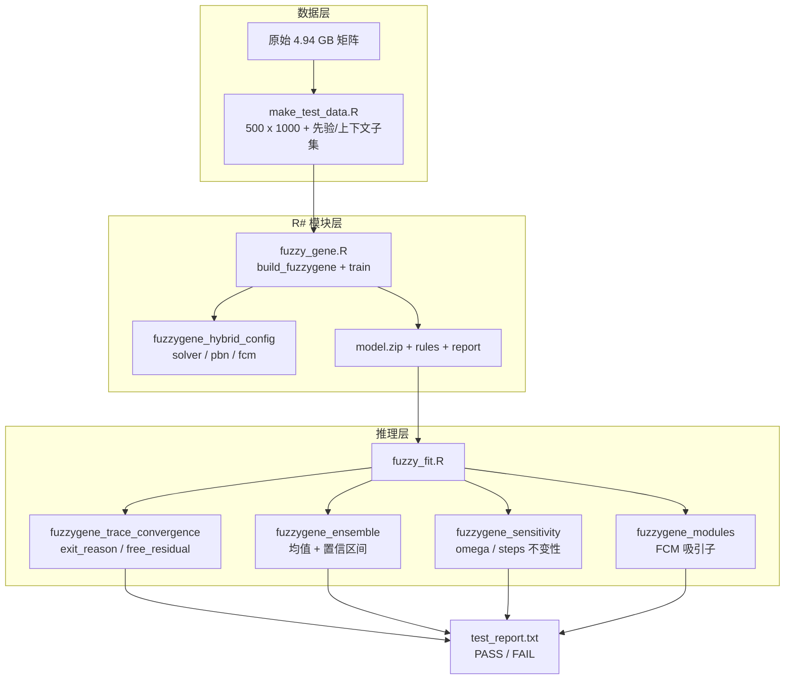

## 用户需求

### 任务一：把「布尔网络」相关能力同步到 R# 模块

`G:\GCModeller\src\workbench\R#\biosystem\fuzzyGene.vb` 是 `FuzzyGene` 命名空间的 R# API 模块。上一轮在 `FuzzyGene` 子系统中新增了以下能力，但 R# 侧完全看不到：

- 概率布尔网络（PBN）定性先验与 CoD 表；
- 基于 PBN 规则采样的扰动集成（均值/标准差/置信区间/符号一致率/布尔吸引子周期）；
- 模块级模糊认知图（FCM）热启动与吸引子代理；
- 牛顿/LM 求根的收敛诊断（退出原因、自由残差、约束违背量、贴界比例）；
- 谱半径校准与求解器/混合层配置项。

需要把这些能力暴露为 R 可调用的 API，且**不得改动既有 `fuzzygene_config` 等函数签名**（这些函数已被 `fuzzy_gene.R`、`fuzzy_chain.R` 等脚本使用）。

### 任务二：用 GNU R 生成小测试数据集

原始矩阵 `G:\vcc2026\data\GRN_expression_matrix_metacell30k_18533genes_x_30409cells.csv` 有 **4.94 GB、18533 行 × 30410 列**，无法直接进 R 内存。需要抽取出：

- **500 个基因 × 1000 个 metacell** 的表达子矩阵，基因挑选遵循「先验覆盖优先、再按方差取前 500」；
- 与之配套的**先验网络子集**（只保留两端基因都在面板内的边）；
- 与之配套的**验证上下文子集**（`controls-validation` 的三个 pseudobulk 上下文 + `pert_counts.csv`，按面板基因过滤）；
- 一份选择记录（随机种子、列号、基因数、边数），保证可复现。

小数据集只用于「链路打通 + 收敛性验证」的快速测试，不作为生物学结论。

### 任务三：改写两个 R# 脚本并跑通

- `fuzzy_gene.R`：在小数据集上做**静态训练**（grid 划分、6 个调控因子、mf=3、maxEpoch=40，牛顿求根默认开启），导出规则、报告、边表与 `model.zip`；
- `fuzzy_fit.R`：加载该模型，用**子集化的验证上下文**做敲除/敲低，输出收敛诊断、集成不确定性与 ω/步数不变性，并以 `[PASS]/[FAIL]` 落盘结论；
- 按 `G:\GCModeller\src\R-sharp\SKILL.md` 的「编译 → 刷新运行时 → 执行脚本」三步流程，在 `R#.exe` 上验证。

### 关键约束

- 脚本原先存在 `here("GRN_...csv")` 指向 `scripts\` 而非 `data\` 的问题，以及对无时间点的 metacell 矩阵调用 `as.time_serials()` 的问题，必须随本轮一并修正。
- 判定以脚本输出的 `[PASS]` 为准，不能只看 `R#.exe` 退出码；计算量大，执行需自行控制超时。

## 技术栈

| 层 | 选择 | 说明 |
| --- | --- | --- |
| R# 模块 | VB.NET / net10.0，`<ExportAPI>` + `<RApiReturn>` | 沿用 `biosystem` 包现有写法，不新增项目引用 |
| R# 运行时 | `G:\GCModeller\src\R-sharp\App\net10.0\R#.exe` | 必须先刷新，否则加载旧 `FuzzyLogic.dll` |
| 数据抽取 | GNU R 4.5.0（`Rscript.exe`），优先 `data.table::fread(select=)` | 无 `data.table` 时退化为 base R 的 `colClasses="NULL"` |
| 训练/推理 | `FuzzyGene` 子系统的牛顿/LM 求根 + PBN/FCM 混合层 | 默认 `Hybrid.Calibration=None`、`PbnRegularization=None` |
| 测试报告 | 脚本内 `writeLines` 写 `[PASS]/[FAIL]` | SKILL.md 明确 R# 脚本测试不用 `DebugAudit` |


## 实现策略

### 1. R# 模块：新增 5 个 API + 扩展 2 个私有助手

**不改 `fuzzygene_config` 签名**。新增配置通过一个可链式调用的 mutator 完成，避免 50 个可选参数：

```
fuzzygene_hybrid_config(config, solver="newton", calibration="none",
                        pbnRegularization="weighted", pbnMaxParents=2,
                        ensembleSamples=0, fcmWarmStart=FALSE, ...) -> fuzzygene_config
```

新增查询/推理 API（全部返回 `list` 或 `dataframe`，与既有风格一致）：

| API | 返回 | 数据来源 |
| --- | --- | --- |
| `fuzzygene_pbn(model)` | `cod` / `rules` / `summary` | `FuzzyGeneModel.PbnPrior` |
| `fuzzygene_ensemble(model, genes, mode, samples)` | `table` / `summary` / `attractors` | `PredictEnsemble` 逐基因调用 |
| `fuzzygene_modules(model)` | `table` / `summary` | `FuzzyGeneNetwork.Modules` + `FcmModuleLayer.BuildInitial` |
| `fuzzygene_solver_report(model, gene, mode, steps)` | 单行 `dataframe` | `TracePerturbation().Mutant` 的退出诊断 |
| `fuzzygene_hybrid_config(...)` | `fuzzygene_config` | `Config.Solver` / `Config.Hybrid` |


扩展：

- `summaryTable()` 增加 `exit_reason` / `free_residual` / `clamp_residual` / `dominant_gene` / `attractor_period` / `is_surrogate`，让既有 `fuzzygene_trace_convergence` 立刻能断言收敛性；
- 包级 `<remarks>` 与 `fuzzygene_relaxation` 的文档按新语义重写（ω 只影响阻尼回落路径，默认求解器是求根）。

**容错约定**：PBN 未启用时 `fuzzygene_pbn` 返回带指引的 `debug.stop`，而不是空表；`fuzzygene_ensemble` 捕获 `InvalidOperationException` 并提示「训练时需开启 `pbnRegularization`」；`AttractorPeriods` 为空时返回零行但有列名的 `dataframe`；`dominant_gene` 用空串而非 `Nothing`，避免 R 侧出现 `NA` 字符。

### 2. 数据抽取：两遍读、只保留需要的列

4.94 GB 无法整体读入，采用「先读表头取列名 → 只选 1000 列读入 → 按行子集」：



关键点：

- 只做**一次**全文件扫描；方差、基因筛选、子集输出都在同一份内存数据上完成。
- 先验覆盖优先：先从先验中取出「TF ∪ TargetGene」作为候选池，池内按方差取前 500；不足 500 时用剩余基因的最高方差补齐，并写进 manifest。
- `pert_counts.csv` 过滤后可能为空（验证靶基因不在 500 基因面板内），此时退化为「按计数取前 20 个」，并记录降级原因。
- 输出目录 `G:\vcc2026\data\test_small\`，脚本幂等可重跑。

### 3. R# 脚本：自检式改写

`fuzzy_gene.R`（训练）：

- 路径改为 `here("../data/test_small/...")`，删除 `as.time_serials()`（矩阵无时间点，强制 lagged 会让模型学错映射）；
- 配置改为 grid / K=6 / mf=3 / maxEpoch=40 / `clampToSupport=TRUE` / `propagationSteps=120` / `relaxation=1`；
- 打开 `pbnRegularization="weighted"` 以便顺带验证新 API；产物写 `../model/test_small/`；
- 训练后立刻打印 `fuzzygene_report`，断言 `trained > 0` 与 `spectral_radius` 已记录。

`fuzzy_fit.R`（扰动收敛测试）：

- 靶基因选取：`pert_counts ∩ 模型基因`，为空时取边表权重最高的目标的；
- 每个靶基因跑 knockout + knockdown，取 `fuzzygene_trace_convergence` 的 `summary`，断言 `exit_reason == "Converged"` 且 `free_residual < tolerance`；
- 输出 `convergence.csv`（逐迭代 `max_delta`）与 `solver.csv`（退出诊断），便于对照「平尾是截断还是真稳态」；
- 追加 `fuzzygene_sensitivity`（ω 不变性）与 `fuzzygene_ensemble(samples=16)`；
- 注入 `pseudobulk_context_A/B/C` 各跑一轮，验证上下文路径下的收敛；
- 结论写 `../analysis/test_small/test_report.txt`，失败显式 `stop()`。

## 实施注意

- **性能**：小数据训练（500 基因 × 27 规则）应在数十秒内完成；扰动单基因是毫秒级。若 `fuzzy_fit.R` 超过数分钟，说明误用了大参数（例如 K=18 / scatter），需回退到已确认的小参数。
- **编译顺序**：本轮改动触及 `src\runtime\sciBASIC#`（FuzzyLogic），因此 SKILL.md 的**步骤 2（`R_system.NET5.slnx`）不可跳过**；判定是否生效以 `assembly\net10.0\biosystem.dll` 与 `App\net10.0\R#.dll` 的时间戳为准。
- **构建兜底**：`GCModeller.slnx` 全量构建可能因无关工程失败，允许改为单独构建 `FuzzyGene.vbproj` + `biosystem.vbproj`，但必须核对 dll 已落盘。
- **兼容性**：`fuzzygene_config` 参数表、`InterventionResult` 契约、`*.fuzzygene.zip` 读取路径全部保持不变；新增 API 只做增量。
- **可观测性**：所有新 API 都带 `summary` 槽，脚本可对单个字段断言；训练报告的 `calibration` / `pbn` 行会自动出现在 `fuzzygene_report`，无需额外格式化。
- **文档**：`fuzzygene_relaxation`、`fuzzygene_trace_perturbation` 里「wildtype 等于训练基线」的旧描述已过时（现在迭代到不动点），必须同步修改，避免误导。

## 架构



## 目录结构

```
G:\GCModeller\src\workbench\R#\biosystem\
└── fuzzyGene.vb                       # [MODIFY] 新增 fuzzygene_pbn / fuzzygene_ensemble /
                                       #   fuzzygene_modules / fuzzygene_solver_report /
                                       #   fuzzygene_hybrid_config 五个 ExportAPI；扩展 summaryTable
                                       #   增加 exit_reason/free_residual/clamp_residual/dominant_gene/
                                       #   attractor_period/is_surrogate；新增 PBN 与 ensemble 的表格
                                       #   构造助手（复用 changesTable/summaryTable 的写法）；
                                       #   重写 fuzzygene_relaxation 与 trace 相关文档；包级 remarks
                                       #   补充 PBN/FCM 说明。必须复用 RInternal.debug.stop 报错，
                                       #   并保证 fuzzygene_config 签名不变。

G:\vcc2026\scripts\
├── make_test_data.R                   # [NEW] GNU R 抽取脚本。参数：--matrix/--prior/--out/--genes/
│                                      #   --cells/--seed。流式只读 1000 列 + gene 列；先验覆盖优先
│                                      #   选基因；输出 expression_small.csv / prior_small.csv /
│                                      #   controls-validation 子集 / manifest.txt。幂等、打印耗时。
├── fuzzy_gene.R                       # [MODIFY] 路径改 ../data/test_small；删除 as.time_serials()；
│                                      #   改为 grid/K=6/mf=3/maxEpoch=40/步骤 120；链式
│                                      #   fuzzygene_hybrid_config 开启 PBN 正则；训练后断言
│                                      #   trained>0 并打印 fuzzygene_report；产物写
│                                      #   ../model/test_small/{rules.txt,report.txt,network.csv,model.zip}。
└── fuzzy_fit.R                        # [MODIFY] 加载 ../model/test_small/model.zip；靶基因取
                                       #   pert_counts ∩ 模型基因（空则回退最高权重目标）；
                                       #   对每个靶基因跑 ko/kd + fuzzygene_trace_convergence，
                                       #   断言 exit_reason=Converged；追加 fuzzygene_sensitivity、
                                       #   fuzzygene_ensemble、fuzzygene_modules；注入 A/B/C 上下文；
                                       #   结论写 ../analysis/test_small/test_report.txt。

G:\vcc2026\data\test_small\            # [NEW] expression_small.csv / prior_small.csv /
                                       #   controls-validation\{pert_counts.csv,pseudobulk_context_A,B,C.csv,
                                       #   gene_names.csv,manifest.json} / manifest.txt
G:\vcc2026\model\test_small\           # [NEW] model.zip / rules.txt / report.txt / network.csv
G:\vcc2026\analysis\test_small\        # [NEW] convergence.csv / solver.csv / ensemble.csv /
                                       #   sensitivity.csv / modules.csv / test_report.txt
```

## 关键代码结构

```
''' <summary>PBN 定性层的可读视图（CoD 表 + 规则表 + 规模摘要）。</summary>
<ExportAPI("fuzzygene_pbn")>
<RApiReturn(GetType(list))>
Public Function fuzzygene_pbn(fuzzygene As fz.FuzzyGeneModel,
                              Optional env As Environment = Nothing) As Object

''' <summary>逐基因的扰动集成：均值、标准差、置信区间、符号一致率。</summary>
<ExportAPI("fuzzygene_ensemble")>
<RApiReturn(GetType(list))>
Public Function fuzzygene_ensemble(fuzzygene As fz.FuzzyGeneModel,
                                   genes As String(),
                                   Optional mode As String = "knockout",
                                   Optional samples As Integer = 16,
                                   Optional env As Environment = Nothing) As Object

''' <summary>求解器/混合层配置的链式 mutator（不改 fuzzygene_config 的签名）。</summary>
<ExportAPI("fuzzygene_hybrid_config")>
<RApiReturn(GetType(FuzzyGeneConfig))>
Public Function fuzzygene_hybrid_config(config As fzcfg.FuzzyGeneConfig,
                                        Optional solver As String = "newton",
                                        Optional calibration As String = "none",
                                        Optional pbnRegularization As String = "none",
                                        Optional ensembleSamples As Integer = 0,
                                        Optional fcmWarmStart As Boolean = False,
                                        Optional env As Environment = Nothing) As Object
```

## Agent Extensions

### SubAgent

- **code-explorer**
- Purpose: 在改写 `fuzzyGene.vb` 前，快速定位模块内可复用的辅助函数（`dataframe` 构造、`parseInterventionMode`、`toIntegerArray`、`summaryTable`）以及所有既有 `ExportAPI` 的调用方，确认新增 API 不与方法名、可选参数产生重载歧义。
- Expected outcome: 一份「可复用助手清单 + 需要同步修改的私有函数清单 + 命名冲突检查结果」，保证新增 5 个 API 与既有脚本零破坏。

### Skill

- **lsp-code-analysis**
- Purpose: 对 `FuzzyGeneModel.PredictEnsemble`、`Hybrid.EnsemblePerturbationResult`、`Hybrid.PbnRegulatorPrior`、`Hybrid.FcmModuleLayer`、`SteadyStateTrace` 做定义跳转与成员枚举，核对确切签名与属性名（VB 大小写不敏感，但 R# 包装要写对返回类型）。
- Expected outcome: 精确的成员签名列表，避免 R# 模块编译期出现 `MissingMemberException`/类型不匹配，也避免把 `Dictionary(Of Integer, Integer)` 直接塞进 `dataframe` 列。