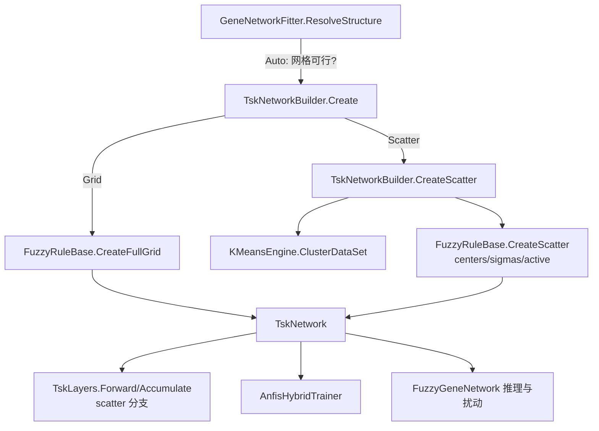

## Product Overview

为 TSK/ANFIS 增加「散射划分（scatter partitioning）」规则生成方式：用现有 KMeans 对训练样本聚类，每个簇生成一条规则，规则前件为每簇独立的高斯中心/宽度（支持 don't-care 输入），使输入维数不再受 `m^K` 指数约束；并提供 Auto/Grid/Scatter 开关，让 `maxRegulators = 18` 这类配置真正生效。

## Core Features

- 新增规则划分开关 `RulePartition = Auto | Grid | Scatter`（默认 Auto）：网格装得下用 Grid，装不下自动切 Scatter
- Scatter 结构：KMeans 聚类（复用 `KMeansEngine.ClusterDataSet`），规则数 = 簇数 C，与输入维数 K 解耦
- 每簇独立高斯前件：每条规则对每个输入有自己的中心与宽度；按簇中心相对全局均值的偏离度自适应决定保留多少个输入（下限 2、上限 `scatterInputs` 默认 8），未保留的输入视为 don't care
- 前向/反向/预测/剪枝/规则文本/JSON 持久化全部支持散射模型
- 训练报告显示实际结构（`structure: scatter C=48, inputs=18 x18264`），R# 配置函数暴露新参数

## Tech Stack

- 语言/运行时：VB.NET / .NET 10.0，沿用现有工程，不引入新依赖
- 涉及工程：`FuzzyLogic`（TSK 结构/前向/反向）、`ANFIS`（训练与剪枝）、`FuzzyGene`（逐基因编排）、`biosystem`（R# 绑定）；聚类直接复用 `DataMining/Clustering/KMeans/KMeansEngine.vb`

## Implementation Approach

### 1. 为什么必须换规则生成方式

网格划分下 `rules = mf^K`、结论参数 `P = mf^K × (K+1)`，`A'A` 需要 `P²` 个 double。K=18、mf=2 时 262,144 条规则、4,980,736 个参数，`A'A ≈ 200 TB`——这不是参数没生效，是架构上限（已实测 K=6 110 s / K=7 1416 s，K 每加 1 约 13 倍）。散射划分把规则数从「输入的指数」变成「簇数」，K 只影响每条规则的前件宽度与结论参数个数。

### 2. 散射模型的数学形式与代码映射

- 聚类：把 `[x | y]` 拼成 K+1 维行交给 `KMeansEngine.ClusterDataSet(rows, ids, C)`，得到 C 个簇（`NumericCluster` 只公开 `size / Item(i) / ClusterIndex(i)`，簇中心与簇内标准差自行按成员平均计算）。
- 前件：第 r 条规则在第 i 个输入上是高斯 `N(c_ri, σ_ri)`；`active(r,i)` 由「簇中心偏离全局均值的 z 分数 ≥ `ScatterZThreshold`」决定，并按 z 分数排序强制保留至少 `ScatterMinInputs` 个、至多 `ScatterInputs` 个。
- 规则触发强度沿用现有对数域公式，只是把「按输入索引共享 MF」换成「按规则索引各自的 c/σ」：`logW(t,r) = Σ_{i active} [-0.5·((x_ti-c_ri)/σ_ri)² − ln σ_ri]`。
- 结论层保持对**全部** K 个输入的一阶线性（`θ` 仍为 `R×(K+1)` 布局），`BuildDesignMatrix` 与 `LeastSquaresAccumulator` 无需改动；代价是每条规则多几个恒为 0 的斜率项，换来实现统一。
- 前提梯度不再需要「先算 dE/dw 再除 w」，直接用现有恒等式：对每个活跃 `(r,i)`，`∂lnμ/∂c = (x-c)/σ²`、`∂lnμ/∂σ = (x-c)²/σ³ − 1/σ`，乘以已算好的 `coefficient(t,r)` 累加。

### 3. 关键设计决策与权衡

| 决策 | 选择 | 理由 |
| --- | --- | --- |
| 前件表示 | 每簇独立高斯（用户已确认） | 经典 scatter 语义，规则中心可被梯度微调，不受共享 MF 网格限制 |
| `TskInferenceTrace` 契约 | 不改字段，只让 `Mu/LogMu/MfOffsets` 在散射时保持 `Nothing` | 避免动 5 个消费者的遍历逻辑；散射前向本来就不需要物化 per-input 隶属度表 |
| rule-mu 是否物化 | **不物化**，前向按 (t,r) 流式在 log 域累加，反向按需重算导数 | C=48、K=18、cap=512 若物化 `RuleMu` 需 4.7 MB/chunk，且完全没有必要 |
| 结论参数布局 | 仍为 `R×(K+1)` | `BuildDesignMatrix`/LSE/剪枝全部零改动 |
| Auto 判定 | 与 `ExceedsBudget` 同一套公式（`m^K ≤ MaxRules` 且 `m^K(K+1) ≤ MaxConsequentParams`） | 预算逻辑只有一个真理源，避免两处判定漂移 |
| `Antecedent(r,i)` | 散射时返回 `-1`（签名不变） | 旧调用者不受影响，don't care 有明确哨兵值 |
| 聚类维度 | 每个特征先按训练集 mean/sd 标准化再聚类，中心与宽度存回原始 z 空间 | 表达量各列量纲不同，不标准化会让方差大的基因主导簇结构 |


### 4. 性能与规模

- 前向/反向：`O(cap × R × q)`（q ≤ 8），C=48 时与现有 Grid(K=6, R=64) 同量级；反向只重算 `(x-c)` 与 `(x-c)²`，无额外分配。
- 结论参数 `P = C×(K+1)`：C=48、K=18 → 912（Grid K=6 为 448），LSE 成本约 4.1 倍；`A'A` 每线程 6.6 MB，128 线程约 850 MB，可接受。
- 聚类本身：一次 KMeans（4000 行 × 19 维、C=48）秒级，且每个基因只做一次。
- 与今天的缓冲复用改造兼容：散射前向同样写入 `TskForwardWorkspace`，不新增 per-chunk 分配。

### 5. 风险与边界

- 空簇 / 退化簇（成员数 < 2 或簇内 sd 为 0）直接丢弃，实际规则数可能小于 C，需要在报告里体现。
- 簇结构一次性确定、不参与梯度优化；但规则中心与宽度会被前提梯度微调，这是散射划分相对网格划分的额外自由度。
- 与 `NoveltyQuota` 正交：前者决定「选哪些调控因子」，后者决定「这些因子在规则里怎么划分」，互不干扰。
- Grid 路径必须保持逐位一致：现有 80 条自测断言与历史边表对拍不能变；Auto 只会改变「以前会静默降 K」的那些配置。

## Architecture Design



数据流：训练矩阵 → 聚类（标准化空间）→ 每簇一条规则（自适应活跃输入）→ `TskNetwork`（散射前提布局）→ LSE 拟合结论参数 + 梯度微调前提 → 边权导出（沿用现有灵敏度汇总）。

## Directory Structure

```
G:\GCModeller\src\runtime\sciBASIC#\Data_science\DataMining\FuzzyLogic\TSK\
├── TskStructureOptions.vb        # [MODIFY] 新增 RulePartition 枚举与 Scatter* 参数、校验；Clone 覆盖新字段
├── FuzzyRuleBase.vb              # [MODIFY] 新增散射载荷（centers/sigmas/active）、IsScatter、CreateScatter、IsActive、ActiveInputs；Antecedent 返回 -1；SelectRules 同步裁剪；ToAntecedentText 输出 N(c,s)
├── TskNetworkBuilder.vb          # [MODIFY] 新增 Create(x,y,options) 的 Auto 分派与 CreateScatter（KMeans + 自适应 q）；CreateGrid 保持不变
├── TskNetwork.vb                 # [MODIFY] 散射前提参数布局（PremiseParameterCount/RulePremiseOffset）、Get/SetPremiseParameters 分支、PremiseParameterNames、DTO 增加 rulePartition/ruleCenters/ruleSigmas + FromModelDto 兼容老包、RuleText 分支
├── TskLayers.vb                  # [MODIFY] ForwardCore 散射分支（逐规则 log 域累加，Mu/LogMu 置空）；Accumulate 前提梯度散射分支
├── TskForwardWorkspace.vb        # [MODIFY] 散射时跳过 Mu/LogMu/MfOffsets 分配，保留 Delta/Coefficient/Column 复用
└── TskInferenceTrace.vb          # [MODIFY] 仅补文档：散射模式下 Mu/LogMu/MfOffsets 为 Nothing

G:\GCModeller\src\runtime\sciBASIC#\Data_science\MachineLearning\ANFIS\
├── AnfisFitting.vb               # [MODIFY] CreateModel 改走 TskNetworkBuilder.Create；PruneRules 散射时按规则块搬运前提参数
└── Training\AnfisHybridTrainer.vb# [MODIFY] 仅确认前提梯度路径对散射前提布局正确（如需按 RulePremiseOffset 写入则加分支）

G:\GCModeller\src\GCModeller\sub-system\FuzzyGene\
├── Fitting\GeneNetworkFitter.vb  # [MODIFY] ExceedsBudget/ResolveStructure 支持 Scatter（K 不再削减、按 C×(K+1) 约束）；FitOneGene 传入 partition；metric 记录 scatter
├── Fitting\FuzzyGeneTrainingResult.vb  # [MODIFY] structure: 行区分 grid/scatter，输出簇数与输入数分布
├── test\Program.vb               # [MODIFY] 新增散射场景：训练/预测/剪枝/zip 往返/扰动/K=18 冒烟
└── IO\FuzzyGeneFile.vb           # [VERIFY] config.json 自动携带新参数（序列化整个 FuzzyGeneConfig），规则表随 manifest 往返

G:\GCModeller\src\workbench\R#\biosystem\fuzzyGene.vb  # [MODIFY] fuzzygene_config 增加 rulePartition/scatterRules/scatterInputs/scatterMinInputs/scatterZThreshold/scatterSeed

脚本：N:\vcell\vcc_2026_controls_final\fuzzy_gene.R  # [MODIFY] 给出 scatter 配置示例（K=18），保留 noveltyQuota/maxTrainRows 等现有设置
基准：K:\hsa_grn\20261025\fuzzy_bench_scatter.R          # [NEW] Grid(K=6) vs Scatter(C=48,K=18) 的 R²/耗时/边数对比
```

## Key Code Structures

```
' TskStructureOptions 新增（结构层开关，AnfisOptions / FuzzyGeneConfig 自动继承）
Public Enum RulePartitionKind
    Auto = 0      ' 网格装得下就用 Grid，否则 Scatter
    Grid = 1
    Scatter = 2
End Enum

Public Property RulePartition As RulePartitionKind = RulePartitionKind.Auto
Public Property ScatterRuleCount As Integer = 48      ' 簇数 C（实际规则数可能更少）
Public Property ScatterInputs As Integer = 8          ' 每条规则最多的前件个数
Public Property ScatterMinInputs As Integer = 2       ' 每条规则至少保留的前件个数
Public Property ScatterZThreshold As Double = 1.0     ' 簇中心相对全局均值的 z 分数门槛
Public Property ScatterSeed As Integer = 0            ' 聚类随机种子（保证可复现）

' FuzzyRuleBase 散射载荷（Antecedent 在散射模式返回 -1）
Public ReadOnly Property IsScatter As Boolean
Public ReadOnly Property RuleCenters As Double(,)      ' [R, n]，don't care 位置为 NaN
Public ReadOnly Property RuleSigmas As Double(,)       ' [R, n]
Public Function IsActive(rule As Integer, inputIndex As Integer) As Boolean
Public Function ActiveInputs(rule As Integer) As Integer()
Public Shared Function CreateScatter(centers As Double(,), sigmas As Double(,),
                                     Optional ruleIds As String() = Nothing) As FuzzyRuleBase

' TskNetworkBuilder 分派
Public Function Create(x As Double()(), y As Double()(), Optional options As TskStructureOptions = Nothing) As TskNetwork
Public Function CreateScatter(x As Double()(), y As Double()(), Optional options As TskStructureOptions = Nothing) As TskNetwork
```

### SubAgent

- **code-explorer**
- 用途：在改动前做一次散射改造的影响面清点，确认 `Rules.Antecedent(`、`MfOffsets`、`Mu`/`LogMu`、`PremiseOffsets`、`GetPremiseParameters`/`SetPremiseParameters` 在 `FuzzyLogic`、`ANFIS`、`FuzzyGene`、`GPS`、`GEARS`、`biosystem` 中的全部调用点，避免新增散射分支时漏改某个消费者。
- 预期产出：一份「文件:行 + 调用形式」清单；标注哪些调用点在散射模式会走到空数组/哨兵 `-1`，从而确定必须加分支的位置，并验证「只新增不改既有签名」这一约束成立。