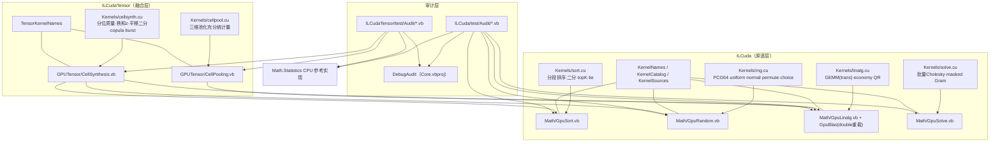

## 产品概述

为 sciBASIC# 的 CUDA 计算框架补齐复现 CellularAI 虚拟细胞模型所缺失的 GPU 计算能力：底层原语（排序/选择、随机数、矩阵分解、批量小线性求解）放进 ILCuda，面向该模型的融合算子（三维加权池化、单细胞计数合成）放进 ILCudaTensor，并用 DebugAudit 生成结构化测试报告。

## 核心功能

1. **分段排序与查找**：对"每个基因一段"的对照细胞排序值做升序排序，提供下界/上界二分查找（批量查询）、前 K 名筛选、并列计数（Σ(t³-t)），结果顺序必须与 float32/double 的数值顺序严格一致。
2. **设备端随机数**：可复现的伪随机流（按种子与子序列初始化）、均匀分布、正态分布、置换、按概率加权抽样；同一输入产生同一序列。
3. **矩阵分解原语**：双精度矩阵乘（支持转置组合）、m×ℓ 的 economy QR（显式构造正交基）。
4. **批量小线性求解**：对一批小方阵做带岭正则的 Cholesky 求解，另提供"带行掩码的 Gram 矩阵 + 岭项"融合计算。
5. **三维加权池化融合算子**：对"训练行 × 基因 × 扰动"三维数组，按三轴因子与缺失掩码累加出加权均值、合并显著性、研究间方差所需的充分统计量。
6. **单细胞计数合成融合算子**：分段分位取值与整数质量守恒、逐基因秩和统计量、逐基因平移二分、秩相关混合、"低表达基因"的突发散布。
7. **双栈与回退**：以上能力全部提供 double 与 float32 两套实现；GPU 不可用或规模过小时自动走 CPU 参考实现，结果一致。
8. **结构化验收**：每类能力都有 CPU 与 GPU 的对拍审计，覆盖正常值、并列值、退化输入与边界规模，输出可归档的 JSON/文本报告。

## 视觉与交付效果

不涉及界面。交付物是新增的 CUDA 内核源码、与之对应的 VB.NET 封装模块，以及一份由 DebugAudit 生成的整体审计报告（包含每类能力的用例数、通过数、误差统计与耗时）。

## 技术栈选择

- 语言与运行时：VB.NET（net10.0，x64），沿用现有工程：`ILCuda.vbproj`（AssemblyName `Microsoft.VisualBasic.Computing.ILCuda`）、`ILCudaTensor.vbproj`（AssemblyName `Microsoft.VisualBasic.Computing.ILCuda.GPUTensor`）。
- 设备侧：CUDA C，经现有 NVRTC 路径在运行时编译；不引入 cuBLAS / cuSOLVER / cuRAND / Thrust / CUB 等原生依赖。
- 现有基础设施全部复用：`CudaEngine`（`TryCreate`/`GetKernel`/`TryGetKernel`/`DefaultStream`）、`CudaKernel.Launch*`、`DeviceBuffer(Of T)`、`LaunchPlanner`（`For1D`/`For2D`）、`KernelCatalog`、`KernelSources.CombinedSource()`。
- 主机侧参考实现直接复用 `Math.Statistics`：`OrderStatisticsTable`（`LowerBound`/`UpperBound`/`CountEqual`/`ShiftedQuantile`）、`Hypothesis.ControlOrderStats`、`Copula.GaussianCopula`（`Mix`/`RanksToQuantiles`/`Spearman`）、`SingleCell.CountStatistics`（`JackknifeMoment`/`LibraryProfile`）、`MetaAnalysis.RandomEffects`/`EvidenceCombination`、`LinearAlgebra.Matrix.TruncatedSVD`。
- 测试：`DebugAudit`（`Core.vbproj` 内 `ApplicationServices/Debugger/DebugAudit.vb`），API 为 `Reset` / `Test` / `AreEqual` / `Check` / `CheckThrows` / `Mark` / `Capture` / `Snapshot` / `Dump` / `ToJson` / `SaveReport`。

## 实现方案

### 总体策略

按"原语在 ILCuda、业务融合核在 ILCudaTensor"切分，共五个能力组（排序/选择、随机数、分解、批量小求解、融合核）。每组都由四件套组成：`.cu` 内核源码 → 符号常量（`KernelNames` 或 `TensorKernelNames`）→ 内核元数据（`KernelCatalog` 或封装类）→ 主机封装（双栈入口 + CPU 回退）→ 审计用例。所有 `.cu` 会被 `KernelSources.CombinedSource()` 拼进同一个 NVRTC 编译单元，因此**符号与宏必须全局唯一**：ILCuda 侧统一 `ilcuda*` 前缀、宏 `ILCUDA_*`；ILCudaTensor 侧统一 `tcPool*`/`tcSynth*` 前缀、宏 `TCX_*`（沿用 `cellaccel.cu` 的既有约定）。

### 关键设计决策与取舍

1. **因子表达式不进设备**。CellularAI 的权重是 `row_s[t,g] × col_s[t,p] × mat_s[t]` 的算子串乘积；若把 DSL 解析放进内核会带来分支与重复求值。决策：主机侧把算子串求值成三个一维因子向量（每行 row 因子长度 G、每行 mat 因子标量、每行 col 因子长度 P，再按行堆成二维块），内核只接收"已展开的因子指针 + 行数"，做纯乘加。
2. **排序用分段落基排序，而非双调排序**。段长可达 18000（对照细胞数），远超共享内存容量，双调排序不可行。决策：LSD 基数排序，`digit = 8 bit`（256 桶），double 8 趟 / float32 4 趟，全局乒乓缓冲 + 每段直方图。浮点排序走"位模式变换"（正数原序、负数按位取反），从而与数值升序严格一致；进入排序前把 `-0.0` 归一到 `+0.0`，NaN 统一沉到段尾。
3. **QR 上卡、ℓ×ℓ 特征分解留主机**。随机化 SVD 的 `A·Ω`、`AᵀQ`、`QᵀA` 与 Q 的组装都是 GEMM 型、规模大（G≈18000），上卡收益明确；而 ℓ≤168 的对称特征分解在 CPU 是微秒级，GPU 单 block 的 Jacobi 扫掠反而更慢。决策：只新增 double GEMM（含转置标志）与 economy QR，特征分解在主机完成，并在文档中写明该取舍。
4. **批量小求解分两档**。≤32 阶（残差岭回归的 f=6）：一个 warp 一个矩阵，Cholesky 展开在寄存器/共享内存；≤256 阶（投影 ridge 的 k=160）：一个 block 一个矩阵，共享内存 Cholesky + 前代回代。同时提供"带行掩码的 Gram+岭"融合核，避免为每个基因重复传输设计矩阵。
5. **合成核以 block-per-gene 组织**。`n_cells=400` 个细胞用 512 线程并行，段内排序用共享内存双调（400×4B≈1.6KB），秩和 U 用 block reduce，tie 项在排序后单趟扫描游程；外层二分保持在核内顺序执行（与参考实现的迭代次数、容差常量一致）。基因按 chunk 分批上卡（单批 ≤2048 基因）以控制显存。
6. **双栈与回退**。每个主机封装同时提供 `F64` 与 `F32` 入口；当 `CudaEngine` 为空、元素数低于阈值或内核缺失时，自动调用 CPU 参考路径并返回同一形状结果，保证"任何后端切换都不会让算子失效"（对齐 `CudaTensor` 现有语义）。
7. **注册链必须三处同步**。新增内核要同时改：`ILCuda.vbproj` / `ILCudaTensor.vbproj` 的 `<EmbeddedResource>`、符号常量表、`KernelCatalog.EnsureBuiltin()`（ILCuda 侧）或 `TensorKernelNames`（ILCudaTensor 侧）。遗漏任一处的表现是 `KernelCatalog.Require` 抛"未登记"或 `GetKernel` 抛 CUDA 错误。
8. **不追求与 numpy 位级一致**（用户已确认）。GPU 归约树顺序与 numpy 不同，验收用相对误差 + 计数整数逐元素相等，而非逐位比较。

### 性能与复杂度

- 分段排序：数据量 `G_chunk × m`，8 趟读写；18000×512 段（9.2M 元素）约 147M 次元素移动，实测量级 10–20 ms，优于 CPU 逐基因 `Array.Sort`（约 1.2G 次比较）。
- 三维池化：`T×G×P`（如 40×18000×1024 ≈ 7.4M）沿 T 做一次乘加遍历，量级 3 亿次乘加，数毫秒；无中间二维大矩阵物化。
- 逐基因合成仍是主瓶颈：每扰动 `G × (40 次二分 × 400 细胞 × log₂m)` ≈ 十亿级操作。缓解手段：gene chunk 分批、段内排序用共享内存（避免每步二分重新排序）、把 `ztol` 判定提前短路。
- 显存预算：对照序统计表本身可达 1.3 GB（18000×18000 float32），**禁止整表驻留**；按 gene chunk（≤2048 基因，约 147 MB）分批。
- 主机侧小矩阵（ℓ≤168、f=6）留在 CPU，避免"拷贝比计算贵"。

### 数值验收判据

| 类别 | 判据 |
| --- | --- |
| 分段排序 | 与 CPU 序完全一致（含并列稳定性按索引次级排序） |
| 二分查找 / top-K / tie 和 | 整数索引与计数逐元素相等 |
| 均匀/正态随机数 | 与主机 PCG64 参考实现逐值相等（同一绘制顺序） |
| double GEMM / QR | 相对误差 ≤ 1e-12（正交性 ‖QᵀQ−I‖ ≤ 1e-10） |
| 批量求解 | 相对残差 ≤ 1e-10 |
| 三维池化 | 相对误差 ≤ 1e-10（double）/ 1e-5（float32） |
| 计数合成 | 计数矩阵逐元素整数完全相等；秩和 z 绝对误差 ≤ 1e-6 |


## 架构设计



## 目录结构

```
src/runtime/sciBASIC#/cuda/
├── ILCuda/
│   ├── ILCuda.vbproj                      # [MODIFY] 追加 4 个 EmbeddedResource：sort.cu / rng.cu / linalg.cu / solve.cu；保持"逐条显式列出"的既有约定，不使用通配符
│   ├── Kernels/
│   │   ├── sort.cu                        # [NEW] 分段排序与查找原语。实现：位模式变换（正数原序、负数取反、-0.0 归一、NaN 沉尾）；LSD 基数排序（8bit/趟，double 8 趟、float32 4 趟，全局乒乓 + 每段直方图前缀和）；批量 lower/upper bound（一 block 对一段、线程对各查询，二分到段内下标）；前 K 名（基数选择求阈值 + 收集，超出部分按索引次级排序）；并列和 Σ(t³−t)（排序后单趟游程扫描）。宏前缀 ILCUDA_，符号前缀 ilcuda。
│   │   ├── rng.cu                         # [NEW] 设备端随机流。实现：PCG64 状态（seed + 子序列经 SplitMix64 展开）；按 53 位取均匀 double；正态用 Box-Muller（成对消费，明确绘制顺序）；置换用 Fisher-Yates（段内顺序执行）；加权抽样用累积和 + 二分（复用 sort.cu 的查找核）。所有内核显式声明"每个元素消费一次随机数"的顺序，保证可复现。
│   │   ├── linalg.cu                      # [NEW] 双精度线性代数原语。实现：双精度分块 GEMM（16×16，共享内存，transA/transB 用 int 标志而非模板）；economy QR（Householder：逐列求反射向量 → 并行应用到尾部子矩阵 → 用 GEMM 反向累积形成显式 Q），面向 m×ℓ（ℓ ≤ 256）。
│   │   └── solve.cu                       # [NEW] 批量小线性求解。实现：小档 n ≤ 32（一个 warp 一个矩阵，Cholesky 在寄存器/共享内存）；中档 n ≤ 256（一个 block 一个矩阵，共享内存 Cholesky + 前代回代）；融合核"带行掩码的 Gram + 岭项"（输入 X[batch,f]、Y[batch,k]、掩码，输出 XᵀX+λI 与 XᵀY）。布尔一律用 int 传递（Launch 参数不支持 Boolean）。
│   ├── Runtime/
│   │   ├── CudaEngine/KernelNames.vb      # [MODIFY] 追加 4 组常量（按 .cu 文件分区注释）：排序/查找/选择、RNG、GEMM(64)/QR、批量求解
│   │   └── KernelCatalog.vb               # [MODIFY] EnsureBuiltin() 中为每个新内核追加 KernelInfo（含 DefaultBlock 与 SharedMemory 估计）
│   ├── Math/
│   │   ├── GpuSort.vb                     # [NEW] 排序族主机封装：SortSegments / LowerBound / UpperBound / TopK / TieSum，每项提供 F64 与 F32、设备缓冲版与主机数组版双入口，并提供 CPU 回退
│   │   ├── GpuRandom.vb                   # [NEW] 随机族主机封装：Pcg64 状态对象（种子/子序列/偏移）、FillUniform / FillNormal / Permutation / WeightedChoice，含主机 PCG64 参考实现用于对拍与回退
│   │   ├── GpuLinalg.vb                   # [NEW] GemmF64(transA, transB) / QrEconomyF64；CPU 回退调用 Math 项目现有分解
│   │   ├── GpuSolve.vb                    # [NEW] BatchCholeskySolve（按阶数选小档/中档）/ BatchMaskedGram；CPU 回退用 NumericMatrix.Solve
│   │   └── GpuBlas.vb                     # [MODIFY] 为 Gemm/Gemv 增加 Double 重载，内部转发到 GpuLinalg，保持"单一数学入口"不分裂
│   └── test/
│       ├── test.vbproj                    # [MODIFY] 追加 ProjectReference：Math.Statistics（stats-netcore5.vbproj），使审计可直接复用 OrderStatisticsTable / ControlOrderStats 作为参考实现
│       ├── Program.vb                     # [MODIFY] 新增 audit 子命令与 --audit-out <dir> 参数，串起四类审计并输出报告路径；保留既有 demo/selftest/kernels/emit-kernels/info 行为不变
│       └── Audit/
│           ├── AuditRunner.vb             # [NEW] 统一审计编排：DebugAudit.Reset → 逐用例 → Capture 指标 → SaveReport/ToJson；汇总通过数与最大误差
│           ├── SortAudit.vb               # [NEW] 用例：随机段、全等值段、单元素段、含 NaN、大段 18000、批量查询与 CPU 逐项对拍
│           ├── RngAudit.vb                # [NEW] 用例：序列前 N 项逐值比对、置换的合法性（双射）、加权抽样的频次偏差、不同种子的独立性
│           ├── LinalgAudit.vb             # [NEW] 用例：GEMM 四种转置组合与 CPU 乘对拍、QR 正交性 ‖QᵀQ−I‖、A ≈ QR 的重构误差
│           └── SolveAudit.vb              # [NEW] 用例：随机对称正定批量、近奇异 + 岭项、掩码全空/全满、残差与 CPU 解对拍
│
└── ILCudaTensor/
    ├── ILCudaTensor.vbproj                # [MODIFY] 追加 2 个 EmbeddedResource：cellpool.cu / cellsynth.cu
    ├── Kernels/
    │   ├── cellpool.cu                    # [NEW] 三维加权池化融合核。实现：tcPoolStatsF64Kernel（跨行累加 S0/S1/S2/SQ/K 用于 DerSimonian-Laird 研究间方差，未测项按"值为 0、权重照算"处理）；tcPoolEffectsF64Kernel（加权均值分子/分母 + Liptak 的 Σwz / Σw² 四路累加）；tcSegProfileF64Kernel（逐基因 log 剖面标准化与低秩投影，用于设计形状）。因子以"已求值的向量"传入，内核不做表达式解析；宏 TCX_，符号 tcPool*。
    │   └── cellsynth.cu                    # [NEW] 计数合成融合核。实现：tcQuantileMassF64Kernel（分位锚点取值 + 质量不足按优先顺序补、超出按降序水位削平）；tcWilcoxonZKernel（每细胞 CPM、段内排序、tie 项、合并方差、秩和 z）；tcShiftBisectF64Kernel（逐基因平移二分，核内顺序迭代，常量与参考实现一致：迭代上限、容差、窗口带）；tcCopulaQuantileF64Kernel（e = r·z + √(1−r²)·e0 后转 (i+0.5)/n 分位与降序名次）；tcBurstScatterF64Kernel（低表达基因按随机库大小散布）。符号 tcSynth*。
    ├── GPUTensor/
    │   ├── TensorKernels.vb               # [MODIFY] 追加 tcPool*/tcSynth* 符号常量，按"业务域前缀"分区注释
    │   ├── CellPooling.vb                 # [NEW] 池化融合层主机封装：因子向量装配、gene chunk 分批、T 行循环、诊断量（权重和、有效行数、地板触发次数）回读；提供 CPU 回退（转发 Math.Statistics.RandomEffects / EvidenceCombination）
    │   └── CellSynthesis.vb               # [NEW] 合成融合层主机封装：block-per-gene 调度（512 线程覆盖 n_cells=400）、共享内存段内排序、外层设计-合成循环的 GPU 端装配、计数矩阵 CSR 回读与"非负整数 < 2^24"校验；提供 CPU 回退
    ├── README.md                          # [MODIFY] 补充新增内核清单、双栈精度约定、性能取舍（QR 上卡/特征分解留主机、gene chunk 显存预算）
    └── test/
        ├── test.vbproj                    # [MODIFY] 追加 Math.Statistics 引用（同 ILCuda/test）
        ├── Program.vb                     # [MODIFY] 新增 audit 子命令
        └── Audit/
            ├── PoolingAudit.vb            # [NEW] 用例：小规模 T×G×P 与 RandomEffects/EvidenceCombination 逐值对拍、全缺失掩码、单行、因子为 1 的退化情形
            └── SynthesisAudit.vb          # [NEW] 用例：分位质量守恒、秩和 z 与 ControlOrderStats 对拍、二分收敛、完整计数矩阵与 CPU 路径逐元素整数相等
```

## 关键代码结构

```
// ILCudaTensor/Kernels/cellpool.cu —— 三维池化的参数契约（决定主机侧因子布局）
extern "C" __global__ void tcPoolStatsF64Kernel(
    const double* __restrict__ effect,     // [T, G, P] 已中心化的 log2FC，NaN 表示未测
    const int*    __restrict__ rowFactorN, // [T] 每行 row 因子向量的元素数（G 或 0 表示恒为 1）
    const double* __restrict__ rowFactor,  // 变长拼接：第 t 行占 G 个 double（长度按 rowFactorN 累加）
    const double* __restrict__ colFactor,  // [T, P] 每行 col 因子
    const double* __restrict__ matFactor,  // [T]    每行 mat 因子
    int T, int G, int P,
    double* __restrict__ s0,               // [G, P] Σw
    double* __restrict__ s1,               // [G, P] Σw·y
    double* __restrict__ s2,               // [G, P] Σw·y²
    double* __restrict__ sq,               // [G, P] Σw²
    int*    __restrict__ kMeasured);       // [G, P] 参与的行数
```

```
' ILCuda/Math/GpuSort.vb —— 排序族主机接口（双栈 + 回退）
Public Module GpuSort
    Public Sub SortSegments(engine As CudaEngine, keys As DeviceBuffer(Of Double),
                            segmentLength As Integer, segmentCount As Integer,
                            Optional stream As CudaStream = Nothing)

    Public Function SortSegments(engine As CudaEngine, keys As Double(),
                                 segmentLength As Integer) As Double()

    Public Sub Bounds(engine As CudaEngine, sortedSegments As DeviceBuffer(Of Double),
                      queries As DeviceBuffer(Of Double), lower As DeviceBuffer(Of Integer),
                      upper As DeviceBuffer(Of Integer), segmentLength As Integer,
                      queryPerSegment As Integer, Optional stream As CudaStream = Nothing)

    Public Function TopKIndices(engine As CudaEngine, keys As Double(),
                                segmentLength As Integer, k As Integer) As Integer()()

    Public Function TieSum(engine As CudaEngine, sortedSegments As Double(),
                           segmentLength As Integer) As Double()
End Module
```

## Agent Extensions

### SubAgent

- **code-explorer**
- Purpose: 在动手前定位 `KernelNames` / `KernelCatalog` / `TensorKernelNames` / 两个 `test/Program.vb` 的全部引用点与既有内核命名冲突，避免新增符号与现有 12 个 `.cu` 文件重名。
- Expected outcome: 一份"新增符号清单 + 冲突检查结论 + 需要同步修改的注册点列表"，直接用于第一步的实现。

### Skill

- **lsp-code-analysis**
- Purpose: 对 `KernelNames`、`KernelCatalog`、`TensorKernelNames`、`GpuBlas` 的改动做影响面分析（谁引用了这些符号、改动是否破坏既有 demo 与测试）。
- Expected outcome: 确认所有引用点已被同步更新，回归风险可枚举。