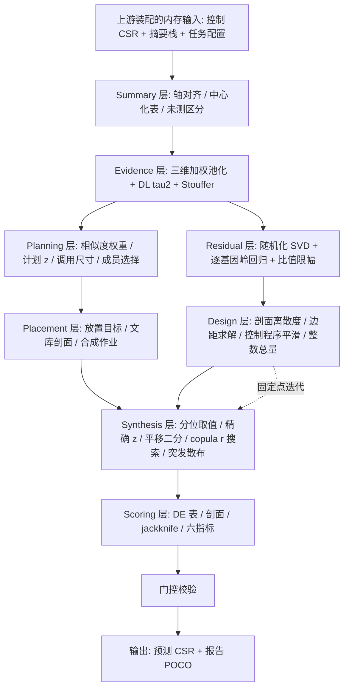

## 产品概述

在 `CellularAI.vbproj` 中以**纯内存、纯 CPU** 的方式复现 Illumina CellularAI 虚拟细胞算法：输入由上游项目装配好的内存对象（控制细胞计数矩阵、训练摘要表、任务配置），输出预测计数矩阵与诊断报告，不做任何 Parquet / HDF5 / VCC 文件读写。随机源采用 Level A 方案（自研可播种 PCG64 + 本地 Box–Muller，统计等价且同 seed 同结果，不要求与 numpy 位流逐位一致）。GPU 加速留作后期可选阶段。

## 核心功能

- **模型参数契约**：把上游已发布的超参数（池化因子表达式、计划曲线、总量设计、放置规则、合成内核参数、护栏阈值）表达为带默认值的参数对象，默认值与参考配置逐项一致。
- **摘要内存契约**：以对象形式承载"逐细胞系 × 逐视图"的效应矩阵、双侧概率矩阵、逐基因中心化表、响应方差表与控制表达剖面，并支持基因轴/扰动轴对齐、重复基因折叠、未测项与实测零的区分。
- **随机效应池化**：按"行 × 列 × 整行"三维因子加权的逐基因 DerSimonian–Laird 随机效应合并；log2 效应取加权均值，显著性取 Stouffer/Liptak 合并；同时输出未测靶列表与全部护栏计数。
- **响应计划**：以对照表达相似度（秩相关 + 软最大 + 权重上限）为权重，计算计划显著性、相似度显著性、训练数据广度；按曲线尺寸、功效得分重排、相近度抬升三步确定每个扰动的响应基因数，并给出基因成员、方向、优先级与非计划基因的微调方向。
- **控制条件残差校正**：用低秩响应基（随机化 SVD）+ 逐基因多响应岭回归（带行掩码）拟合上下文相关残差，并以比值限幅、符号保持与证据一致性权重把残差修正融合回池化效应。
- **总量设计**：把效应转成相对对照池的基因比例；以剖面离散度为目标、以控制细胞留一法矩为"信用"上界，求解设计幅度与设计边距；再叠加控制程序平滑与程序加权；最后用最大余数法转成整数基因总量，并通过固定点迭代把合成后的实际离散度对齐到信用目标。
- **单细胞计数合成**：为每个扰动生成固定数量的非负整数细胞；以对照 CPM 分层分位为边缘分布、以目标秩和 z 为约束做平移二分、以高斯 copula 把基因秩与文库大小秩耦合、以相关系数搜索逼近放置目标，低表达基因按文库大小概率突发散布；所有随机性由扰动名派生的可复现种子驱动。
- **门控与评分**：计算 VCC 六项指标（剖面距离、无偏表达误差、方向保真、方向覆盖、显著集 Jaccard、log2FC 标准化绝对误差）与锚点缩放总分；并按上下文轴、基因/扰动轴、每靶细胞数、整数性、实际 call depth、未测靶、readout 覆盖、收敛性、信用区间、护栏触发率逐项校验，任一项失败即阻止该上下文的预测被接受。

## 技术栈

- 语言/运行时：VB.NET，`net10.0`，沿用现有 SDK 式工程（隐式编译）。
- 目标项目：`E:\codebuddy\GCModeller\src\GCModeller\sub-system\CellularAI\CellularAI\CellularAI.vbproj`（`RootNamespace=CellularAI`），已引用 `Core.vbproj`、`Math.NET5.vbproj`、`stats-netcore5.vbproj`、`DataMining.NET5.vbproj`、`DeepLearning.NET6.vbproj`、`TensorFlow.vbproj`；本期不新增项目引用。
- 不引入任何 NuGet 依赖；不做 YAML 解析、不做 Parquet/HDF5/VCC 读写。
- 测试框架：`Microsoft.VisualBasic.ApplicationServices.Debugging.DebugAudit`（用户强制要求），不使用外部测试框架。

## 复用的既有能力（均已在本仓验证可用）

| 需求 | 复用类型 |
| --- | --- |
| 随机化 SVD（秩 160，2 次幂迭代，容差秩） | `LinearAlgebra.Matrix.RandomizedSVD`（含 `FromOperator` 委托工厂） |
| 基因空间截断 PCA（top-100 载荷 + σ²） | `LinearAlgebra.Matrix.TruncatedPCA`（稠密 / CSR） |
| 逐基因多响应岭回归（行掩码、最小行数、并行确定性） | `...Bootstrapping.Ridge.MultiResponseRidge.BatchFit` |
| DL τ²、逆方差权重、方差中位数回填 | `MetaAnalysis.RandomEffects` / `Heterogeneity` |
| 加权均值（两种缺失语义）、Stouffer/Liptak、有效样本数、最大权重占比 | `MetaAnalysis.EvidenceCombination` |
| 双侧 P ↔ 带符号 z、正态 CDF/逆 CDF | `NormalDistribution` |
| 精确秩和检验、对照序统计表（`Table` 公开，`Core` 为 Friend 不可直接调用） | `Hypothesis.Wilcoxon` / `Hypothesis.ControlOrderStats` / `OrderStatistics.OrderStatisticsTable` |
| 分层分位剖面、整数分摊、水位法质量守恒 | `OrderStatistics.QuantileProfile`、`Apportionment.Apportion` |
| 高斯 copula 混合 / 名次转分位 / 一维求根 | `Copula.GaussianCopula`、`Numerics.RootFinding.RootSolver` |
| BH 校正 | `Microsoft.VisualBasic.Math.FalseDiscoveryRate` |
| CSR 计数矩阵、整数与 2^24 校验、jackknife 矩、CPM 均值 | `Compressed.CsrMatrix`、`CompressedBuilder`、`CellularAI.SingleCell.*` |


## 实现方案

### 1. 设计原则

1. **与参考实现逐阶段同构**：每个 Python 模块对应一个 VB 命名空间，每个函数对应一个小类型/模块方法，便于逐条比对与替换。
2. **纯函数 + 显式状态**：所有算法入口都接收"数据 + 参数"、返回"结果对象"，不持有全局可变状态；唯一的可变状态是护栏计数器，用 `Guards` 的 `reset/snapshot` 显式圈定作用域。
3. **浮点顺序固定**：跨记录累加一律按输入目录顺序单线程执行；并行只用于"每扰动 / 每基因只写自己槽位"的场景，禁止跨行归约。
4. **两层随机**：`Pcg64` 提供 `next_uint64/next_double/standard_normal/permutation/choice`，扰动种子由 `CRC32(扰动名)`（可选与任务 seed 组合）派生，保证"同 seed 同结果"。
5. **可替换计算后端**：接口 `IComputeBackend` 先只有 `CpuBackend`，M8 再加 `CudaBackend`，切换不改业务代码。

### 2. 四个必须新建的数值内核

| 内核 | 位置 | 为什么不能用现成实现 |
| --- | --- | --- |
| 三维加权池化 | `Evidence/MetaPooling.vb` | 权重为 `row[t,g] × col[t,p] × mat[t]`（逐基因 × 逐扰动），而 `RandomEffects.PoolMatrix` 的 `WeightMultiplier` 只能表达"每研究一个权重" |
| 精确 Wilcoxon z 快速路径 | `Synthesis/WilcoxonKernel.vb` | 合成内层循环每扰动要跑数十次二分 × 上万个基因；`Wilcoxon.TestTable` 每基因建 `Dictionary` 统计并列，开销不可接受。改用 `OrderStatisticsTable` 的二分定位 + 游程扫描 |
| 分位取值 + 质量守恒 | `Synthesis/QuantileBuilder.vb` | 需要在"整数计数数组 + 降序名次数组"上原地做均摊/削平，且与文库大小逐细胞耦合 |
| 可复现 PCG64 | `Random/Pcg64.vb` | 仓内 CPU 侧只有 MT19937；GPU 侧有 PCG64 但不可用（本期不上 GPU） |


### 3. 性能预算与内存策略

| 阶段 | 规模 | 估计代价 | 策略 |
| --- | --- | --- | --- |
| 池化 | `G=18000`, `P=1024`, `T≈10` | 约 2×10⁸ 乘加 | 逐基因外循环、逐扰动内循环，因子数组常驻 |
| 残差 SVD | `G×P`，`ℓ=k+8=168`，2 次幂迭代 | 约 2.5×10¹⁰ flops | 复用 `RandomizedSVD`（已按行累加、不物化中间矩阵）；残差栈按 P 分块（不超过 256 列）构建，避免 1.4 GB 常驻 |
| 控制 PCA | `6000×18000`，`ℓ=108` | 约 1.3×10¹⁰ flops | 复用 `TruncatedPCA`（算子形式中心化，不复制稠密矩阵） |
| 合成 | `P × n_cells(400) × G` 的分位取值 + 每基因数十次二分 | 主导项 | 按扰动 `Parallel.For`；引擎侧序统计表只读共享；`n_cells > 1024` 或规模过小时回退串行 |


### 4. 确定性与校验规则

- 同一 `task_seed` 两次运行：计数矩阵**逐元素整数相等**；`credit`、`margin`、`converged` 逐位相等。
- 每扰动恰好 `n_cells` 行；每行 `Σ = Lt(i)`；每基因 `Σ` 等于设计总量；全部计数为非负整数且小于 2²⁴。
- 设计层校验：`margin` 的 realized/target 落在信用带（0.975 ~ 1.001）；固定点最多 3 轮、`rtol=1e-3`，未收敛时报告标记而**不静默接受**。
- 门控：任一项失败则报告 `Accepted=False` 并列出失败项，不返回半成品。

## 架构设计



职责边界：

- `Summary` 只做"把上游数据摆成算法需要的轴"，不含统计。
- `Evidence` / `Planning` / `Residual` / `Design` 是纯计算，不感知细胞矩阵的稀疏结构。
- `Synthesis` 独占"控制侧序统计 + 随机源"，是唯一有随机性的层。
- `Scoring` 同时服务"模型内部设计目标"与"外部评估"，两者共用同一实现（`TS`、`jackknife`、`spread_B` 必须只有一份）。

## 目录结构

```
sub-system/CellularAI/
├── CellularAI/
│   ├── CellularAI.vbproj
│   ├── Class1.vb                      [DELETE] 占位类，实现完成后删除
│   ├── Guards.vb                      [NEW] 护栏计数：reset/fired/share/over/under/clip_abs/snapshot
│   ├── PredictionReport.vb            [NEW] 上下文报告 POCO：credit/margin/converged/guards/unmeasured/门控结果
│   ├── ContextPipeline.vb             [NEW] 单上下文端到端装配：输入 → 预测 CSR + 报告
│   ├── Model/
│   │   ├── CellularAiModel.vb         [NEW] 聚合根，组合下列 7 个参数对象
│   │   ├── PoolingOptions.vb          [NEW] 因子表达式字符串 + noise/se/se_clip/kd_ref/kd_floor/sim/sim_hvg/views/auxiliary_weight/pair_weight/v_floor_rel 等
│   │   ├── CallOptions.vb             [NEW] eligible_cpm/min_lfc/gamma/n_min/n_max/w_pow/phi/strength_*
│   │   ├── PlanOptions.vb             [NEW] curve_slope/sim_tau/sim_ntop/sim_cap/plan_z_uniform/xsim_*/power_*/shrink_*
│   │   ├── TotalsOptions.vb           [NEW] credit_*/amp_share/shape_*/mix/gate_z/pcs_*/cp_*/pw_*/residual_*/fixed_*
│   │   ├── PlacementOptions.vb        [NEW] RuleBand（amp/h0/kz/phi/cap/cl2）、evidence_z、band 区间、boost/damp、order_*、lib_spread
│   │   ├── SynthesisOptions.vb        [NEW] z_plan/z_nudge/rmax/n_bis/ztol*/ltol/ne_burst/planned_z/overshoot_z/repair_r/solve_*/shift_band/sparsify_step
│   │   └── GuardOptions.vb            [NEW] l2_abs_max/z_abs_max/sim_sd_min/sim_z_clip/nr_clip/log2_max/mt_ls_clip/order_sd_min/sim_share_max/sim_neff_min/credit_band
│   ├── Summary/
│   │   ├── OffsetTable.vb             [NEW] 逐基因中心化表：effect_center/effect_count/signed_score_center/response_variance
│   │   ├── SummaryRow.vb              [NEW] 一条训练摘要：cell_line/view/role/pair_group/pair_alternate + 三个面板 + 控制剖面 + 中心化表
│   │   ├── SummaryCatalog.vb          [NEW] 行集合 / primary_view / variance / orders；primary_row(cellLine)
│   │   └── SummaryBundle.vb           [NEW] 内存栈：T×G×P 效应与概率、T×G 控制表达、T×G 方差；提供轴对齐/折叠/偏移应用/带符号 z 转换
│   ├── Evidence/
│   │   ├── PoolingFactors.vb          [NEW] nr / sef / kd / sim / pair 因子与敲低系数
│   │   ├── FactorExpression.vb        [NEW] "inv:mad:dl"、"sef*kd"、"auxiliary*sim*pair" 解析与三维因子求值
│   │   ├── MetaPooling.vb             [NEW] 逐基因 tau2 + 逆方差权重 + 相对地板 + 加权均值 + Stouffer + 护栏
│   │   └── PooledEvidence.vb          [NEW] L2/Z/L2Tot/ZTot + guards + unmeasured
│   ├── Planning/
│   │   ├── SimilarityWeights.vb       [NEW] 秩/皮尔逊相关 + z 标准化 + softmax + 上限水位法
│   │   ├── PlanZ.vb                   [NEW] plan_z / similarity_z / x_sim
│   │   ├── CallSizing.vb              [NEW] curve_sizes / power_score / s1_sizes / xsim_sizes / plan_sizes
│   │   └── CallPlan.vb                [NEW] select_calls / sized_plan；CallEntry POCO
│   ├── Residual/
│   │   ├── ResponseBasis.vb           [NEW] 对角元替换 + RandomizedSVD + 响应尺度 + 残差坐标投影
│   │   ├── ControlResidual.vb         [NEW] 控制 logCPM 标准化 + 全局主成分 + BatchFit 逐基因岭回归 + 预测
│   │   └── EffectShaping.vb           [NEW] bounded_ratio / preserve_signs / evidence_agreement / profile_effects
│   ├── Design/
│   │   ├── ProfileSpread.vb           [NEW] profile_spread / totals_spread / make_spread
│   │   ├── MarginSolver.vb            [NEW] solve_margin / bisect_amp / expected_credit / control_moments
│   │   ├── ControlPcs.vb              [NEW] 按 seed 抽样控制细胞 → TruncatedPCA → 载荷与特征值
│   │   ├── ShapedDesign.vb            [NEW] base/zshape/strength_gate/cp_design/shaped_design
│   │   └── TotalsDesign.vb            [NEW] 整数总量（apportion）+ Solve 固定点循环
│   ├── Placement/
│   │   ├── PlacementTargets.vb        [NEW] Targets POCO + library_profile
│   │   ├── MagnitudeRule.vb           [NEW] magnitude / dn_target / plan_sign / q_order
│   │   └── SynthesisJob.vb            [NEW] 单扰动作业：T/Lt/mt/z 目标/优先级/随机源
│   ├── Synthesis/
│   │   ├── SynthesisEngine.vb         [NEW] 控制侧状态：OrderStatisticsTable、平均 CPM、基因比例、中位深度、log2_cg、eligible
│   │   ├── WilcoxonKernel.vb          [NEW] 精确 z（float32 栅格 + 游程 + 合并 tie 校正）
│   │   ├── QuantileBuilder.vb         [NEW] 分位取值 + 不足均摊 + 超出水位削平
│   │   ├── BlockSolver.vb             [NEW] solve_one / q_from / mcpm / solve_block_place（r=0 → 过冲修复 → r 二分 → 降级重解）
│   │   └── CellSynthesizer.vb         [NEW] synthesize(job) / synthesize_all(jobs, n_jobs)
│   ├── Scoring/
│   │   ├── GroupProfile.vb            [NEW] TS 归一化群剖面
│   │   ├── DeTable.vb                 [NEW] 逐扰动 DE 表（复用 Wilcoxon + BH）
│   │   ├── SideStats.vb               [NEW] 预测侧/参考侧统计容器（剖面、DE、jackknife）
│   │   └── VccMetrics.vb              [NEW] pds/expr_mse/fid/reach/jac/nmae + 锚点缩放
│   ├── Random/
│   │   ├── Pcg64.vb                   [NEW] PCG64 XSL-RR 128/64：next_uint64/next_double/standard_normal/permutation/choice
│   │   └── PerturbationSeed.vb        [NEW] CRC32(扰动名) 派生；与任务 seed 组合
│   ├── Compute/
│   │   ├── IComputeBackend.vb         [NEW] 后端接口（本期仅 CPU 实现，为 M8 预留）
│   │   └── CpuBackend.vb              [NEW] CPU 实现（池化/合成内核转发）
│   └── SingleCell/                    [KEEP] 已有的 CountStatistics / SingleCellCounts 保持不动
└── CellularAI.test/                   [NEW] 独立测试工程（必须放兄弟目录：库工程未排除 test\**）
    ├── CellularAI.test.vbproj         [NEW] Exe，引用 CellularAI.vbproj + Core.vbproj
    ├── Program.vb                     [NEW] Sub Main(args) 分派 m0~m7 / pipeline
    ├── SyntheticFixture.vb            [NEW] 30 基因 / 3 扰动 / 2 上下文的虚构数据装配（对齐上游 smoke 剧本）
    ├── M0ModelAudit.vb                [NEW] 参数默认值与配置逐项一致
    ├── M1PoolingAudit.vb              [NEW] 手算小例 + tau2 交叉验证 + Stouffer 一致性
    ├── M2PlanAudit.vb                 [NEW] 权重上限/守恒、曲线中位对齐、总量守恒、成员排除自身靶
    ├── M3ResidualAudit.vb             [NEW] U 正交、残差还原、比值区间、符号保持
    ├── M4DesignAudit.vb               [NEW] 边距命中/夹紧、总量精确、信用带
    ├── M5SynthesisAudit.vb            [NEW] 同 seed 自一致、每行/每基因守恒、整数与 2^24、降级逻辑
    ├── M6ScoringAudit.vb              [NEW] 完美预测=1、噪声退化、缩放 clamp/floor
    └── M7PipelineAudit.vb             [NEW] 端到端门控与报告完整性
```

## 关键代码结构

```
' 池化结果：后续所有阶段都读取这个对象
Public Class PooledEvidence
    Public Property L2 As Double()()          ' G x P，加权均值 log2FC
    Public Property Z As Double()()           ' G x P，|Stouffer|
    Public Property L2Tot As Double()()
    Public Property ZTot As Double()()
    Public Property Guards As Dictionary(Of String, Double())
    Public Property Unmeasured As String()
End Class

' 计划结果：每个扰动一份
Public Class CallEntry
    Public Property Index As Integer()        ' 响应基因下标（按优先级）
    Public Property Sign As Double()
    Public Property Priority As Double()
    Public Property NudgeSign As SByte()      ' G，非计划基因的微调方向
    Public Property NudgeStrength As Double() ' G
    Public Property NCalls As Integer
End Class

' 端到端入口（唯一对外 API）
Public Module ContextPipeline
    Function Predict(controls As CsrMatrix,
                     genes As String(), perturbations As String(),
                     bundle As SummaryBundle,
                     medianDegs As Double,
                     callDepth As Double,
                     model As CellularAiModel,
                     Optional nCells As Integer = 400,
                     Optional seed As Integer? = Nothing,
                     Optional nJobs As Integer = 1,
                     Optional backend As IComputeBackend = Nothing) As PredictionResult
End Module

' 计算后端（本期只有 CPU；M8 增加 CUDA）
Public Interface IComputeBackend
    ReadOnly Property Name As String
    Function Pool(factors As PoolingFactors, effect As Double()(), probability As Double()()) As PooledStats
    Function Synthesize(engine As SynthesisEngine, job As SynthesisJob) As Double()()
End Interface
```

## 实施顺序与验收

| 阶段 | 交付 | 验收（DebugAudit 断言） |
| --- | --- | --- |
| M0 | `Model/*`、`Summary/*`、`Guards`、测试工程与 slnx 注册 | 参数默认值逐项等于参考配置；`Guards` 计数语义正确；虚构任务可装配 |
| M1 | `Evidence/*` | T=3/G=5/P=2 手算对拍；`tau2` 与 `RandomEffects.DerSimonianLaird` 一致；无因子时合并结果与 `EvidenceCombination.Stouffer` 一致；`unmeasured` 正确 |
| M2 | `Planning/*` | softmax 权重单调、cap 后总和守恒且不超上限；曲线尺寸中位对齐；s1 搬移守恒；xsim 增量不超过 20%；成员集排除自身靶基因 |
| M3 | `Residual/*` | U 列正交低于 1e-10；构造精确线性残差时系数还原误差低于 1e-8；比值恒在 0.5~2；符号不翻转；收缩权重在 0~1 |
| M4 | `Design/*` | 边距求解 3 步内命中近线性目标；不可达时夹紧并标记；`ΣT` 精确等于 `n_cells × depth`；realized/target 落在信用带 |
| M5 | `Synthesis/*` + `Random/*` | 分位取值总量精确；精确 z 与 `Wilcoxon.Test` 在小样本上一致；平移二分命中容差；同 seed 两次运行计数逐元素相等；每扰动行数/每行总和/每基因总量/整数性/2²⁴ 全部满足 |
| M6 | `Scoring/*` | 完美预测时 pds/fid/reach/jac 为 1 且 expr_mse 接近 0；噪声预测明显退化；缩放 clamp 与 floor 规则正确 |
| M7 | `ContextPipeline`、`PredictionReport`、性能与文档 | 虚构端到端流程通过全部门控；串行与多并行度结果逐位一致；README 与 ReleaseNotes 更新 |


## Agent Extensions

### SubAgent

- **code-explorer**
- Purpose: 在实现 M1/M5 前，对 Python 参考实现的关键函数（`meta_analysis.combine_layer`、`synthesis._solve_block_place`）做一次"实现细节逐行核对"，确认累加顺序、缺失值语义、并列校正与降级分支没有遗漏。
- Expected outcome: 产出逐行对照清单（Python 行号 → VB 成员），作为 M1 与 M5 的实现依据与审计断言的来源。

### Skill

- **lsp-code-analysis**
- Purpose: 在新增 `IComputeBackend` 抽象与删除 `Class1.vb` 时做引用查询，确认没有其他项目依赖被改动的公开成员。
- Expected outcome: 得到受影响符号清单，保证 `CellularAI.vbproj` 的公开面（`SingleCell.*`）零回归。