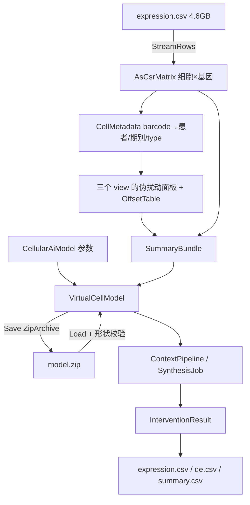

## 用户需求

### 四项交付

1. **补完流式稀疏矩阵转换**：在 `analysis/HTS_matrix/Matrix/MatrixBuilder.vb` 中实现 `AsCscMatrix(rows, sample_ids) As CscMatrix` 与 `AsCsrMatrix(rows, sample_ids) As CsrMatrix`，供 `Document.StreamRows` 的惰性流式加载直接转成稀疏矩阵。
2. **构建鼻咽癌虚拟细胞模型**：用 `StreamRows` 流式加载 `E:\hyperomics_24samples\expression.csv`（4.6 GB），结合 `sampleinfo.csv` 的样本元数据，调用 `CellularAI.vbproj` 的算法层建立模型。
3. **模型持久化**：提供序列化/反序列化模块，后续无需重新解析 4.6 GB CSV 即可复用模型。
4. **虚拟过表达实验**：基于模型做 BATF 单基因过表达、BATF3 单基因过表达、BATF+BATF3 联合过表达，输出三套过表达后的转录组结果数据。

### 落点与约束（已确认）

- 代码落在用户已建好的 `sub-system/CellularAI/VirtualCellular/VirtualCellular.vbproj`（`RootNamespace=SMRUCC.genomics.Analysis.VirtualCellular`），需参考 `sub-system` 下既有虚拟细胞流程（以 `GEARS.vb` 为主范式）。
- **必须实现** `core/Bio.InteractionModel/InsilicoPerturbationExperiment.vb` 接口，通过该接口调用 CellularAI 完成虚拟扰动；接口含 `SetContext`、`SetContextAlignmentMode`、`KnockoutGene`、`KnockDownGene`、`OverexpressGene`。
- 流程完成后**新建 demo 命令行程序**，用示例数据跑上述三次扰动测试。
- `CellularAI.vbproj` 继续保持"纯数学、无文件 IO"；CSV/ZIP 读写全部在 `VirtualCellular` 与 Demo 内完成。

### 数据事实（已实测）

- `expression.csv`：4.6 GB，行=基因、列=细胞，表头 `name,<barcode>...`；**102,525 个细胞列、23,450 个基因行**，取值为原始非负整数计数。
- `BATF`、`BATF3`（以及 `BATF2`）均在基因轴上。
- `sampleinfo.csv`：102,525 行，列含 `ID,sample_name,patient_id,type,stage,...`；**24 个患者**；期别分布 `NA=43,077 / II=9,487 / III=27,043 / IVB=13,828 / IVC=9,090`。
- 全表单遍顺序扫描约 28.5 s；全量稠密化不可行，必须走稀疏 + 流式。

### 已确认的建模口径

- **伪扰动采用两个 view**：期别对比 view 与患者对比 view，池化时按 view 分别加权。
- **过表达效应来自表达分层 DE**：在 III/IV 细胞内按 BATF（或 BATF3）表达量高/低分层做 DE，得到 `BATF_high`、`BATF3_high` 签名面板，联合过表达用"双高 vs 双低"。
- **计算规模取全量**：不筛细胞、不筛基因（用户接受内存与时间代价），但需提供降采样逃生口与显式的 nnz/内存/耗时报告。

## 产品概述

一个可复现、可持久化的鼻咽癌虚拟细胞工作流：把 4.6 GB 的观察性单细胞数据装配成 CellularAI 所需的训练摘要与对照矩阵，产出可保存/加载的模型包；再以 `InsilicoPerturbationExperiment` 接口对外暴露，支持指定基因的过表达/敲除/敲低，并把每次扰动的合成细胞导出为转录组矩阵与差异表达清单。

## 核心功能

- **流式转换**：单遍累积把基因×细胞流转换成 CSC，并按 O(nnz) 计数排序转置成细胞×基因 CSR；打印 nnz、耗时、峰值内存。
- **元数据装配**：barcode → 患者 / 期别 / `type` / 分组，交叉核对 `NA` 是否等价于正常对照，产出可审计的分组统计。
- **伪扰动面板**：期别对比面板（全局）、患者对比面板（逐记录）、BATF/BATF3/联合签名面板（逐记录，上/下四分位分层），同时产出 log2FC、p 值、BH 校正概率与 `OffsetTable`。
- **模型对象**：聚合参数、三个 view 的摘要、对照 CSR、基因/扰动轴、细胞元数据与构建清单。
- **持久化**：ZIP 包（`manifest.json` + 面板二进制 + 偏移二进制 + 对照 CSR + 细胞表），加载时逐项校验形状与轴哈希，版本不匹配即报错。
- **虚拟扰动接口**：KO/KD/OE 映射为"目标基因方向 + 强度"，与签名面板协同产生下游响应；返回 `InterventionResult`（野生型均值/标准差、突变型均值、倍数变化、百分比、Z 值、显著性）。
- **结果导出与 demo**：三次过表达各输出 `expression.csv`（基因×细胞）、`de.csv`（显著基因）、`summary.csv`（top 变化）与 `run.json`（参数、门控、耗时）。

## 技术栈

- 语言/运行时：VB.NET，`net10.0`，沿用 SDK 隐式编译工程。
- 目标工程：
- 修改：`E:\codebuddy\GCModeller\src\GCModeller\analysis\HTS_matrix\Matrix\MatrixBuilder.vb`
- 主体：`E:\codebuddy\GCModeller\src\GCModeller\sub-system\CellularAI\VirtualCellular\VirtualCellular.vbproj`（已存在，已引用 `CellularAI.vbproj`、`HTS_matrix-netcore5`、`InteractionModel`、`designer-netcore5`、`biocore-netcore5`、`stats-netcore5`、`Math.NET5`、`linear-netcore5`）
- 新增：`VirtualCellular.Demo`（Exe）、`VirtualCellular.test`（Exe，DebugAudit）
- 复用（已在仓内验证可用）：`Document.StreamRows`、`DataFrameRow`、`CscMatrix`/`CsrMatrix`/`CompressedBuilder`、`ContextAlignmentState`、`InterventionResult`/`InterventionSpec`/`InterventionMode`、`CellularAI.ContextPipeline`/`SummaryBundle`/`CellularAiModel`/`SynthesisEngine`/`CellSynthesizer`/`Metrics`、`DebugAudit`。
- 不引入任何 NuGet 依赖。

## 实现方案

### 1. 两个转换函数（`MatrixBuilder.vb`）

语义与算法：

| 函数 | 输出 | 说明 |
| --- | --- | --- |
| `AsCscMatrix(rows, sample_ids)` | 基因 × 样本 CSC | 与流式行序天然一致，`indptr` 按样本（列）压缩 |
| `AsCsrMatrix(rows, sample_ids)` | 样本 × 基因 CSR | CellularAI 的 `controls` 需要细胞×基因，由 CSC 转置得到 |


- 单遍累积：`rows` 是 `Iterator`（只能枚举一次），遍历每个基因行 `g`，把非零 `(g, v)` 追加到该细胞的桶；结束时按细胞 flatten 出 `indptr/indices/values`。**禁止** `rows.ToArray()`、禁止二次枚举。
- 转置：CSR 由 CSC 做计数排序（先统计每行 nnz，再前缀和填充），O(nnz)。
- 校验与边界：`rows Is Nothing` 或空 → 返回 `CscMatrix.Empty(0,0)`；`experiments.Length <> sample_ids.Length` → `ArgumentException`（带实际长度）；`geneID` 为空则用行序号占位；负值不做静默取整但记录警告计数。
- 诊断：返回前打印（可关闭）基因数、细胞数、nnz、稀疏率、耗时、CSC→CSR 转置耗时。
- 复杂度：时间 `O(基因数 × 细胞数)`（受 nnz 主导）+ `O(nnz)`；空间 `O(nnz)` 两份（桶 + 结果），峰值约为最终矩阵的 2 倍，因此调用方可选择只建所需的那一个。

### 2. 流式装配（`VirtualCellular/Data`）

```
StreamRows(expression.csv)  ──►  AsCsrMatrix(rows, cell_ids)  ──►  Controls (细胞 × 基因)
sampleinfo.csv ──►  CellMetadata(barcode → patient/stage/type/group)
```

- `ExpressionStream.Load(exprPath, metaPath, options)`：先读表头拿 `cell_ids`（可选按 `stage` 子集过滤列，默认全量），用 `StreamRows(excludes)` + `AsCsrMatrix` 得到 `Controls`；再解析 `sampleinfo.csv`（`File.ReadLines` + 手动分列，避免 9.87 MB 的强类型开销）建立 `CellMetadata`。
- **`NA` 语义核对**：交叉统计 `stage × type × group`，若 `NA` 组全部是 `type=normal` 则视作正常对照；否则回退到 `type=normal` 子集，并把判定依据写进 `run.json` 与模型清单。
- `DifferentialPanel.Contrast(caseCells, ctrlCells)`：逐基因用 `CellularAI.Synthesis.WilcoxonKernel.ZExact` 求 z → `NormalDistribution.TwoSidedPValue` → BH（`FalseDiscoveryRate.PValueAdjust`），log2FC 用 `log2((cpm_case+ε)/(cpm_ctrl+ε))`；输出 `effect[gene]`、`pvalue`、`padj`、`probability = 1 - padj`、以及 `OffsetTable`（`effect_center` = 组内均值、`effect_count`、`signed_score_center`、`response_variance`）。
- 三个 view 的构造：
- `stage`：全局对比面板（`NA→II`、`II→III`、`III→IVB`、`III→IVC`、`III→IV`），挂到每条患者记录下，配各自的偏移与相似度权重参与池化。
- `patient`：每患者 vs 正常，24 个伪扰动，逐记录独立计算。
- `signature`：在 III/IV 细胞内按目标基因表达取上/下四分位分组（默认 `0.25/0.25`），产出 `BATF_high`、`BATF3_high`、`BATF_high+BATF3_high`（双高 vs 双低），逐记录计算。
- 内存：面板为 `T×G×P`（24 × 23,450 × ≈32 ≈ 180 MB），可接受；DE 计算按基因分块并行（每基因只写自己槽位）。

### 3. 模型与持久化（`VirtualCellModel` / `ModelStorage`）



- `VirtualCellModel` 字段：`Options As CellularAiModel`、`Bundle As SummaryBundle`、`Controls As CsrMatrix`、`Genes As String()`、`Perturbations As String()`（按 view 分组）、`Cells As CellMetadata`、`Manifest As ModelManifest`。
- `ModelManifest`：`FormatVersion`、`CreatedAt`、`CellularAiVersion`、`NGenes`、`NCells`、`Views`、`Perturbations`、`GeneAxisHash`（SHA256 前 16 字节）、`Nnz`、`DataFingerprint`、`Seed`。
- `Save(Stream)`：`ZipArchive` 条目 `manifest.json`、`panels/<view>.effect.bin`、`panels/<view>.probability.bin`、`panels/<view>.offsets.bin`、`controls.bin`（`indptr/indices/values` + 形状头）、`cells.csv`；全部小端 float64/int32，行主序。
- `Load(Stream)`：先读 manifest，校验 `FormatVersion` 与 `GeneAxisHash`、逐一比对形状，通过后才装配；不匹配抛 `InvalidDataException` 并列出差异（参考 `GEARS.Load` 的"形状逐一对齐校验后才注入"写法）。

### 4. 接口实现（`Perturbation/CellularAIPerturbation.vb`）

```
Public Class CellularAIPerturbation
    Implements InsilicoPerturbationExperiment
```

- `SetContextAlignmentMode` / `SetContext` / `ClearContext`：复用 `ContextAlignmentState`（`core/Bio.InteractionModel/Intervention/ContextAlignment/`），`ContextAlignmentReference` 由模型的 `WildtypeMeans/SDs` 与训练种群构造；对齐后按相似度挑最近的阶段 III 患者作为合成用的 `Controls` 切片，并记录 `ContextDiagnostics`。
- 三次接口方法统一走 `Run(target As String, mode As InterventionMode, nSamples)`：

1. 目标基因在 `signature` view 中取对应签名（OE 用 `BATF_high`，KO/KD 用其取反）；联合过表达用 `BATF_high+BATF3_high` 面板；
2. 调用 `ContextPipeline.Predict(..., overrides)`，其中 `overrides` 是新加的**可选参数**（见"关键代码结构"），用于显式覆盖目标基因的设计方向与强度（因为 `SelectCalls` 会把自身靶排除，光靠面板无法把目标基因本身拉起来）；
3. 把合成细胞与上下文对照细胞做 DE，填 `InterventionResult`（`WildtypeMeans/SDs` 来自对照、`MutantMeans` 来自合成群均值、`FoldChanges = mutant − wildtype`、`PercentChanges`、`ZScores`、`IsSignificant = padj < 0.05` 或自身靶）。

- 扩展入口：`OverexpressGenes(genes() As String, nSamples)`（接口只有单基因，联合过表达用这个），`Spec.GeneName = "BATF+BATF3"`。
- 结果附带诊断：门控结论、`credit share`、`margin`、合成细胞数、实际 call depth。

### 5. Demo 与结果导出

- `VirtualCellular.Demo`（Exe）参数：`--expr`、`--meta`、`--out`、`--model`、`--rebuild`、`--stage III`、`--genes BATF,BATF3`、`--n-cells 400`、`--seed 20261126`、`--max-cells-per-group 0`（0 = 全量）。
- 流程：`--rebuild` → 加载 + 装配 + `Save`；否则 `Load`。随后依次跑 BATF、BATF3、BATF+BATF3，导出 `expression.csv`（基因×细胞）、`de.csv`（`gene,log2fc,pvalue,padj,significant`）、`summary.csv`（top 200 变化基因），以及全局 `run.json`。
- 导出复用 `ResultExporter.ToCsv(CsrMatrix, genes, cells, path)`，按 5 万行/批流式写出，避免拼接巨型字符串。

### 6. 性能与内存预算（全量，102,525 × 23,450）

| 阶段 | 估计 | 说明 |
| --- | --- | --- |
| 流式解析 | ≈30–90 s | 与 PowerShell 单遍 28.5 s 同量级，VB 侧解析更慢一些 |
| CSR 构建 | `O(nnz)`，nnz 实测后打印（经验 1.5–3 亿） | `values 8B + indices 4B ≈ 12 B/nnz` → 1.8–3.6 GB |
| CSC 转置 | 峰值 +1 份 | 只在需要时构建；`AsCsrMatrix` 内部用完即释放桶 |
| 面板 DE | 每 view 每记录 × 23,450 基因 | 按基因并行、每基因只写自己槽位；预计 10–40 min/全量 view |
| 合成 | 每扰动 `n_cells × G` | 复用现有 `CellSynthesizer` 的按扰动并行 |
| 建议 | ≥16 GB 空闲内存、SSD | 同时提供 `--max-cells-per-group` 逃生口 |


## 架构设计

- 分层：`HTS_matrix`（IO 原语）→ `VirtualCellular/Data`（装配与面板）→ `VirtualCellular/Model`（模型与持久化）→ `VirtualCellular/Perturbation`（接口实现）→ `Demo`（编排与导出）。
- 依赖方向单向：`VirtualCellular` 依赖 `CellularAI` 与 `HTS_matrix`，反向不成立；`CellularAI` 只新增一个纯参数化的可选入口（`TargetOverride`），不引入任何 IO。
- 与既有范式对齐：接口实现、`Save/Load`、`SetContext` 均照 `GEARS.vb` 的写法（`ZipArchive` + manifest + 形状校验、`ContextAlignmentState`、`PredictWithBaseline`）。

## 目录结构

```
src/GCModeller/analysis/HTS_matrix/
└── Matrix/MatrixBuilder.vb                  [MODIFY] 实现 AsCscMatrix / AsCsrMatrix：单遍桶累积、OO(nnz) 转置、空输入返回 Empty、形状校验、nnz/耗时诊断

src/GCModeller/sub-system/CellularAI/CellularAI/
├── ContextPipeline.vb                       [MODIFY] Predict 增加 Optional overrides As TargetOverride()：在计划后强制目标基因的方向/优先级与设计 L
└── PredictionReport.vb                      [MODIFY] 报告增加 Overrides 字段（记录本次强制干预，便于审计）

src/GCModeller/sub-system/CellularAI/VirtualCellular/
├── NamespaceDoc.vb                          [MODIFY] 填充命名空间说明（工作流四步与边界）
├── Data/ExpressionStream.vb                 [NEW] StreamRows + AsCsrMatrix 装配 Controls；读表头取 cell_ids；支持 stage 子集与 --max-cells 逃生口
├── Data/CellMetadata.vb                     [NEW] 解析 sampleinfo.csv；barcode→患者/期别/type/group；stage×type 交叉统计与 NA 语义判定
├── Data/DifferentialPanel.vb                [NEW] 逐基因 z→p→BH、log2FC、probability、OffsetTable；分块并行
├── Data/SummaryAssembly.vb                  [NEW] 三个 view（stage/patient/signature）→ SummaryBundle（含 SummaryRow/Catalog）
├── Model/VirtualCellModel.vb                [NEW] 模型聚合根：Options/Bundle/Controls/Genes/Perturbations/Cells/Manifest
├── Model/ModelManifest.vb                   [NEW] 清单与轴哈希
├── Model/ModelStorage.vb                    [NEW] ZipArchive Save/Load；manifest+面板+CSR+cells；形状与版本校验
├── Perturbation/VirtualPerturbation.vb      [NEW] (target, mode, nCells) → SynthesisJob 参数与合成调用；含联合过表达
├── Perturbation/CellularAIPerturbation.vb   [NEW] Implements InsilicoPerturbationExperiment；SetContext 走 ContextAlignmentState；结果转 InterventionResult
└── IO/ResultExporter.vb                     [NEW] CSR → expression.csv / de.csv / summary.csv；流式写、分批 flush

src/GCModeller/sub-system/CellularAI/VirtualCellular.Demo/
├── VirtualCellular.Demo.vbproj              [NEW] Exe，引用 VirtualCellular
├── CommandLine.vb                           [NEW] 参数解析与校验
└── Program.vb                               [NEW] rebuild/load → 三次过表达 → 导出 + run.json

src/GCModeller/sub-system/CellularAI/VirtualCellular.test/
├── VirtualCellular.test.vbproj              [NEW] Exe，引用 VirtualCellular + Core
├── Program.vb                               [NEW] 子命令分派（conv/model/pert）
├── ConverterAudit.vb                        [NEW] 稠密对拍、CSC↔CSR 转置一致、空行/全零行/列选择
├── ModelStorageAudit.vb                     [NEW] Save→Load 后预测逐位一致；版本/形状不匹配抛错
└── PerturbationAudit.vb                     [NEW] 同 seed 两次过表达逐元素相等；自身靶方向正确；结果字段非空

src/GCModeller/sub-system/CellularAI/CellularAI.slnx  [MODIFY] 注册 Demo 与 test 工程
```

## 关键代码结构

```
''' <summary>对指定基因强制施加的设计覆盖（虚拟干预的入口）。</summary>
Public Class TargetOverride
    Public Property Gene As String
    Public Property Log2FoldChange As Double   ' OE: +2.0；KO: -12.0（近似置零）；KD: -1.0
    Public Property Priority As Double = 1.0
End Class

' ContextPipeline.Predict 的增量签名（其余参数不变）
Function Predict(controls, genes, perturbations, bundle, model, medianDegs, callDepth,
                 Optional context As String = "context",
                 Optional nCells As Integer = 400,
                 Optional seed As Integer = 0,
                 Optional reference As SideStats = Nothing,
                 Optional withResidual As Boolean = False,
                 Optional overrides As TargetOverride() = Nothing) As PredictionResult

''' <summary>可持久化的虚拟细胞模型。</summary>
Public Class VirtualCellModel
    Public Property Options As CellularAiModel
    Public Property Bundle As SummaryBundle
    Public Property Controls As CsrMatrix          ' 细胞 × 基因
    Public Property Genes As String()
    Public Property Perturbations As String()
    Public Property Cells As CellMetadata
    Public Property Manifest As ModelManifest

    Public Sub Save(stream As Stream)
    Public Shared Function Load(stream As Stream) As VirtualCellModel
End Class
```

## 实施顺序与验收

| 阶段 | 交付 | 验收（DebugAudit） |
| --- | --- | --- |
| V1 | 两个转换函数 + `ConverterAudit` | 与稠密参考逐元素一致；`AsCsrMatrix` 与 `AsCscMatrix` 互为转置；空输入返回 `Empty`；长度不匹配抛 `ArgumentException` |
| V2 | 流式装配 + 元数据 + DE 面板 | 小样本（200 细胞 × 50 基因切片）上手工对拍 log2FC / z / BH；`stage×type` 交叉统计自洽；nnz 与稠密非零数一致 |
| V3 | 三视图 `SummaryBundle` + `VirtualCellModel` | `Bundle.TrainingRows` 计数正确；每个视图的面板形状 `T×G×P` 与轴一致；`OffsetTable` 无 NaN |
| V4 | `Save/Load` + `ModelStorageAudit` | 保存→加载后 `Predict` 的计数矩阵逐元素相等；篡改 manifest 版本/轴哈希时抛 `InvalidDataException` |
| V5 | `CellularAIPerturbation` + `PerturbationAudit` | 同 seed 两次过表达逐元素相等；目标基因方向正确且 ` | log2FC | ≥ 阈值`；`InterventionResult` 字段完整、自身靶显著 |
| V6 | Demo + 结果导出 | 三次过表达各产出三个 CSV；`run.json` 含门控与耗时；CSV 行数 = 基因数、列数 = 细胞数 + 1 |
| V7 | 真实数据全量端到端 | 全量加载 nnz/耗时打印；模型包可重复加载；三次过表达结果可复现；内存峰值与预算表一致（误差 ≤ 30%） |


## Agent Extensions

### SubAgent

- **code-explorer**
- Purpose: 在实现 V2/V3 前，核实 `ContextAlignmentState` / `ContextAlignmentReference` / `ContextAlignmentResult` 的确切成员签名、`HTS_matrix.DataFrameRow` 与 `Matrix` 的字段（`geneID`/`experiments`/`sampleID`/`rownames`），以及 `sampleinfo.csv` 可复用的解析器是否存在。
- Expected outcome: 产出"类型成员清单 + 逐字段用法"的对照表，避免凭记忆写错 API；同时确认 `NA` 组在仓库既有代码中的语义约定。

### Skill

- **lsp-code-analysis**
- Purpose: 在修改 `MatrixBuilder` 前做引用查询（`AsCscMatrix`/`AsCsrMatrix` 是否已被其他项目调用），在新增接口实现与 `TargetOverride` 参数前做调用点影响分析。
- Expected outcome: 得到受影响符号与调用点清单，确保扩展方法签名与 `ContextPipeline.Predict` 的增量参数不破坏既有调用（`CellularAI.test` 的 M0–M7 审计需保持全绿）。