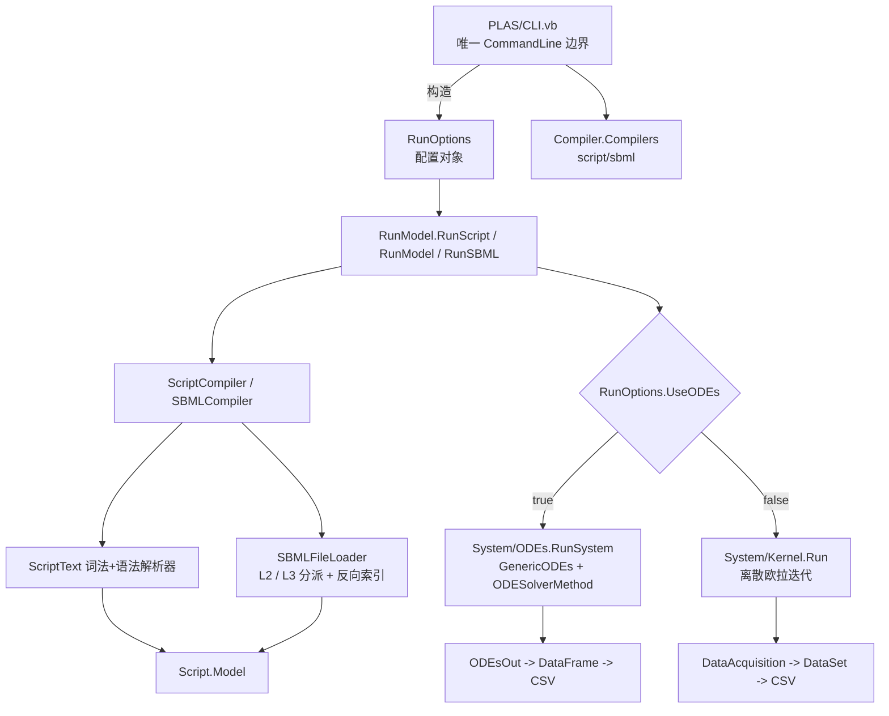

## 产品概述

对 GCModeller PLAS.NET 子系统的 S-system 算法库（`PLAS.NET/SSystem/SSystem.NET5.vbproj`）做一次源码审查与重构：修复脚本解析器与 ODE 方程组求解两处的功能缺陷，把 `RunModel.vb` 从「依赖 CommandLine」改造为「依赖配置对象」，并新增可切换 ODE 求解引擎的参数。最后用 `PLAS/PLAS.vbproj` 命令行程序回归 `test` 目录全部用例，并完成 E.coli SBML 全模型端到端求解算例。

## 核心功能

1. **源码审查结论落地（脚本解析）**

- 修复 `STIMULATE` 扰动行解析差一位导致的必然崩溃（`ModelParsers.vb:87` 循环起点应为 0）。
- 修复 `NAMED` / `REM-SUB` 被二次剥前缀、且 `FindObject(s)` 误传整串导致的 NRE（`ScriptParser.vb:158-162`、`176-180`）。
- 修复 `COMMENT` 行被词法器丢弃、`FINALTIME` 精度被整数截断、缺 `RXN` 段时报不可读的 `KeyNotFoundException`。
- 词法器增加行号/诊断信息，未知行与非法注解给出可读语法错误，并提供 strict/宽松两种容错开关（向后兼容）。

2. **源码审查结论落地（ODE 求解）**

- 修复 `/ODEs` 路径 100% 崩溃：`ODEs.vb:83` 的 `bounds(x.x)` 对 `Nothing` 必 NRE。
- 修复 `dynamics(var.Name)` 缺键时的 `KeyNotFoundException`；`Kicks` 构造对 `model.Experiments` 缺空保护。
- 把硬编码的 `.Solve(100000, ...)` 步数、`/precise` 死变量，改为由配置驱动的真实 Rhythm/步数参数。
- 把生物扰动（`STIMULATE`）从 ODE 的导数纯函数 `df` 中剥离，改为按「仿真时间轴」触发，消除 RK/自适应算法多次求值造成的语义污染。
- 增加负浓度保护（S-system 幂律 `^0.5` 遇负值会扩散 NaN）。

3. **RunModel 去命令行化**

- 引入不可变的运行配置对象（输入/输出/终止时间/求解模式/精度/步数/求解器/容差等），`RunModel.vb` 彻底移除 `Imports Microsoft.VisualBasic.CommandLine`。
- CommandLine 解析只在 `PLAS/CLI.vb` 边界完成，由 CLI 构造配置对象再调用算法库。

4. **ODE 求解引擎可切换**

- 新增求解器选择参数，默认保持 RK4（完全向后兼容），支持 Euler/RK2/Gill/RK4/ABM4/BackwardEuler/Trapezoidal/BDF2/RosenbrockROS2/RK23/RK45，配套步长/步数与自适应容差（atol/rtol）参数。

5. **SBML 编译器增强**

- 同时支持 SBML Level2（`test/example.sbml`）与 Level3（`F:\ecoli\29.0\data\metabolic-reactions.xml`，Level3.L1 + fbc）。
- 用 O(E) 反向索引替换当前 O(n×m) 全表扫描，使 5649 物种 / 6148 反应的全模型编译可行。
- 缺失 `initialAmount` / `initialConcentration` 时提供可配置初值兜底（含确定性抖动），避免全模型初值为零导致动力学恒零。

6. **回归与算例**

- 用 PLAS 跑通 `test` 目录全部脚本与 SBML 用例（离散 Kernel 与 ODE 两条路径），输出 CSV 并校验无 NaN、行数与终止时间一致。
- 完成 E.coli Level3 全模型端到端算例：编译产出 `.plas`、求解产出 `.csv`，并给出可复现命令行与结果摘要。

## 技术栈

- 语言/框架：VB.NET，SDK 风格工程，`net10.0`（单目标框架），`Microsoft.NET.Sdk`。
- 目标工程：`PLAS.NET/SSystem/SSystem.NET5.vbproj`（库，RootNamespace=`SMRUCC.genomics.Analysis.SSystem`）、`PLAS.NET/PLAS/PLAS.vbproj`（Exe）。
- 现有依赖（不新增外部 NuGet）：Core、Math.NET5、`odes-netcore5`、`dataframework-netcore5`、biocore、CompilerServices、`sbml-netcore5`。
- ODE 求解：`Microsoft.VisualBasic.Math.Calculus.Dynamics` 命名空间下的 `GenericODEs` / `ODEs` / `ODEsOut` / `ODESolverMethod` / `ODESolverOptions`。
- SBML：`SMRUCC.genomics.Model.SBML.Level2` 与 `SMRUCC.genomics.Model.SBML.Level3`（`XmlFile(Of Reaction).LoadDocument`）。
- 注意既有约定：两个工程的 VB 均**未开启 OptionStrict**、`SSystem` 开 `DocumentationFile` → 新增 Public 成员需写 XML 注释；XML 注释中不得出现 `--`；VB 不区分大小写，局部变量不可遮蔽类型名/模块名（`Module` 成员不可 `Shared`）。

## 实现思路

采用「**配置对象下沉 + CLI 适配上浮 + 求解器透传**」三层策略：

1. **配置对象（Fact 层）**：新建 `SSystem/Runner/RunOptions.vb`（Class），承载全部运行参数，并作为 `RunScript/RunModel/RunSBML` 的唯一入参，替换 `IRunModel(args As CommandLine)` 委托。`RunOptions` 提供 `GetOutputPath()` 缺省推导（`<输入去扩展名>.out.Csv`）与 `Validate()`（精度/步数/终止时间合法性）。ODE 专用参数聚合成 `ODESolveOptions`（method、options{Atol,Rtol,InitialStep,MaxSteps}、steps、nonNegative）。
2. **CLI 适配层**：`PLAS/CLI.vb` 负责把 `-i / -o / -f / /time / /ODEs / /precise / /steps / /solver / /atol / /rtol / /as-solver=x` 解析成 `RunOptions`；算法库不再出现 `CommandLine` 类型，实现依赖倒置。
3. **求解器透传**：底层已有 `ODEs.Solve(n, a, b, method As ODESolverMethod, incept, options As ODESolverOptions) As ODEsOut`（`ODEs.vb:337`），返回值与委托签名均不变，因此只需要在 S-system 侧把 `.Solve(n,a,b)` 换成带 `method` 的重载，即可零成本支持 11 种引擎。因 `Verlet/Yoshida4` 需要模型继承 `SymplecticODEs`（否则抛 `InvalidOperationException`），在配置层做白名单校验/友好报错。

## 关键实现要点（执行细节）

- **ODE 求解重构（`SSystem/System/ODEs.vb`）**
- `bounds` 参数改为可选：为 `Nothing` 时回落到「全变量默认通量区间」（沿用离散路径 `Equation.readRangeHelper` 非 strict 分支的 `-5..5` 语义），彻底消除必崩 NRE。
- `dynamics` 字典缺补：`dVAR/dt` 未在任何方程中出现的变量，`dy` 置 0（而非抛 `KeyNotFoundException`）。
- 步数：由 `RunOptions` 计算，`steps = Clamp(finalTime / precise, min, max)`，不再硬编码 100000；ODE 分支的 `p` 死变量删除。
- 扰动触发：把 `tick`（df 调用次数）替换为「当前仿真时间 `dx`」驱动的 `Kicks`，并用「同一时间点只触发一次」的时间戳守卫，保证 `df` 在给定时间点可重复求值；对无多步中间求值的 Euler 也成立。
- 非负保护：在 `df` 中同步 symbols 到 `ExpressionEngine` 时按开关钳位到 `>= 0`（默认开启），并在 Evaluate 后对 NaN/±Inf 做回退，避免单个 NaN 污染整个解。
- 性能：`SetSymbol` 全量刷新保持（向量长度 n），但把 `engine` 与 `dynamics` 提升到闭包外的局部变量；对 E.coli 规模用 `--steps` 小值 + 采样点控制总求值次数（`n 变量 × steps × 每步求值次数`）。
- **脚本解析修复（`ScriptText/*`）**
- `ExperimentParser`：循环改为 `For i = 0 To tokens.Length - 2 Step 2`，并对缺主键给出带原文的错误（不再是 `KeyNotFoundException`）；`VALUE` 的 `++/--` 前缀判定保持。
- `setAliasNames` / `setObjectComments`：去掉多余的 `Mid(s, 7)` / `Mid(s, 9)`；`FindObject(name)` 使用切分出的变量名，并对未声明对象做告警而非 NRE。
- `TokenIcer`：保留关键字剥前缀逻辑（`getLine -> ScriptToken(type, text, lineNumber, raw)`），新增行号字段与「未知/被忽略行」回流；`ScriptTokens.Comment` 行不再丢弃本体，使 `Model.Comment` 可正确填充。
- `FinalTime`：`Model.FinalTime` 放宽为 `Double`（XML 向后兼容），`FINALTIME 4.5` 不再被银行家舍入成 4/5。
- `tokens(ScriptTokens.Reaction)`：改为显式校验 + 可读 `SyntaxErrorException`（指出脚本行数）。
- **SBML 编译器（按用户选型：Level3 优先 + Level2 兼容）**
- 新增 `SSystem/Script/Models/SBMLFileLoader.vb`：按根元素 xmlns/level 分派——Level3 走 `Level3.XmlFile(Of Level3.Reaction).LoadDocument(path)`，Level2 走既有 `Level2.XmlFile.Load(path)`，对外统一暴露 `ISbmlNetwork`（species id/name/compartment/initialAmount + reactions 的 reactants/products）。
- 注意：Level3 路径**不会**执行 Level2 的 `RevertEscapes`，ID 保留 `__45__` 形式且不含 `-`，对数学表达式解析更安全；Level2 路径保留原 `__strip` 连字符逻辑。
- `__generateSystem` 改为**一次性反向索引**：遍历 reaction 列表构建 `Dictionary(Of String, List(Of Reaction))` 的 produce/consume 索引（O(E)），替代 5649×6148 的 `GetAllProduce/GetAllConsume` 全表扫描； `__where` 的子串 `InStr` 判定改为精确符号集合判定（避免 `ATP` 误命中 `ATPase_c`）。
- 初值兜底：新增 `InitialAmountFallback`（默认 1.0）与确定性抖动（基于 species id 的稳定哈希，幅度可配），使 `0.5*Π - 0.5*Π` 不会恒等于 0 而得到无意义平坦解。
- **输出保持兼容**：离散路径继续用 `DataAcquisition` + `DataSet.SaveTo`；ODE 路径继续用 `ODEsOut.DataFrame(xDisp:="#Time")` + `File.Save`，列名与既有 `*.out.Csv` 一致。

## 架构设计



- 依赖方向严格单向：**PLAS → RunOptions → SSystem**；SSystem 内部不再反向依赖任何命令行类型。
- 新增概念不引入新框架/新模式，沿用现有 `Module + Extension Method + Named Dictionary` 代码风格，避免破坏既有 API 面。

## 目录结构

```
PLAS.NET/
├── PLAS/
│   ├── CLI.vb                        # [MODIFY] 唯一命令行适配层：把 -i/-o/-f/ /time/ /ODEs/ /precise/ /steps/ /solver/ /atol/ /rtol 解析成 RunOptions；补 ExportAPI/Description/Usage 元数据
│   └── Program.vb                    # [不改动]
└── SSystem/
    ├── RunModel.vb                   # [MODIFY] 移除 Imports Microsoft.VisualBasic.CommandLine 与 IRunModel(CommandLine)；改用 RunOptions 驱动；删除 /precise 死变量
    ├── Runner/
    │   ├── RunOptions.vb             # [NEW] 运行配置对象：Input/Output/FinalTime/UseODEs/Precise/Steps/Solver/Atol/Rtol/NonNegative/AutoFix/Chart + GetOutputPath()/Validate()
    │   └── SolverRegistry.vb         # [NEW] 求解器名→ODESolverMethod 的 case-insensitive 映射、可用列表与友好报错（过滤 Verlet/Yoshida4）
    ├── System/
    │   └── ODEs.vb                   # [MODIFY] RunSystem(model, bounds, options)：bounds 空值回落、dynamics 缺键置 0、步数由配置、扰动按时间触发、非负与 NaN 保护、透传 ODESolverMethod
    ├── Script/
    │   ├── ScriptText/
    │   │   ├── TokenIcer.vb          # [MODIFY] 行号/原文保留、注释行不再整体丢弃、忽略行回流供诊断
    │   │   ├── Tokens.vb             # [MODIFY] ScriptToken 增加 lineNumber/raw 字段
    │   │   ├── ScriptParser.vb       # [MODIFY] 修 NAMED/REM-SUB 双剥与 FindObject 误传；修 COMMENT 不可达；FinalTime 双精度；缺 RXN 段可读报错；可选 strict 模式
    │   │   └── ModelParsers.vb       # [MODIFY] ExperimentParser 差一位修复 + 缺主键可读错误；ConstantParser 注释剥离加固
    │   ├── Models/
    │   │   ├── Model.vb              # [MODIFY] FinalTime 改为 Double；Vars 重复声明诊断
    │   │   ├── SBML.vb               # [MODIFY] 改为消费 ISbmlNetwork；O(E) 反向索引；初值兜底+确定性抖动；保留 .plas 产物写出
    │   │   └── SBMLFileLoader.vb     # [NEW] Level2/Level3 文档分派加载，统一 ISbmlNetwork 抽象（species + reactions 的 reactants/products）
    │   └── ScriptCompiler.vb         # [MODIFY] 接入行号化诊断，错误信息带行号
    └── test/                         # [新增验证产物] 各用例回归 CSV、E.coli 全模型 .plas 与 .csv、run-all 批处理脚本
```

## Agent Extensions

### SubAgent

- **code-explorer**
- 用途：在实施各步骤前精确定位符号与调用点（如 `WriteScript`、`WriteProperty`、`Iterator.Kernel.Run`、`DataSet.SaveTo`、`ODEsOut.DataFrame`、`Cholesky` 等既有 API 的确切签名与所在文件行号），以及在修改后做「影响面assert」（确认 SSystem 之外无残留对旧 `IRunModel(CommandLine)` 的引用）。
- 预期产出：给出带绝对路径与行号的依赖清单与调用点列表，确保重构不产生编译断点、不遗漏调用方。

### Skill

- **lsp-code-analysis**
- 用途：对 VB.NET 的老仓库（IDE 对 VB 的符号索引较弱，需回退文本检索时）做「查找引用 / 预览重构」的交叉校验，特别是在重命名 `IRunModel` 委托与调整 `RunSystem` 参数时确认全部调用点。
- 预期产出：重命名/签名变更影响的全部引用位置清单，配合 code-explorer 双源校验，保证零遗漏。