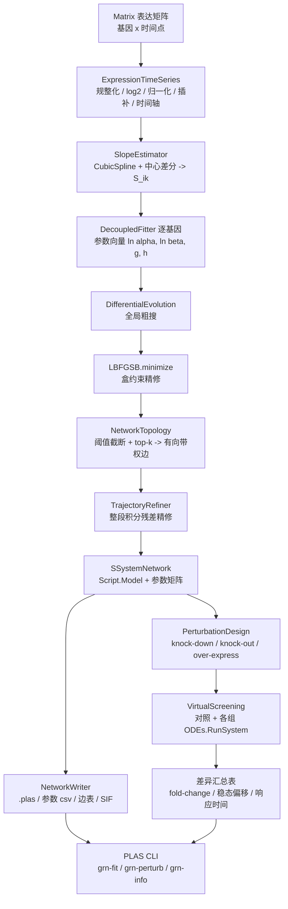

## 产品概述

在新建的类库项目 `PLAS.NET/SGrid/SGrid.vbproj` 中，依据 `SSystem/method.md` 的 S-system 逆问题方法论，实现「从基因表达矩阵反演基因表达调控网络」与「基于拟合模型做虚拟扰动实验」两个能力，并在 PLAS 命令行程序中新增对应入口。

## 核心功能

### 一、基因调控网络拟合（GRN Fitting）

- **输入**：`HTS_matrix` 的 `Matrix`（行=基因、列=时间点/样本），支持 `LoadData`/`LoadMatrixDocument` 读取；支持 log2(x+pseudo) 变换、ZScore / QuantileNormalize / TPM 归一化、缺失值插补、按 `sampleID` 或用户指定的时间点向量解析时间轴。
- **斜率估计（method.md 步骤1）**：三次样条重采样 + 中心差分求 `S_ik ≈ dX_i/dt|t_k`，把 ODE 拟合转化为对斜率的回归问题；输出斜率矩阵并做非负/异常值保护。
- **逐基因解耦拟合（步骤2）**：每个基因独立求解 `2(n+1)` 维参数 `(α_i, β_i, g_i*, h_i*)`，跳过自环或保留自环可配；对数域 OLS 给出 `g−h` 的初值。
- **两阶段优化（步骤4）**：阶段一用 `DifferentialEvolution.Evolution` 做全局粗搜（最小斜率残差 SSE + 稀疏惩罚），阶段二用 `LBFGSB.minimize(f, x0, lb, ub)` 做盒约束局部精修；参数上下界 α/β∈[0,10]、g/h∈[−3,3] 可配。
- **稀疏化与拓扑（步骤3）**：阈值截断（默认 0.2）+ 每基因最大边数（默认 3）→ 有向带权边 `source/target/weight`，权重取净调控弹性 `e_ij = g_ij − h_ij`，符号表示激活/抑制；附稳定性诊断（对数增益矩阵特征值实部）。
- **轨迹精修（阶段二）**：固定拓扑后，用多重打靶/整段积分最小化「模拟轨迹 vs 观测」残差，复用 SSystem 的 ODE 求解链路。

### 二、产物

- `Script.Model`（可直接被 PLAS 运行的 S-system 模型）+ `.plas` 脚本（`ScriptWriter`）
- 参数矩阵 csv：`alpha` / `beta` / `G` / `H` / `netElasticity`
- 有向边表 csv（`source, interaction, target, weight`）与 SIF 文本（Cytoscape 可直接导入）
- 拟合质量报告：`SSE` / `RMSE` / 每基因收敛标志 / 稳定性诊断

### 三、虚拟扰动实验（Perturbation）

- **扰动设计**：程序化构造 SSystem 既有的 `Experiment()`（knock-down / knock-out / over-express → `Decrease` / `ChangeTo` / `Increase`，含 `Start` / `Interval` / `Kicks` / `Value`），挂到 `Model.Experiments`，完全复用 `Kicks` 调度与 `ODEs.RunSystem` 求解链路。
- **批量筛选**：对照组 + 每个基因一个扰动组，逐组求解并落盘轨迹 csv（`ODEs.ToDataFrame`）。
- **差异指标**：稳态偏移、fold-change、响应时间、上下游影响排序（敏感性 / 对数增益），输出汇总表。

### 四、命令行入口

- 在 PLAS 中新增 `grn-fit`（拟合）、`grn-perturb`（虚拟扰动）、`grn-info`（查看已拟合模型摘要）命令；PLAS 新增 `SGrid.vbproj` 引用，`PLAS.NET.sln` 登记 SGrid。

## 技术栈

- 语言/框架：VB.NET，`Microsoft.NET.Sdk`，`net10.0`，`RootNamespace=SGrid`（未设 OptionStrict，默认 Off；未设 DocumentationFile）
- 目标工程：`PLAS.NET/SGrid/SGrid.vbproj`（新类库，已预置 14 条 ProjectReference，覆盖 HTS_matrix、MachineLearning、DataFittings、Math.NET5、odes-netcore5、ODESolver.Extensions、Core、SSystem、SBML、biocore、CompilerServices、ExperimentDesigner）
- 复用依赖（均已可达）：
- 表达矩阵：`SMRUCC.genomics.Analysis.HTS_matrix.Matrix` / `DataFrameRow`（`HTS_matrix\Matrix\Matrix.vb:80` / `DataFrameRow.vb:72`），`Matrix.LoadData(file, excludes, trimZeros, tqdm_wrap)`
- 全局优化：`MachineLearning\Darwinism\DifferentialEvolution.vb:178` `Evolution(target, [new], N, F, CR, threshold, maxIterations, PopulationSize, iteratePrints, parallel, seed)`；`IIndividual`（:83，需实现 `Yield(i)/Put(i,value)` 与 `Chromosome(Of T)` 的 `Crossover/Mutate/MutationRate`）
- 局部优化：`Math\Numerics\Optimization\LBFGSB\LBFGSB.vb:182` `minimize(f As IGradFunction, x0, lb, ub)`；`IGradFunction.evaluate(x)`（梯度自动中心差分）
- 初值回归：`Math\Algebra\Solvers\OLS.vb:158` `OLS.Solve(X(,), y(), nS, nP)`
- 插值/微分：`Math\Spline\CubicSpline\CubicSpline.vb:73` 与 `Extensions.vb:98`
- 模型与求解：SSystem 的 `Script.Model`、`SEquation`、`ScriptWriter`、`Experiment`/`Types`、`Kernel.ODEs.RunSystem(model, bounds, options)`、`ODEs.ToDataFrame(out)`、`Runner.RunOptions`
- 输出：`Microsoft.VisualBasic.Data.Framework.IO.File` + `RowObject`（与 `ODEs.ToDataFrame` 同款写法）
- 不新增任何外部 NuGet；不引用 `Data_science\Graph`（未被 SGrid 引用），自定义等价的有向边结构

## 实现思路

采用「**预处理 → 斜率 → 解耦粗拟合 → 稀疏化定拓扑 → 轨迹精修 → 产物导出 → 虚拟扰动复用**」的流水线，每层单一职责：

1. **数据层（ExpressionTimeSeries）**：`Matrix` → 规整化（基因 ID 必须以字母开头、非法字符转 `_`，与 `SBMLFileLoader.StripNumber` 同款，避免表达式引擎 `NotImplementedException`）→ log2/归一化 → 缺失值线性插补 → 时间轴 `t()`。
2. **微分层（SlopeEstimator）**：CubicSpline 重采样 + 中心差分 → `S(n×m)`；对非正值做 `log(x+ε)` 保护。
3. **拟合层（DecoupledFitter）**：逐基因打包参数向量 `(ln α, ln β, g_i1..g_in, h_i1..h_in)`，DE 粗搜 → L-BFGS-B 精修；目标 = 斜率残差 SSE + λ·稀疏惩罚；上下界数组一次性构造避免逐次分配。
4. **稀疏与拓扑层（NetworkTopology）**：阈值截断 + top-k → `RegulatoryEdge(source, target, weight, interaction)`；`net = g − h`；稳定性诊断输出最大特征值实部。
5. **精修层（TrajectoryRefiner）**：固定拓扑，用 SSystem `ODEs.RunSystem` 整段/分段积分，最小化轨迹残差（阶段二，可选开关，默认关闭以控制耗时）。
6. **扰动层（Perturbation / VirtualScreening）**：`Experiment()` 构造 + 批量 `RunSystem` + 差异指标汇总。
7. **CLI 层**：因 `App.RunCLI(Interpreter As Type, ...)` 只反射扫描单个类型（`App.vb:1191`）的 `<ExportAPI>` 方法，故逻辑放 `PLAS\GRN.vb` 的 `Public Module GRN`，并在既有 `CLI.vb` 模块内加薄包装 `<ExportAPI>` 方法转发。

## 关键实现要点

- **性能**：解耦后每基因参数维度 `2(n+1)`，DE 与 L-BFGS-B 的 `evaluate` 是热路径 —— 预计算 `ln X`（`n×m` 矩阵）用 `exp(sum(g·lnX))` 替代逐点 `Pow`，避免 `Math.Pow` 成为瓶颈；目标函数内不分配大对象；`evaluate` 中捕获 NaN/Inf 返回大惩罚值而非让优化器发散。
- **数值稳定**：α/β 用对数参数化保证正值；斜率估计前对 ≤0 值加伪计数；轨迹精修中若求解发散（NaN）返回大惩罚并跳过该基因。
- **向后兼容**：不动 SSystem 任何既有逻辑（上一轮已稳定的 8 用例 × 双路径回归），新能力全部落在 SGrid；PLAS 只新增方法，不改 `Run`/`Compile`/`Solvers` 语义。
- **VB 陷阱规避**：

1. CLI 一律用 `args.GetValue(name, def)` + `optStr/optBool` 助手，`Val(args("/x"))` 在开关缺失时抛 `ArgumentException`（DefaultString）。
2. 局部变量不可与属性同名（`steps` 遮蔽 `Steps` → BC32000）。
3. 跨类型边界的集合全部全限定 `System.Collections.Generic.List/Dictionary`，避免被 `Microsoft.VisualBasic.Language.List` 与 `Microsoft.VisualBasic.ComponentModel.Collection.Dictionary` 遮蔽（曾致 BC30311 / 运行时 InvalidCastException）。
4. 基因 ID 必须规整化为字母开头（表达式引擎硬约束）。
5. XML 注释不出现 `--`，`cref` 不指向不可解析成员（否则 BC42309）。

- **可验证性**：提供合成数据自测（构造已知 3 基因反馈回路，如 method.md 的 `Ẋ1=12X3^-0.8−2X1` 示例），比对恢复出的边集合与真实拓扑，输出 precision/recall；该自测作为 CLI 的 `--selftest` 分支或独立入口。

## 架构设计



## 目录结构

```
PLAS.NET/
├── SGrid/                                  # [NEW] 全部新代码落在这个类库
│   ├── SGrid.vbproj                        # [MODIFY] 保持既有 14 条引用；如需可补 sln 登记
│   ├── Class1.vb                           # [DELETE] 删除模板 stub
│   ├── GRN/
│   │   ├── ExpressionTimeSeries.vb         # [NEW] Matrix -> 时序视图：基因 ID 规整化（字母开头）、log2(x+pseudo)、
│   │   │                                   #       ZScore/Quantile/TPM 归一化、缺失值插补、时间轴解析（sampleID 或显式给定）、
│   │   │                                   #       预计算 lnX 矩阵、有效性校验（>=8 时间点、全常数行剔除）
│   │   ├── SlopeEstimator.vb               # [NEW] CubicSpline 重采样 + 中心差分 -> S(n x m)；非正值保护与平滑开关
│   │   ├── FittingOptions.vb               # [NEW] 配置对象：alpha/beta/g/h 上下界、sparsity=0.2、maxEdges=3、
│   │   │                                   #       DE(popSize/F/CR/maxIterations/threshold)、LBFGSB 迭代、伪计数、
│   │   │                                   #       是否轨迹精修、是否保留自环、随机种子 + Validate()
│   │   ├── SSystemParameters.vb            # [NEW] 拟合结果载体：geneNames、alpha()、beta()、G(n,n)、H(n,n)、
│   │   │                                   #       netElasticity(n,n)、SSE/RMSE、每基因收敛标志、稳定性诊断
│   │   ├── DecoupledFitter.vb              # [NEW] 参数向量打包/解包、斜率残差 SSE + 稀疏惩罚目标、
│   │   │                                   #       DE 个体（实现 IIndividual）与 LBFGSB 的 IGradFunction、逐基因两阶段求解
│   │   ├── NetworkTopology.vb              # [NEW] RegulatoryEdge(source/target/weight/interaction)、阈值截断 + top-k、
│   │   │                                   #       g-h 净弹性、激活/抑制标注、对数增益矩阵稳定性诊断
│   │   ├── TrajectoryRefiner.vb            # [NEW] 阶段二：固定拓扑，用 ODEs.RunSystem 整段/多重打靶积分最小化轨迹残差，
│   │   │                                   #       发散保护与耗时上限
│   │   └── SSystemNetwork.vb               # [NEW] 顶层门面：Fit(matrix, options) -> SSystemNetwork；
│   │                                       #       产出 Script.Model、参数矩阵、边表、拟合报告；SaveAll(dir)
│   ├── Perturbation/
│   │   ├── PerturbationDesign.vb           # [NEW] 扰动类型枚举（KnockDown/KnockOut/OverExpress）-> Experiment() 构造，
│   │   │                                   #       支持 Start/Interval/Kicks/Value 与批量展开（单基因/组合）
│   │   └── VirtualScreening.vb             # [NEW] 对照组 + 各组求解（ODEs.RunSystem + ToDataFrame），
│   │                                       #       计算 fold-change / 稳态偏移 / 响应时间 / 影响排序并汇总落盘
│   ├── IO/
│   │   └── NetworkWriter.vb                # [NEW] 参数矩阵 csv、边表 csv、SIF 文本、.plas（ScriptWriter）、模型 xml 导出
│   └── SelfTest/
│       └── GrnSelfTest.vb                  # [NEW] 合成 SOS 类/3 基因回路数据生成 + 拓扑恢复 precision/recall 断言
├── PLAS/
│   ├── PLAS.vbproj                         # [MODIFY] 新增 <ProjectReference Include="..\SGrid\SGrid.vbproj" />
│   ├── GRN.vb                              # [NEW] Public Module GRN：命令行解析（复用 optStr/optBool 助手）、
│   │                                       #       调用 SSystemNetwork.Fit / VirtualScreening，产物落盘与控制台摘要
│   └── CLI.vb                              # [MODIFY] 在既有 CLI 模块内新增 3 个薄包装 <ExportAPI> 方法：
│                                           #           grn-fit / grn-perturb / grn-info（RunCLI 只扫描单个类型，必须在此转发）
└── PLAS.NET.sln                            # [MODIFY] 登记 SGrid\SGrid.vbproj
```

## Agent Extensions

### SubAgent

- **code-explorer**
- 用途：实施前精确定位 `DifferentialEvolution.IIndividual` 的完整成员契约（`Chromosome(Of T)` 的 `Crossover`/`Mutate`/`MutationRate`/`Identity` 精确签名）、`LBFGSB.IGradFunction` 的 `MustOverride` 成员清单、`HTS_matrix` 中 `ZScore`/`QuantileNormalize`/`TPM` 的确切入参，以及 `PLAS.NET.sln` 的登记格式；实施后做「影响面确认」（SGrid 之外无残留断链、PLAS 旧命令未受影响）。
- 预期产出：带绝对路径与行号的签名清单 + 影响面结论，确保新增代码一次编译通过、不遗漏接口成员。

### Skill

- **lsp-code-analysis**
- 用途：本仓库 IDE 对 VB 的符号索引较弱（需回退文本检索）；用 LSP 交叉校验 `IIndividual`/`IGradFunction` 的必需实现成员与 `Matrix`/`DataFrameRow` 的可用成员，避免接口实现漏项导致编译失败。
- 预期产出：接口成员清单与实现校验结论，配合 code-explorer 双源确认。