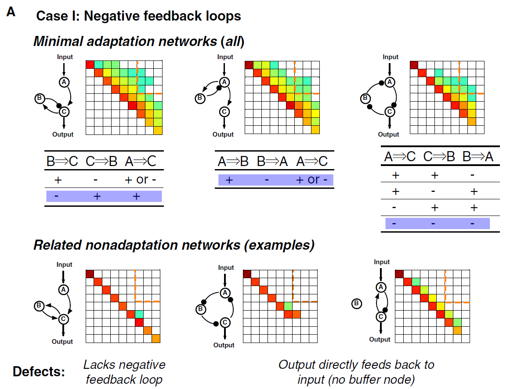
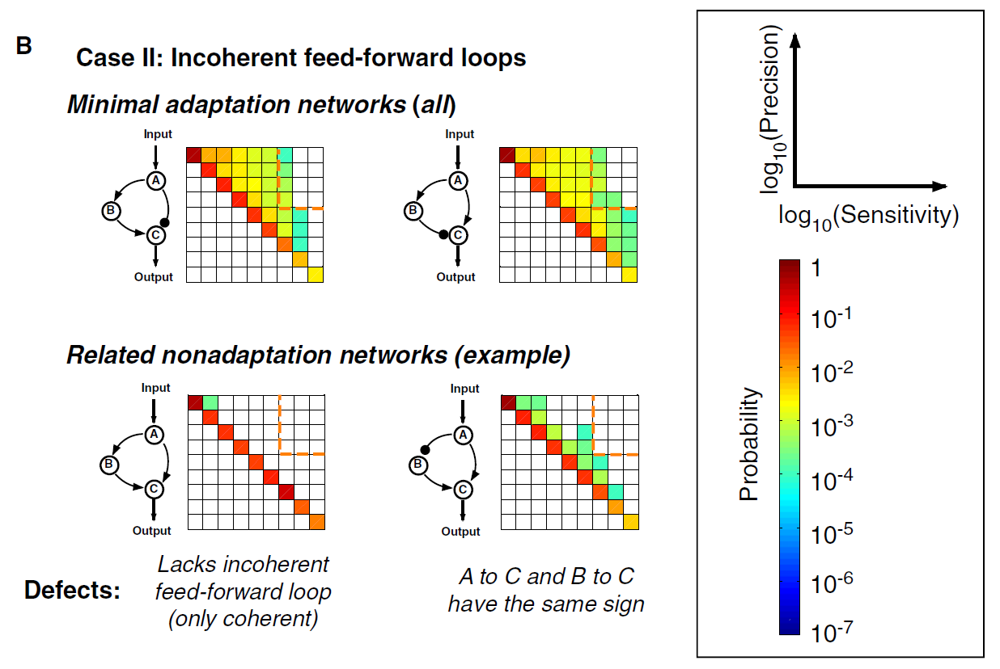

# 《Defining Network Topologies that Can Achieve Biochemical Adaptation》论文讲解
这是 Ma, Trusina, El-Samad, Lim 和 Tang 于 2009 年发表在 *Cell* 上的一篇系统生物学经典论文。
---
## 一、研究背景与核心问题
**适应性（adaptation）**是生物信号系统中一种普遍而关键的行为：系统在感受到刺激变化后做出瞬时响应，然后**返回到刺激前的输出水平**，即使刺激一直持续。典型例子包括细菌趋化、变形虫感知、酵母渗透压响应、嗅觉适应、钙稳态等。它使细胞能在宽输入范围内保持灵敏度并维持稳态。
作者提出了一个大胆的假设：
> 尽管细胞网络极其复杂，但能**稳健地执行某种特定功能**的网络拓扑结构可能是**有限的少数几种**。如果这是真的，就可以建立一张"功能—拓扑映射图"，作为复杂天然网络的分类框架和合成生物学的"设计手册"。
为了回答这个问题，他们选择了适应性作为目标功能，进行**穷举式的拓扑空间搜索**。
---
## 二、研究方法：系统化的计算机穷举搜索
### 1. 网络模型设定
- **三节点最小框架**：节点 A 接收输入，节点 C 输出，节点 B 承担调控角色。限制在三个节点上牺牲了分辨率，但换来**对拓扑空间的完整搜索能力**。
- 酶网络模型：每个节点有固定总浓度，在活性/非活性两种形式之间转换，链接用**米氏方程（Michaelis-Menten kinetics）**建模，假设无协同性（Hill 系数 = 1）。
- 共有 9 条可能的有向链接，每条有正、负、无三种状态，即 3⁹ = 19,683 种拓扑；去掉输入到输出无连通的 3,645 种后，得到 **16,038 种可行拓扑**。
### 2. 参数采样与功能判据
- 对每个拓扑，用拉丁超立方体方法在对数空间均匀采样 **10,000 组参数**，共计约 **1.6 × 10⁸ 个"电路"**（拓扑+参数组合），用 ODE 模拟。
- 定义两个功能量（Figure 1A）：
  - **灵敏度 S**：输出峰值变化相对于输入变化的倍数；
  - **精度 P**：刺激前后稳态输出差异（相对误差）的倒数。
- 定义"功能电路"：S > 1 且 P > 10（初始输入 I₁=0.5，步增 20% 到 I₂=0.6，即初始输出变化 >20%，最终输出偏差 <2%）。
- **鲁棒性 Q 值**：落入功能区的参数组数量——一个拓扑若在更多参数组合下实现适应性，就越稳健（避免对单组参数的偶然命中）。
### 3. 双重策略
- **正向思路**：先找最少链接（≤3 条）的最小网络，看最简单的解是什么；
- **反向思路**：搜索全部 16,038 种拓扑，看哪些拓扑在功能区域被"过度代表"。两条路径**收敛到同一结论**，保证了结果的完备性。
---
## 三、核心发现：仅有两类核心拓扑
### 发现一：只有两种最小解（Figure 2）
在 ≤3 条链接的最小网络中，能实现适应性的只有两类：
1. **带缓冲节点的负反馈回路（NFBLB：Negative Feedback Loop with a Buffering node）**
   - 输出经中间节点 B 负反馈回自身，**关键约束：输出不能直接反馈到输入节点，必须经过 B 这个缓冲节点**。
2. **带比例器节点的非相干前馈回路（IFFLP：Incoherent FeedForward Loop with a Proportioner node）**
   - 输入沿两条符号相反的路径汇于输出节点 C；只有 B 直接对 C 施加相反方向调控的那种非相干 FFL 才稳健有效。
而相干前馈回路、正反馈回路、以及缺少上述关键特征的负反馈都不能实现适应性——论文明确列出了它们的"缺陷"。
### 发现二：这两类结构是**必要的**
对全部 16,038 种拓扑的搜索中，有 395 种拓扑在功能区域被显著过度代表。**所有这 395 种都至少包含一个 NFBLB 或 IFFLP 基序**（Figure 4B 的 Venn 图）。这证明了两类基序的必要性——它们是适应性电路的拓扑"内核"。
---
## 四、机制解析：为什么这两类结构能实现完美适应？
### NFBLB：积分控制（integral control）机制（Figure 3A, Equation 1–4）
以负反馈环 B⊣C 为例，关键在于节点 B 上的**两个酶都工作在饱和区**（即 K_CB 和 K'_FB 很小）。此时：
$$\frac{dB}{dt} = C k_{CB} - F_B k'_{FB} \implies C^* = \frac{F_B k'_{FB}}{k_{CB}}$$
**稳态输出 C\* 与输入 I 完全无关**——这就是完美适应。而且：
$$B(t) = B(I_0) + k_{CB}\int_0^t (C - C^*)\,d\tau$$
即缓冲节点 B **对 (C − C\*) 做时间积分**——这正是工程控制论中经典的积分控制，与 Barkai-Leibler（1997）和 Yi 等（2000）提出的细菌趋化积分反馈一致。零阶超灵敏（Goldbeter-Koshland）保证了数学条件在参数区间内**稳健成立，而非靠精调参数**。
灵敏度（瞬态响应大小）则由时标分离决定：节点 C 响应快（大 k_AC）、适应慢（小 k'_BC），且可与精度**独立调节**。
### IFFLP：比例抵消（proportioner）机制（Figure 3B, Equation 5–6）
前馈电路不是"监测输出"而是"**预判输出**"：节点 B 监测输入并对 C 施加反作用力。当 B 的激活项处于饱和区、失活项处于线性区时：
$$B^* = A^* \cdot \frac{k_{AB} K'_{FB}}{F_B k'_{FB}}$$
即**稳态 B 与稳态 A 成正比**——B 是 A 的"比例器"。它以与输入成正比的强度反向拉低 C，恰好抵消 C 对输入的依赖。
### 严格的理论证明（Figure 5）
作者还做了通用的解析分析：对稳态方程线性化，完美适应要求行列式 |N| = 0（同时 |J| < 0 保证稳定）。|N| 含两项 I 和 II，稳健地使 |N| = 0 只有两条途径：
- **I = II = 0** ⇒ 不可能存在前馈回路，B 必须是"缓冲器"（∂f_B/∂B = 0，可通过饱和或 B 上正自环实现），且网络中至少有一个负反馈环 ⇒ **NFBLB 类**；
- **I = II ≠ 0** ⇒ 必须存在前馈回路，B 必须是"比例器"（f_B = αA + g(C)B）⇒ **IFFLP 类**。
这就从数学上证明了：**一切稳健的完美适应网络必然属于这两类之一**。
---
## 五、设计表（Design Table，Figure 6）
论文将结果总结为"设计手册"：
- 最小网络是充分但不一定最稳健的；**添加额外基序可提高鲁棒性 Q 值**：
  - 给 B 加**正自环**（实现 log(B) 型积分控制）；
  - 增加**经过 B 的负反馈环**；
- 例如 NFBLB 最小网络 Q=5 → 加自环 Q=27 → 再加负反馈 Q=49；IFFLP 最小网络 Q=16 → 加负反馈 Q=72 → 再加两个 Q=133。
- 每种电路的稳健性与 B 节点所建立的数学关系（如 C\* = 常数、B\* ∝ A\* 等）一一对应。
---
## 六、生物学验证与应用意义
1. **大肠杆菌趋化系统（Figure 7）**：作者发现其适应网络（CheR–甲基化水平–CheB 负反馈）与识别出的一个 NFBLB 最小拓扑等价——甲基化水平 M 正是那个"缓冲节点"，CheR 饱和、CheB 依赖输出活性，完全符合积分控制的参数条件。这为理论提供了天然实例。
2. **IFFLP 为何在自然界少见？** 理论上 IFFLP 性能更好，但建立比例关系需要**线性（无协同）动力学**；而 Hill 系数 >1 有助于 NFBLB 的饱和条件、却破坏 IFFLP 的线性条件——这可能解释了 IFFLP 架构的稀缺性。
3. **方法论意义**：
   - 提供了用"穷举 + 参数采样 + 鲁棒性统计"做**功能—拓扑映射**的通用范式，可推广到其他功能（振荡、双稳态等）；
   - 为合成生物学提供了**设计手册**：想造一个适应电路，只需选 NFBLB 或 IFFLP 内核，再按设计表叠加增强基序即可；
   - 为解读高通量网络数据提供功能分类框架，并为疾病治疗中的网络调控提供思路。
---
## 七、一句话总结
这篇论文通过**穷举所有三节点酶网络拓扑（约 1.6 × 10⁸ 个电路）并辅以严格的解析证明**，证明了实现稳健生化适应的解在拓扑上是有限且完备的：**要么是带缓冲节点的负反馈回路（实现积分控制），要么是带比例器节点的非相干前馈回路（实现比例抵消）**——由此建立了第一个完整的功能-拓扑"设计表"，开创了网络功能设计原理研究的经典范式。




###### Figure 2. Minimal Networks (%3 Links) Capable of Adaptation
+ (A) Adaptive networks composed of negative feedback loops. Three examples of adaptation networks are shown in the upper panel. Each is one member(shaded) of a group of similar adaptation networks, whose signs of regulations are listed underneath. For comparison, three examples of nonadaptive networks are shown in the low panel, with their ‘‘defects’’ for adaptation function listed underneath.
+ (B) Adaptive networks composed of incoherent feedforward loops. The only two minimal adaptation networks in this case are shown in the upper panel. Examples of nonadaptive networks are shown in the lower panel.

# 面向"功能拓扑搜索"的程序系统设计
以这篇 Cell 2009 论文的方法为核心，系统本质上是一个**"枚举—模拟—评估—统计"四层流水线**：先枚举所有可能的网络拓扑，对每个拓扑在参数空间中大量采样，将每组参数代入 ODE 动力学模型仿真，评估其是否落入"功能区"，最后从统计上筛选出稳健的功能拓扑并归纳基序。下面从整体架构、六大核心模块、代码与数据结构建议、验证技巧四个层面展开。
---
## 一、整体系统架构
```
┌─────────────────────────────────────────────────────────────┐
│                     工作流编排层（DAG 调度器）                  │
└─────────────────────────────────────────────────────────────┘
        ↓
┌───────────────┐   ┌───────────────┐   ┌────────────────┐   ┌──────────────────┐
│ ① 拓扑枚举器   │ → │ ② 参数采样器   │ → │ ③ 动力学仿真器  │ → │ ④ 功能评估器      │
│ Topology      │   │ Parameter     │   │ ODE Solver     │   │ Functional       │
│ Enumerator    │   │ Sampler (LHS) │   │                │   │ Assessor         │
└───────────────┘   └───────────────┘   └────────────────┘   └──────────────────┘
        ↓                                       ↓
┌─────────────────────────────────────────────────────────────┐
│              ⑤ 拓扑聚类与基序分析器（后处理）                   │
└─────────────────────────────────────────────────────────────┘
        ↓
┌─────────────────────────────────────────────────────────────┐
│         ⑥ 存储与可视化层（数据库 + 绘图，贯穿全流程）           │
└─────────────────────────────────────────────────────────────┘
```
这与论文 Figure 1D 的流程一一对应：拓扑枚举 → 参数采样(10,000 组) → ODE 仿真 → sensitivity/precision 二维分布图与功能判据。类似的方法论在后续的开关响应拓扑搜索工作中也被沿用并系统化，可作为参照实现。
---
## 二、六大核心模块详细设计
### 模块①：拓扑枚举器（Topology Enumerator）
**功能**：穷举 N 节点网络的所有可能拓扑，并做结构预过滤。
**实现要点**：
- **枚举方式**：3 个节点共有 9 条有向链接（A→B, A→C, B→A, B→C, C→A, C→B, A→A, B→B, C→C），每条链接有 {正调控 +1, 负调控 −1, 无调控 0} 三种状态，故空间为 $3^9 = 19{,}683$ 种。可推广到 $N$ 节点时为 $3^{N^2}$（注意组合爆炸，$N\geq 5$ 时需引入剪枝或采样策略）。
- **结构剪枝**：过滤掉"输入节点 A 到输出节点 C 之间不存在直接或间接因果连通路径"的拓扑。论文中 19,683 → 16,038，即剔除了约 3,645 种无连通拓扑。可用 BFS/DFS 在有向图上判定 A→C 可达性。
- **拓扑编码**：把每条链接的符号编码成长度 9 的整数向量，作为拓扑的唯一 ID；后续所有统计都以此为 key。
```python
# 拓扑编码示例：9 维向量，元素 ∈ {-1, 0, +1}
# 顺序固定为 [A→B, A→C, B→A, B→C, C→A, C→B, A→A, B→B, C→C]
import itertools, numpy as np
from collections import deque
def enumerate_topologies(n=3):
    links = [(i, j) for i in range(n) for j in range(n)]
    for signs in itertools.product([-1, 0, 1], repeat=len(links)):
        topo = np.array(signs, dtype=np.int8)
        if has_io_path(topo, input_node=0, output_node=2, links=links):
            yield topo
def has_io_path(topo, input_node, output_node, links):
    adj = {i: [] for i in range(3)}
    for (i, j), s in zip(links, topo):
        if s != 0:
            adj[i].append(j)
    visited, q = {input_node}, deque([input_node])
    while q:
        u = q.popleft()
        if u == output_node: return True
        for v in adj[u]:
            if v not in visited:
                visited.add(v); q.append(v)
    return False
```
**输出**：拓扑 ID 列表 + 邻接矩阵缓存，供后续模块直接调用。
---
### 模块②：参数采样器（Parameter Sampler）
**功能**：为每个拓扑生成大量参数组合，覆盖动力学的关键非线性区域。
**实现要点**：
- **维度计算**：参数量 $n_p = 2n_l + 2$，其中 $n_l$ 是网络中链接数（含背景酶引入的链接）。每个链接贡献一对 (k_cat, K_M)。
- **采样策略**：使用 **Latin Hypercube Sampling (LHS)** 在**对数空间**均匀采样，$k \in [0.1, 10]$，$K \in [0.001, 100]$。论文采样了 10,000 组/拓扑，总电路数约 $1.6\times 10^8$。SciPy 提供现成的 `scipy.stats.qmc.LatinHypercube` 实现。
- **背景酶常数**：E_i = F_i = 0.5（当某节点只有正调控入链时，加一个恒定失活酶做反向反应，反之亦然），作为非采样参数固定。
- **可扩展**：如果未来要扩大采样量或加入约束采样（如饱和区/线性区针对性采样），采样器要可插拔。
```python
from scipy.stats import qmc
import numpy as np
def sample_parameters(n_links, n_samples=10_000, seed=42):
    n_params = 2 * n_links + 2
    sampler = qmc.LatinHypercube(d=n_params, seed=seed)
    unit = sampler.random(n_samples)                     # [0,1]^n_p
    # log10 范围：k ∈ [0.1, 10] → log10 ∈ [-1, 1]
    #              K ∈ [0.001, 100] → log10 ∈ [-3, 2]
    lb = np.tile([-1, -3], n_links + 1)[:n_params]
    ub = np.tile([ 1,  2], n_links + 1)[:n_params]
    log_params = lb + unit * (ub - lb)
    return 10.0 ** log_params   # 每行一个参数集
```
**输出**：参数矩阵 (n_samples × n_params)，与拓扑 ID 关联。
---
### 模块③：动力学仿真器（ODE Simulator）
**功能**：将"拓扑 + 参数"翻译成 ODE 方程组，数值求解并记录时序轨迹。
**实现要点**：
- **ODE 构建**：对每个节点 i，按论文 Equation (7) 写出 Michaelis-Menten 型速率方程：
  
  $$\frac{dB}{dt} = \sum_i X_i \cdot k_{X_iB}\cdot\frac{1-B}{(1-B)+K_{X_iB}} - \sum_i Y_i \cdot k'_{Y_iB}\cdot\frac{B}{B+k'_{Y_iB}}$$
  
  其中 $X_i$ 是所有激活酶（正调控者，含背景酶 E_i），$Y_i$ 是所有失活酶（负调控者，含背景酶 F_i）。
- **输入协议**：输入 I 作用于 A 节点，采用阶跃方案：初始 I₁=0.5，稳态后变为 I₂=0.6（相对变化 20%）。
- **求解器选择**：系统刚性程度取决于参数，推荐自适应刚性求解器（如 LSODA、BDF、Radau）。若追求性能，可用 JAX/numba 做 JIT 编译，或采用自适应概率 ODE 求解器以配合 JIT 获得数量级加速。
- **批量计算**：这是整个系统的性能瓶颈，$10^8$ 量级仿真必须**高度并行**。建议：
  - Python 层面：`multiprocessing` / `joblib` / `ray` / `dask` 多进程分发拓扑任务；
  - JIT 加速：`numba.njit`、`jax.jit`（对 ODE right-hand side 向量化）；
  - 或换用高性能库：`JiTCODE`、`diffrax`（JAX 生态）。
- **异常处理**：仿真可能不收敛、溢出、出现持续振荡等，需要 try/except 包裹并记录失败案例，打上 `ill-behaved` 标签后跳过（论文也明确剔除"病态电路"）。
```python
from numba import njit
from scipy.integrate import solve_ivp
@njit(cache=True)
def rhs(t, y, params, topo):
    A, B, C = y
    # 根据 topo 和 params 展开各链接项，逐项累加
    dA = dB = dC = 0.0
    # ... 按拓扑逐条链接累加米氏项 ...
    return dA, dB, dC
def simulate(topo, params, I1=0.5, I2=0.6, t_end=1000.0):
    # Phase 1: 输入 I1，求稳态 O1
    sol1 = solve_ivp(rhs, [0, t_end], [0.5,0.5,0.5],
                     args=(params, topo), method='LSODA',
                     rtol=1e-6, atol=1e-9)
    O1 = sol1.y[2][-1]
    y0 = sol1.y[:, -1]
    # Phase 2: 输入跳变 I1→I2，记录 transient
    sol2 = solve_ivp(rhs, [0, t_end], y0,
                     args=(params, topo), method='LSODA',
                     dense_output=True, rtol=1e-6, atol=1e-9)
    return sol1, sol2
```
**输出**：每个 (topology, params) 的 O1、O2、O_peak（瞬态峰值），存入数据库。
---
### 模块④：功能评估器（Functional Assessor）
**功能**：根据 O1、O2、O_peak 计算灵敏度与精度，判定电路是否落入功能区。
**实现要点**：
- **核心指标**（论文 Equation 8, 9）：
  - 灵敏度 $S = \dfrac{|O_{peak}-O_1|/O_1}{|I_2-I_1|/I_1}$
  - 精度 $P = \dfrac{|O_2-O_1|/O_1}{|I_2-I_1|/I_1}^{-1}$
  - 功能判据：$S > 1$ 且 $P > 10$（即输出瞬态变化 >20%，最终稳态偏差 <2%）
- **鲁棒性 Q 值**：对每个拓扑，统计落入功能区的参数集数量 Q。论文用 Q 作为"稳健性"指标（一个拓扑 Q 值大 = 大量参数下都能实现适应性）。
- **过度代表分析**：论文以"Q > 10"作为进入功能拓扑列表的门槛（16,038 → 395 个拓扑）。这个阈值是超参数，可以做成可配置项。
- **病态电路过滤**：稳态值过小（<0.001）、弛豫时间过长、持续振荡/欠阻尼严重的样本剔除。
```python
def assess(O1, O_peak, O2, I1=0.5, I2=0.6,
           s_thresh=1.0, p_thresh=10.0):
    denom = abs(I2 - I1) / I1
    S = abs(O_peak - O1) / O1 / denom
    E = abs(O2 - O1) / O1 / denom          # 相对适应误差
    P = 1.0 / E if E > 0 else np.inf
    return S, P, (S >= s_thresh and P >= p_thresh)
```
**输出**：`(topo_id, S, P, is_functional)` 记录流，聚合后得到每个拓扑的 Q 值。
---
### 模块⑤：拓扑聚类与基序分析器（Post-processing & Motif Analyzer）
**功能**：对筛选出的功能拓扑做结构归纳，识别核心基序（NFBLB / IFFLP）。
**实现要点**：
- **基序自动识别**：遍历每个功能拓扑，检查是否含有：
  - **负反馈环**（NFBLB 类）：从任一节点出发沿有向链接回到原点，链上符号乘积为负，且存在一个不直接回连输入的"缓冲节点"；
  - **非相干前馈环**（IFFLP 类）：从输入节点 A 出发有两条路径汇于输出 C，两条路径累计符号一正一负。
  
  可用 DFS 枚举所有环与前馈路径，按符号乘积分类。
- **Venn 图统计**：统计"含 NFBL / 含 IFFL / 功能性"三集合的交并关系，复现论文 Figure 4B。
- **Hamming 距离聚类**：拓扑用长度 9 的符号向量表示，两拓扑间距离定义为不同符号位的个数；用层次聚类（`scipy.cluster.hierarchy` 或 MATLAB `clustergram` 等价物）分组，观察是否出现共享子结构的亚类。
- **过度代表统计**：在功能区热点处（sensitivity-precision 平面右上角）统计哪些拓扑频繁出现，筛出 395 个鲁棒拓扑。
```python
from scipy.spatial.distance import pdist
from scipy.cluster.hierarchy import linkage, fcluster
def hamming_matrix(topo_ids):
    X = np.array(topo_ids, dtype=np.int8)
    D = pdist(X, metric='hamming') * X.shape[1]  # 还原为计数
    return D
def cluster_functional_topos(topo_ids, max_dist=3):
    D = hamming_matrix(topo_ids)
    Z = linkage(D, method='average')
    labels = fcluster(Z, t=max_dist, criterion='distance')
    return labels
```
**输出**：基序归属表、Venn 统计、聚类树状图、设计表雏形。
---
### 模块⑥：存储与可视化层（贯穿全流程）
**实现要点**：
- **数据模型**：
  ```
  Topology(id, sign_vector, adjacency_json)
  ParameterSet(id, topology_id, values_json)
  SimulationResult(id, paramset_id, O1, O_peak, O2, S, P, is_functional, ill_beaved_flag)
  MotifAssignment(topology_id, has_nfblb, has_iffbp, cluster_label)
  ```
- **推荐数据库**：由于数据量大（$10^8$ 量级记录），建议：
  - 轻量场景：SQLite + 索引
  - 大规模：Parquet + DuckDB / ClickHouse / PostgreSQL + TimescaleDB
- **可视化组件**：
  - sensitivity–precision 散点/密度热图（复现 Figure 1D, 4A）
  - 拓扑聚类树状图 + 每类代表网络（Figure 4C, 4D）
  - 设计表生成器（Figure 6 风格：最小网络 + 附加基序 → Q 值提升）
  - 网络示意图渲染（`networkx` + `matplotlib` 或 `pygraphviz`，用颜色标注正/负/无调控链接）
---
## 三、工作流编排层
**功能**：把以上模块串成 DAG，支持断点续跑、并行分发、失败重试。
**推荐方案**：
- **轻量**：`prefect` / `dagster` / `airflow`，把"枚举 → 采样 → 仿真 → 评估"作为 4 个 task 节点；
- **大规模并行**：`ray` 做分布式任务调度，拓扑间天然可并行（embarrassingly parallel），单个拓扑内部参数集也可再并行；
- **容错**：任务幂等（同一拓扑重跑结果可复现），seed 固定（LHS 采样器 seed 与仿真初值 seed 都要固化），保证结果可复现。
---
## 四、验证技巧与陷阱提醒
1. **单元测试锚点**：论文给出了一些"已知否定结论"可作为校验——例如 2 节点网络（4 链接、81 种拓扑）没有任何一个能实现适应性，3 节点 2 链接网络也不行；最小可行链接数是 3。跑通系统后这些数字必须一致。
2. **复核校准**：跑一遍 11 个最小拓扑（3 节点 3 链接），它们的 Q 值分布应与论文 Figure 2 的热图定性一致。
3. **阈值敏感性**：S > 1、P > 10、Q > 10 都是超参数，建议做成配置文件并在结果中报告不同阈值下的拓扑集合，评估结论稳定性。
4. **动力学刚性**：Michaelis-Menten 项在 K 值极小时（接近 0.001 下界）会非常刚性，务必用刚性求解器并设置合理的 `atol/rtol`，否则会把数值噪声误判为适应行为。
5. **符号约定统一**：正/负调控的约定务必与论文 Equation (7) 一致（$X_i$ 为激活酶列表，$Y_i$ 为失活酶列表，且隐含背景酶 E_i/F_i = 0.5 补全），否则基序识别会出错。
6. **组合爆炸预警**：3 节点没问题，但若想推广到 4 节点（$3^{16} \approx 4.3\times10^7$ 拓扑 × 参数采样）计算量会瞬间爆炸，需要引入图同构去重（如 `nauty` 的 canonical labeling）和更激进的剪枝。
---
## 五、一句话总结
把系统拆成 **"拓扑枚举器（3⁹ 穷举 + 连通性剪枝）→ 参数采样器（LHS 对数空间）→ ODE 仿真器（MM 动力学 + 刚性求解 + JIT 并行）→ 功能评估器（S/P/Q 三指标）→ 基序分析器（环/前馈符号扫描 + Hamming 聚类）→ 存储/可视化"** 六个松耦合模块，用 DAG 编排串联起来，即可复现论文的核心算法流程，并为扩展到其他功能（开关、振荡、双稳态等）留好接口。