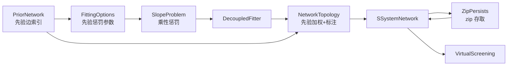

## 用户需求

在现有 SGrid（S-system 基因调控网络拟合库）基础上，补齐两项库能力（先验知识约束、模型 zip 持久化），并在 `test.vbproj` 中跑通真实人类数据的端到端 demo：拟合 + 虚拟扰动。

## 产品概述

一个命令行 demo 程序，输入三份文件（4.92GB 的 pseudotime 排序表达矩阵、细胞→pseudotime 映射表、TF→靶基因先验调控表），输出一个可复用的 S-system 网络模型压缩包、拟合报告、网络边表与虚拟扰动预测结果。

## 核心功能

### 1. 表达矩阵子集提取

- 对 4.92GB 矩阵做一次流式扫描，只导出选定基因行（默认约 200 个基因）为独立子集矩阵文件（带原表头），供后续用矩阵对象加载。
- 基因选择由先验网络驱动：按基因的先验连接强度打分，取强连通子图中的核心基因（默认 30 个）以及其扩展邻域。
- 子集文件可缓存复用：已存在且基因清单一致时跳过 4.92GB 重扫，仅提示命中缓存。

### 2. pseudotime 时间轴构建

- 读取细胞→pseudotime 映射，为子集矩阵的每一个样本列绑定时间值。
- 将 30409 个细胞按 pseudotime 等宽分箱（默认 60 箱），每个基因在每个箱内取均值，得到「基因 × 时间点」的规整时序数据。
- 空箱用相邻箱线性补值，最终时间轴必须严格单调递增；缺失映射的细胞计数并告警。

### 3. 先验知识约束网络结构拟合

- 加载先验调控表（约 45001 条边，含激活/抑制类型与高/中/低置信度，证据字段内嵌逗号与引号）。
- 软约束：所有基因仍可成为候选调控因子（保留发现新边的能力），但对「先验不支持」的交互按强度施加额外收缩惩罚；对与先验方向冲突（激活却为负、抑制却为正）的交互施加符号惩罚。
- 稀疏化时对先验支持的边给予加权优先保留，并在输出边表中标注：是否先验支持、先验类型、置信度。
- 报告中给出先验覆盖率、方向一致性与违背条目清单。

### 4. 模型持久化

- 将拟合得到的完整网络模型（参数、拓扑、时序数据、时间轴、拟合配置、所用先验、诊断告警）打包为单个压缩包文件。
- 从压缩包无损重建同一网络模型对象，重建后可直接生成动力学模型并继续做仿真与扰动实验。
- 附带往返一致性校验：重新加载后的全部数值与原件逐位一致。

### 5. 虚拟扰动实验

- 基于拟合模型，自动挑选出度最高的若干枢纽基因作为扰动靶点。
- 对每个靶点执行敲除与过表达两类扰动，与对照组轨迹逐点比较，给出终末值、倍数变化、最大偏差、响应时间。
- 输出扰动轨迹表、响应排序表与文字摘要。

### 6. 运行与产物

- 所有产物写入 `K:\hsa_grn\20261025\outputs\sgrid_demo`：子集矩阵、分箱矩阵、模型压缩包、重载校验报告、拟合报告、边表、先验指标、扰动目录与总结报告。
- 控制台输出分步进度（提取、分箱、逐基因拟合、持久化、重载校验、扰动），并提供静默开关。
- 结束时给出自检结论与非零退出码（任一环节失败时）。

## 技术栈

沿用现有工程，不引入新依赖：

- 语言/运行时：VB.NET，net10.0（`SGrid.vbproj`、`test.vbproj` 均已是该配置）
- 拟合核心：现有 `GRN` 命名空间（`ExpressionTimeSeries` / `SlopeEstimator` / `DecoupledFitter` / `NetworkTopology` / `SSystemNetwork`）
- 矩阵对象：`SMRUCC.genomics.Analysis.HTS.DataFrame.Matrix` + `Matrix.LoadData`（`analysis\HTS_matrix\Matrix\Matrix.vb:468`）
- 仿真：`SMRUCC.genomics.Analysis.SSystem.Kernel.ODEs.RunSystem` + `Perturbation.VirtualScreening`
- CSV 读写：已有 `Microsoft.VisualBasic.Data.Framework.IO`（`csv.File` / `csv.RowObject`）
- 压缩包：BCL `System.IO.Compression.ZipArchive`（net10.0 共享框架内，无需新增引用）

## 实现方案

### 总体策略

1. **先验约束做成「可选注入」而不是重写拟合器**：`FittingOptions` 增加先验字段，`SlopeProblem` 在既有「相对 RMS 误差 × 乘性惩罚」框架里追加两项乘性惩罚（非先验交互的质量、符号违背量）。因为惩罚是乘性的，量级仍由残差项主导，不会压垮拟合（这是该目标函数既有的关键设计，必须沿用）。
2. **持久化采用「纯文本条目 + zip 容器」**：条目为 CSV/TXT，double 一律 `ToString("G17", InvariantCulture)` 往返无损；不引入 JSON 序列化器（避免 `DoubleRange` 等第三方类型的序列化器构造器/特性陷阱）。
3. **大数据不走全量 LoadData**：先流式提取「基因子集 × 全部细胞」CSV（用户已选方案），再用 `Matrix.LoadData` 载入内存（约 200×30409×8B ≈ 49MB）；随后在内存中分箱为 60 列，构造新的 `Matrix` 对象并显式传入 `FittingOptions.TimePoints`，进入现有 `SSystemNetwork.Fit(matrix, options)` 流水线——零改动主流程。
4. **提取性能**：4.92GB 单遍扫描，`StreamReader(bufferSize:=1 shl 20)`；每行只用 `line.IndexOf(","c)` 取出基因符号，**未命中行不拆分整行**（30409 列，Split 会分配 553M 字符串，是唯一真正的性能陷阱）；命中行才 `Split` 并写出。预计 30~90s（磁盘受限）。
5. **并行拟合的随机数安全**：`DecoupledFitter` 当前 `Parallel.ForEach` 共享一个 `Random` 实例并由 `rnd.Next()` 取种子——`System.Random` 非线程安全，会出现退化/重复种子。改为每个基因用确定性种子 `options.Seed + i * 7919` 在 `fitGene` 内创建局部 `Random`（`Seed=0` 时用 `Environment.TickCount` 派生），保持可复现且并发安全。

### 先验模型设计（新增 `GRN\PriorNetwork.vb`）

- `PriorRegulationTypes { Unknown = 0, Activator = 1, Inhibitor = -1 }`
- `PriorConfidence { Unknown = 0, Low = 1, Medium = 2, High = 3 }`
- `PriorEdge { TF, TargetGene, RegulationType, Confidence, Evidence }`，`ReadOnly Weight`（High=1.0 / Medium=0.6 / Low=0.3 / Unknown=0.5），`Sign`（+1/-1/0）
- `PriorNetwork`：`Edges`、`Size`、`Shared LoadCsv(path)`、`RegulatorsOf(target)`、`Lookup(tf, target)`、`Subset(genes)`（按大写基因符号建索引，`OrdinalIgnoreCase` 查找）
- CSV 解析为**自带的最小解析器**（支持双引号包裹与 `""` 转义），不使用反射式 `LoadCsv(Of T)`，避免 `Evidence` 字段含逗号导致列错位。

### 拟合器接入（`GRN\FittingOptions.vb`、`GRN\DecoupledFitter.vb`）

`FittingOptions` 新增（全部带默认值，保持向后兼容）：

```
Prior As PriorNetwork = Nothing
UsePrior As Boolean = True
PriorPenalty As Double = 0.3          ' 非先验交互的乘性收缩惩罚强度
PriorSignPenalty As Double = 0.3      ' 符号违背惩罚强度
UsePriorSign As Boolean = True
PriorRankBoost As Double = 0.5        ' 稀疏化时先验边的排序加权
PriorCandidateRestriction As Boolean = False  ' 硬约束开关（demo 关闭，留给服务器场景）
```

`SlopeProblem` 新增 `PriorMask As Boolean()`、`PriorSign As Integer()`、`PriorPenalty`、`PriorSignPenalty`，在 `Objective` 的 `penalty` 累加段追加：

```
非先验质量  = Σ_{c: Not PriorMask(c)} (|g_c| + |h_c|)      -> penalty += PriorPenalty * 该值
符号违背量  = Σ_{c: PriorSign(c)≠0} max(0, -sign*net_c)     -> penalty += PriorSignPenalty * 该值
```

`selectCandidates` 保持「全部基因 + 可选相关性筛选」（软模式）；当 `PriorCandidateRestriction=True` 时改为先验调控因子 ∪ 自环，无先验命中则回退全部。

### 拓扑稀疏化接入（`GRN\NetworkTopology.vb`）

- `RegulatoryEdge` 新增可写属性：`PriorSupported As Boolean`、`PriorType As String`、`PriorConfidence As String`（新增属性，不改变既有构造/用法）。
- `Sparsify` 的排序分数改为 `|net(i)(j)| * (1 + PriorRankBoost * priorWeight)`（仅用于 top-N 排序与阈值判定后的取舍），阈值判定仍用原始 `|net|`，保证「先验优先但不硬否决」。
- 新增 `PriorMetrics(parameters, edges, prior)`：先验覆盖率、方向一致率、未支持边清单，供 `Report()` 使用。

### 持久化格式（`IO\ZipPersists.vb`）

```
model.zip
├── manifest.txt         format=sgrid-network-zip / version=1 / created / geneCount / edgeCount / timePoints
├── parameters.csv       gene,original,alpha,beta,slope_sse,slope_rmse,converged
├── matrix_G.csv         gene + 基因列（行 = 靶基因）
├── matrix_H.csv
├── edges.csv            source,target,weight,g,h,interaction,prior_supported,prior_type,prior_confidence
├── series.csv           gene + t0..tN（规整化后的表达量 X；LnX 由 X 重算，不落盘）
├── timepoints.csv       index,pseudotime
├── options.txt          key=value（含 Alpha/Beta/G/H 的 min/max、Normalize、Sparsity、DE/LBFGSB、Solver、Precise、FinalTime、Steps、Seed、各项惩罚）
├── prior.csv            tf,target,type,confidence（本次拟合实际使用的先验子集）
└── warnings.txt         一行一条
```

- 签名：`<Extension> Sub Save(model As SSystemNetwork, file As Stream)`、`Overloads Sub Save(model As SSystemNetwork, path As String)`、`Function Load(file As Stream) As SSystemNetwork`、`Overloads Function Load(path As String) As SSystemNetwork`。
- `Load` 对不可 `CanSeek` 的流先缓冲到 `MemoryStream`（`ZipArchive` 读取模式要求可定位）。
- `manifest.txt` 校验 `format`/`version`，不匹配抛 `InvalidDataException` 并给出条目缺失清单。
- `SSystemNetwork` 增加便捷包装 `SaveZip(path)` / `Shared LoadZip(path)`（内部仍调用 `IO\ZipPersists`），并在类中新增 `Prior As PriorNetwork` 属性、在 `Report()` 增加先验指标段。

### demo 流程（`test` 工程）

```
先验 CSV ──▶ GeneSelector：打分/连通分量 → 核心30 + 邻域200
                       │
表达矩阵(4.92GB) ──流式筛选──▶ subset_expression_matrix.csv（缓存）
                       │
              Matrix.LoadData ◀┘
                       │
cell_pseudotime ◀── PseudotimeMatrix：60 箱均值 → Matrix(30×60) + TimePoints
                       │
        SSystemNetwork.Fit（带先验软惩罚）
                       │
        ZipPersists.Save → model.zip → Load → 逐位对拍
                       │
        VirtualScreening：hub 基因 KnockOut / OverExpress
                       │
                   产物落盘 + 断言 → 退出码
```

## 架构设计（仅展示本次改动关系）



## 目录结构

```
SGrid/                                   （库工程，RootNamespace = SMRUCC.genomics.Analysis.SGrid）
├── GRN/
│   ├── PriorNetwork.vb                  # [NEW] 先验知识模型与加载。定义 PriorRegulationTypes / PriorConfidence / PriorEdge（含置信度权重与 Sign）/ PriorNetwork（LoadCsv、RegulatorsOf、Lookup、Subset、Size）。内置引号安全的最小 CSV 解析器；基因符号统一大写索引、OrdinalIgnoreCase 查找；重复边合并（保留最高置信度）。
│   ├── FittingOptions.vb                # [MODIFY] 新增 Prior / UsePrior / PriorPenalty / PriorSignPenalty / UsePriorSign / PriorRankBoost / PriorCandidateRestriction 属性（全部带默认值）；Clone() 用 MemberwiseClone 无需改动；ToString/Validate 补充先验参数校验（惩罚非负）。
│   ├── DecoupledFitter.vb               # [MODIFY] SlopeProblem 增加 PriorMask/PriorSign/PriorPenalty/PriorSignPenalty 并在 Objective 中按上文公式追加乘性惩罚；selectCandidates 支持 PriorCandidateRestriction（先验因子∪自环，空则回退全部）；fitGene 改为按基因派生确定性种子创建局部 Random（并发安全、可复现）；Verbose 日志追加「先验支持边数/候选数」。
│   ├── NetworkTopology.vb               # [MODIFY] RegulatoryEdge 新增 PriorSupported/PriorType/PriorConfidence；Sparsify 增加 optional prior 参数，排序分数乘 (1 + PriorRankBoost*priorWeight)，并对每条边写入先验标注；新增 PriorMetrics 返回覆盖率/方向一致率/未支持边集合；ToSIF 保持不变。
│   └── SSystemNetwork.vb                # [MODIFY] 新增 Prior 属性；Fit 中把 options.Prior 传入 DecoupledFitter 与 Sparsify，回填 .Prior；Report() 追加先验指标段与未支持边 top-N；新增 SaveZip(path) / Shared LoadZip(path) 便捷包装。
└── IO/
    └── ZipPersists.vb                   # [IMPLEMENT] 按上文条目结构实现 Save(Stream/path) 与 Load(Stream/path)：写入用 UTF8 无 BOM，double 用 G17 + InvariantCulture；读取先缓冲非可定位流，校验 manifest 的 format/version；重建 SSystemNetwork（含 Series.X/TimePoints/LnX、Parameters、Edges、Options、Prior、Warnings）；缺失条目给出明确异常信息。

SGrid/test/                              （demo 工程，OutputType=Exe，RootNamespace=test）
├── Program.vb                           # [MODIFY] 由 Hello World 改为 CLI 分派：extract / fit / persist / perturb / all / selftest；解析 --matrix --mapping --prior --out --extract-genes --fit-genes --bins --normalize --de-iters --seed --quiet；`selftest` 转调现有 SelfTest.GrnSelfTest.Run；无参默认 all。
├── DemoOptions.vb                       # [NEW] 强类型参数对象 + 解析器（默认值即上文所有路径与规模）+ 参数合法性校验 + 用法文本。
├── GeneSelector.vb                      # [NEW] 先验驱动的基因挑选（按置信度加权的出入度打分 → 取 top-K 诱导子图 → 最大连通分量 → 核心 fitGenes）+ 4.92GB 矩阵流式提取（1MB 缓冲、只 IndexOf 首列、命中行才 Split、每 2000 行打进度）+ 子集 CSV 与基因清单缓存复用。
├── PseudotimeMatrix.vb                  # [NEW] 读取 cell→pseudotime 映射（含缺失统计）、按等宽箱求基因均值、空箱线性补值、生成严格单调时间轴、构造 Matrix（sampleID = 箱内平均 pseudotime 文本，便于对照）并返回 TimePoints；输出分箱矩阵 CSV。
├── DemoRunner.vb                        # [NEW] 端到端编排：提取→LoadData→分箱→FittingOptions（TimePoints、Normalize、Prior、并行、种子）→Fit→ZipPersists 保存/重载逐位对拍→报告与边表/先验指标落盘→挑 hub 基因→VirtualScreening（KnockOut + OverExpress）→ranking/摘要/轨迹落盘→断言汇总（子集规模、alpha/beta 为正、zip 往返 max|Δ|=0、重载后可积分、扰动记录有限）→返回退出码。
├── grn-selftest.vb                      # [KEEP] 既有 3 基因金标准自测，作为回归基线（不改动）。
└── test.vbproj                          # [VERIFY] 现有引用已覆盖 SGrid/SSystem/HTS_matrix/CSV；ZipArchive 属 BCL。预计无需修改；若启用 `--selftest` 分支需要新文件自动包含（SDK 风格默认通配），不需要改 vbjproj。
```

## 关键代码结构

```
' GRN\PriorNetwork.vb
Public Class PriorEdge
    Public Property TF As String
    Public Property TargetGene As String
    Public Property RegulationType As PriorRegulationTypes
    Public Property Confidence As PriorConfidence
    Public Property Evidence As String
    Public ReadOnly Property Weight As Double      ' High=1.0 / Medium=0.6 / Low=0.3
    Public ReadOnly Property Sign As Integer       ' Activator=+1 / Inhibitor=-1 / Unknown=0
End Class

Public Class PriorNetwork
    Public Property Edges As PriorEdge()
    Public ReadOnly Property Size As Integer
    Public Shared Function LoadCsv(path As String) As PriorNetwork
    Public Function RegulatorsOf(target As String) As PriorEdge()
    Public Function Lookup(tf As String, target As String) As PriorEdge
    Public Function Subset(genes As IEnumerable(Of String)) As PriorNetwork
End Class

' GRN\DecoupledFitter.vb —— SlopeProblem 新增（惩罚均为乘性因子）
Public Property PriorMask As Boolean()
Public Property PriorSign As Integer()
Public Property PriorPenalty As Double
Public Property PriorSignPenalty As Double

' IO\ZipPersists.vb
<Extension> Public Sub Save(model As SSystemNetwork, file As Stream)
<Extension> Public Sub Save(model As SSystemNetwork, path As String)
Public Function Load(file As Stream) As SSystemNetwork
Public Function Load(path As String) As SSystemNetwork
```

## 实施注意（防回归）

- **性能**：提取阶段是唯一的重 IO 路径，务必避免对每一行做 `Split(",")`；拟合阶段每基因复用 `SlopeProblem.LnX`（已是引用数组，不要逐次拷贝）；zip 条目全部为小文件（30 基因，<1MB），无需流式压缩优化。
- **数值稳定**：`ExpressionTimeSeries` 会对含 0 的基因行整体平移，平移是单调仿射变换，不影响拓扑；`ensurePositive` 之后 `LnX` 一定有限。`NonNegative=True` 保持开启。仿真若发散（NaN/Inf），demo 需降级为「记录告警 + 跳过扰动」，而不是抛异常中断。
- **序列化精度**：所有 double 用 `"G17"` + `InvariantCulture` 写出，保证 `Load` 后逐位相等；CSV 字段中基因符号只含字母/数字/下划线（由 `SanitizeGeneId` 保证），无需引号处理。
- **向后兼容**：`SSystemNetwork.Fit` 签名不变；`RegulatoryEdge`/`FittingOptions` 只新增带默认值的成员；`PLAS\GRN.vb` 的 `grn-fit` 路径不受影响。
- **日志**：沿用现有 `Console.WriteLine($"[INFO] ...")` / `"[WARN] ..."` 前缀；`--quiet` 时只输出阶段汇总；不打印矩阵内容。
- **VB 陷阱**：局部变量不得与属性同名（`steps`、`prior`、`edges`、`alpha` 之类要与 `Parameters.alpha` 区分，建议局部用 `p`, `edgeList`）；`If(cond, array, Nothing)` 需 `DirectCast`；Module 成员不能 `Shared`；XML 注释中禁止出现 `--`；`Next`/`Call`/`Step`/`Error`/`Sub` 不能作标识符；`row`/`file`/`path` 局部名会遮蔽 `File`/`Path` 类型，需 `System.IO.Path` 全限定或改名。

## 验证方式

1. 构建：`dotnet build SGrid.vbproj` 与 `dotnet build test\test.vbproj`（Debug/Release 均为 0 警告 0 错误）。
2. 回归：`test.exe selftest` 退出码 0（保持既有 3 基因金标准断言）。
3. 端到端：`test.exe all --out K:\hsa_grn\20261025\outputs\sgrid_demo`，检查产物齐全、`reload_check.txt` 中 max|Δ|=0、扰动记录全部有限、退出码 0。
4. 缓存复用：第二次运行跳过 4.92GB 重扫（日志显示 `subset cache hit`）。

## Agent Extensions

### SubAgent

- **code-explorer**
- Purpose: 在实现先验接入与 zip 持久化时，快速定位 `NetworkTopology.Sparsify`、`RegulatoryEdge`、`SSystemNetwork`、`FittingOptions` 在全仓（含 `PLAS\GRN.vb`、`SSystem`）的所有调用点与成员用法，确认新增可选参数不会破坏既有调用。
- Expected outcome: 输出一份精确的调用点清单（文件:行）与兼容性结论，保证本次改动只新增、不改签名。