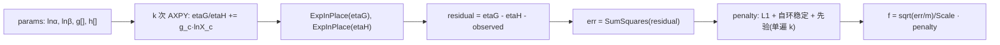

## 需求概述

对 SGrid（S-system 基因调控网络拟合）及其底层依赖做一次面向“原始大型矩阵”的性能审查与重构：定位性能瓶颈，并用核心库 `Microsoft.VisualBasic.Core/src/Math/SIMD` 的 SIMD + 并行能力重写计算热点。

## 已确认范围

- **本次做**：拟合数值内核（目标函数、差分进化、L-BFGS-B 梯度）+ 数据摄取（直接从 4.9GB CSV 流式分箱，避免 4.4GB 全矩阵与多份拷贝）。
- **本次不做**：导出/持久化（`matrixOf`、`ExportCoefficientMatrix` 的 n×n 字符串拼接）与虚拟扰动链路，仅作为后续项记录。
- **允许改核心库**：可在 SIMD 目录新增真正向量化的 `Exp/Log`（AVX2/FMA 多项式）、AXPY/FMA、批量 matrix-vector 内核，必须保留标量回退并提供精度校验。
- **允许算法改动**：为 L-BFGS-B 提供解析梯度替换有限差分（同 seed 结果不再逐位一致）。

## 核心功能与视觉/产物效果

1. 600 基因 × 80 箱基准：拟合耗时相对当前 104 s **至少降低到三分之一以内**，R² 中位数不低于 0.703，边数与先验指标不退化。
2. 18k 基因规模的拟合不再因为 `n×n` 中间矩阵（2.6 GB/次）与全矩阵多副本而 OOM；分箱阶段常驻内存从 4.4 GB 级降到几十 MB 级。
3. 新增可复现的基准与精度校验入口（`--profile`、`simd-check` 子命令），使每次优化都有量化对照。
4. 对外 API 保持向后兼容：`SSystemNetwork.Fit`、`NetworkTopology.Sparsify`、`SlopeProblem.Objective` 的既有调用方式继续可用。

## 1. 技术栈

- 语言/框架：VB.NET / .NET 10（`SGrid.vbproj` RootNamespace `SMRUCC.genomics.Analysis.SGrid`）。
- SIMD：`System.Numerics.Vector(Of Double)`（现有 `SimdEngine`/`SimdReduce` 已使用）+ `System.Runtime.Intrinsics.X86.Avx2/Fma`（`Intrinsics.vb` 已有手写 AVX2 路径可参照），二者均需 `IsSupported` 门控与标量回退。
- 并行：沿用现有基因级 `Parallel.ForEach`，新增显式 `MaxDegreeOfParallelism`；**禁止**在基因内部再开线程（避免 18k 基因线程超订）。
- 校验：GNU R 不是必需；正确性用 `selftest`（3 基因金标准）+ 新增 `simd-check`（内核精度）+ 600×80 对照（耗时/R²/边数）。

## 2. 瓶颈审查结果（代码证据）

| 层 | 位置 | 现状代价 | 证据 |
| --- | --- | --- | --- |
| 目标函数 | `GRN/DecoupledFitter.vb` `SlopeProblem.Objective` | 每 t 做 2×k 次跨行跳跃累加 + 2 次标量 `Math.Exp`；每次 eval 都是标量循环，无法向量化 | `LnX(c)(t)` 布局为“按候选一行”，固定 t 访问跨行 |
| 目标函数 | `SlopeProblem.RawSSE` / `priorPenaltyFactor` | 同一目标重复扫 k 参数，每次 eval 额外开销 | 三处独立循环 |
| 梯度 | `SlopeObjective : IGradFunction` 仅实现 `evaluate` | 走默认中心差分：dims=42 时每次梯度约 **84 次** Objective 调用 | `IGradFunction.vb:69-79` |
| 差分进化 | `GRN/DifferentialEvolutionLite.vb:104-141` | 逐个体串行评估，每 trial `New Double(dims-1)`；无批量、无 SIMD | 双层 `For` 内直接调 `target(trial)` |
| 拓扑稀疏化 | `GRN/NetworkTopology.vb` `Sparsify` | 生成 n×n `NetElasticity()` 后 O(n²) 双循环，每对调 `PriorKnowledge.FindEdge`（含 `.ToArray()` 分配） | 18k 基因：3.3e8 次迭代 + 2.6 GB 分配 |
| 稳定性诊断 | `NetworkTopology.StabilityDiagnosis` | 再生成一份 n×n `NetElasticity()` | 同一函数再 2.6 GB |
| 摄取/归一化 | `GRN/ExpressionTimeSeries.vb` `FromMatrix` | `fillMissing → Log2 → ensurePositive → LnX` 三遍全矩阵扫描 + 2~3 份副本；`std.Log` 逐元素标量 | 18k×30k ≈ 4.4 GB/份 |
| 分箱 | `test/PseudotimeMatrix.vb` `Bin(Matrix,...)` | 必须先 `Matrix.LoadData` 全量进内存才能分箱 | demo 现流程为“子集 CSV → LoadData → Bin” |
| 核心 SIMD 库缺陷 | `Math/SIMD/Engine/SimdMath.vb` `Exp/Log` | 名为 SIMD，实为标量 `For` 循环 | 与 `SimdReduce.Dot`（4 路展开）对比明显 |


## 3. 实现方案

### 3.1 核心 SIMD 内核（新增，带标量回退）

- `SimdMath.ExpInPlace(v As Double())`、`LogInPlace(v As Double())`：`Avx2/Fma` 路径用标准区间约减 + 多项式（exp：`x = k·ln2 + r`，degree 11~13；log：mantissa 分解 + `atanh` 级数），目标相对误差 `< 1e-9`（对 `[-700,700]` 与 `[1e-300,1e300]` 全区间抽样校验）；极端值退化为 `Math.Exp/Log`。
- `SimdEngine.AddScaledInPlace(scalar, v, acc)`（AXPY）与 `MultiplyAddInPlace(a, b, acc)`：`acc[t] += scalar·v[t]`，是整个目标函数的主循环原语。
- `SimdEngine.SubtractInPlace`、`SimdMatrix.MatVec(w As Double()(), x As Double()(), rows, cols, out)`：供“整代差分进化”批量评估使用。
- 所有新 API 保留旧重载，`SIMDEnvironment.IsEnabled` 为假时自动走标量实现。

### 3.2 目标函数重写（最大热点）

为每个基因构造一个**零分配工作区** `SlopeWorkspace`（线程局部复用，`ArrayPool` 或 `ThreadLocal`），包含：`etaG(m)`、`etaH(m)`、`residual(m)`、`lnXFlat(k*m)`。

单次评估流程（全部沿 m 维连续内存，可被 SIMD 覆盖）：



要点：

- `lnXFlat` 由 `LnX(c)(t)` 一次性重排为 `c*m + t`，保持 c 维外层、t 维连续（AXPY 天然向量化）。
- 惩罚项合并进同一函数，不再二次扫描参数向量。
- `Objective(p)` 旧签名保留（内部委托到新实现），并新增 `Objective(p, workspace)` 供内部高频调用。
- `RawSSE` 复用同一 workspace，避免第二次全量计算。

### 3.3 解析梯度（替换有限差分）

记 `η_g(t)=lnα+Σ_c g_c·lnX_c(t)`、`A=e^{η_g}`、`B=e^{η_h}`、`r=A−B−y`、`E=Σr²`、`f=√(E/m)/Scale·P`：

- 先算 `u(t)=2r(t)A(t)`、`v(t)=−2r(t)B(t)`（一次向量化乘加）；
- `∂E/∂lnα=Σu`、`∂E/∂lnβ=Σv`；
- `∂E/∂g_c = dot(u, lnX_c)`、`∂E/∂h_c = dot(v, lnX_c)`（k 次 SIMD 点积）；
- `∂f/∂θ = P·∂E/∂θ /(2·Scale·√(E·m)) + √(E/m)/Scale·∂P/∂θ`，其中 L1 项为 `L1·sign(θ)`、自环项为 `±StabilityWeight`、先验项按质量占比/违背均值解析求导。

`SlopeObjective` 重写 `gradient(x, grad)`（或直接覆写带 `grad` 的 `evaluate`），使每次 L-BFGS-B 迭代从约 84 次 Objective 调用降为 1 次评估 + k 次点积。

### 3.4 差分进化批量评估

`DifferentialEvolutionLite` 新增批量入口：`Minimize(..., evaluatePopulation As Func(Of Double()(), Double()))`。每代把 `pop × dims` 组装为矩阵，一次 mat-vec 得到 `pop × m` 的 `etaG/etaH` 块，随后对整块调用一次 `ExpInPlace`，再按行做 `SumSquares` 归约；trial 向量改用预分配缓冲池。保留旧的逐点 `Minimize` 重载。

### 3.5 拓扑阶段去 n²

- `Sparsify`：只遍历 `parameters.Candidates(i)`（≤ `MaxRegulators`，实际 20~24），`|g−h|` 与阈值在遍历时即时计算，不再构建 n×n；`MaxEdgesPerGene` 对 k 个候选做局部排序。
- 先验索引：拟合开始时构建一次 `Dictionary(Of Long, PriorEdge)`（键 `((long)j << 32) Or i`），替代逐对 `FindEdge`（消除 `.ToArray()` 分配）。
- `StabilityDiagnosis`：直接按行从 `G/H` 累加 Gershgorin 半径，不生成 n×n。
- `SSystemParameters.NetElasticity()` 保留（API 兼容），内部改分块/惰性实现，并新增 `NetAt(i, j)` 供流式使用。

### 3.6 数据摄取（流式分箱 + 融合归一化）

- 新增 `PseudotimeMatrix.BinFromCsv(matrixFile, mapping, bins, genes?)`：单遍顺序读 4.9GB CSV，按行（基因）解析；行内按 cell 归属 bin 累加，写回 `bins` 长的行向量；对行批次用有限并行（`Parallel.ForEach` 于缓冲块），常驻内存仅 `n × bins × 8B`（18k×80 ≈ 11.5 MB）。
- `ExpressionTimeSeries.FromMatrix` 内部融合：一次遍历同时产出 `X` 与 `LnX`（`SimdMath.LogInPlace`），`ensurePositive` 的平移改为就地加常数（`AddScalarInPlace`），取消 2~3 份临时副本；`Offsets` 语义保持不变。
- demo 增加 `--stream` 路径：不落盘子集 CSV、不 `LoadData` 全矩阵，直接分箱后拟合。

### 3.7 基准与验收

- `test` 工程新增 `--profile`（每基因耗时、Objective 调用次数、DE/L-BFGSB 阶段耗时）与 `simd-check` 子命令（Exp/Log 相对误差、梯度与差分一致性）。
- 验收口径：600×80 同参数对照 ≥3× 加速、R² 中位数 ≥0.703、边数变化 <5%、`selftest` 通过、`all --force` 退出码 0；并给出 18k 基因的内存预算（峰值 < 2 GB）。

## 4. 关键代码结构

```
' 线程局部工作区（零分配热路径）
Public Structure SlopeWorkspace
    Public etaG As Double()      ' m
    Public etaH As Double()      ' m
    Public residual As Double()  ' m
    Public lnXFlat As Double()   ' k*m，布局 c*m+t
End Structure

' 内核入口（保留旧签名，新增带 workspace 的高频版本）
Public Function Objective(p As Double()) As Double
Public Function Objective(p As Double(), ws As SlopeWorkspace) As Double
Public Sub Gradient(p As Double(), grad As Double(), ws As SlopeWorkspace)
```

## 5. 目录结构

```
runtime/sciBASIC#/Microsoft.VisualBasic.Core/src/Math/SIMD/
├── Engine/SimdMath.vb        # [MODIFY] 新增 ExpInPlace/LogInPlace（AVX2 多项式 + 标量回退）
├── Engine/SimdEngine.vb      # [MODIFY] 新增 AddScaledInPlace(AXPY)/MultiplyAddInPlace/SubtractInPlace
├── Engine/SimdMatrix.vb      # [MODIFY] 新增 MatVec 与行归约（批量种群评估）
└── Intrinsics.vb             # [MODIFY] 新增 Exp256/Log256 等 AVX2 多项式辅助

GCModeller/sub-system/PLAS.NET/SGrid/
├── GRN/DecoupledFitter.vb    # [MODIFY] SlopeProblem 重写（扁平 lnX + workspace + 批量评估 + 解析梯度）
├── GRN/SlopeWorkspace.vb     # [NEW] 线程局部 scratch 缓冲（etaG/etaH/residual/lnXFlat）
├── GRN/DifferentialEvolutionLite.vb  # [MODIFY] 新增整代批量 Minimize 重载，trial 缓冲池
├── GRN/NetworkTopology.vb    # [MODIFY] Sparsify/PriorMetrics/StabilityDiagnosis 去 n²
├── GRN/SSystemParameters.vb  # [MODIFY] NetElasticity 分块化 + NetAt(i,j)
├── GRN/PriorKnowledge.vb     # [MODIFY] BuildIndex 先验索引（O(1) 查询，替代逐对 FindEdge）
├── GRN/ExpressionTimeSeries.vb  # [MODIFY] 融合归一化，单遍产出 X/LnX
└── test/
    ├── PseudotimeMatrix.vb   # [MODIFY] 新增 BinFromCsv 单遍流式分箱
    ├── DemoOptions.vb        # [MODIFY] 新增 --profile/--threads/--stream
    ├── DemoRunner.vb         # [MODIFY] 接入流式路径与剖析输出
    └── SimdKernelTest.vb     # [NEW] simd-check：内核精度与梯度一致性校验
```

## 6. 性能与内存预期

- 单次 Objective：从 `2k·m` 标量乘加 + `2m` 标量 exp，变为 `2k` 次 AXPY（m 连续）+ 2 次向量化 exp + 1 次 `SumSquares`，预计 3~5×。
- L-BFGS-B 阶段：梯度调用从约 84 次评估降到 1 次评估 + k 次点积，预计 10× 以上。
- 差分进化：整代批量化摊薄 exp/归约开销，预计 1.5~2.5×。
- 拓扑：600 基因从 3.6e5 次迭代降到约 1.4e4；18k 基因从 3.3e8 降到约 4.3e5，并去掉每次 2.6 GB 的 `NetElasticity` 分配。
- 摄取：18k×30k 从“4.4 GB 矩阵 + 3 份副本”降为 `n×bins` 级（约 11.5 MB），时间由内存/GC 受限转为 IO 受限。
- 综合目标：600×80 基准 ≥3×（预期 5~8×），18k 基因峰值内存 < 2 GB。

## 7. 风险与对策

1. **数值等价性**：SIMD 归约改变求和顺序，R² 可能有 1e-3 级抖动；用 Kahan/补偿累加保持精度，验收以“R² 不下降”为准，不要求逐位一致。
2. **Exp/Log 精度**：所有多项式路径用 `Math.Exp/Log` 做差分校验（`simd-check`），超界输入退化到标量；不通过则自动回退。
3. **线程超订**：仅基因级并行，新增 `--threads` 显式控制；批量评估内部不再开线程。
4. **API 兼容**：`Objective(p)`、`Minimize(...)`、`Sparsify(...)` 旧签名保留为兼容层，新增重载承载新实现。
5. **先验索引一致性**：索引在 `Fit` 内按本次映射后的 `PriorNet` 构建，不修改 BNLearn 的 Core 数据模型。

## Agent Extensions

### SubAgent

- **code-explorer**
- Purpose: 在改写 `SlopeProblem.Objective`、`Sparsify`、`NetElasticity` 之前做一次调用点与影响面核查（"medium" 级别），确认旧签名兼容层需要覆盖的全部调用位置，避免破坏 `selftest`、`PLAS/GRN.vb`、`VirtualScreening` 等既有调用方。
- Expected outcome: 返回精确的“文件:行 + 证据代码”清单与兼容性结论，作为重写前的冻结依据。

### Skill

- **lsp-code-analysis**
- Purpose: 用语义级引用查找定位 `Objective`、`NetElasticity`、`Sparsify`、`RSquared` 的实现与全部引用，确认新增重载不会与现有成员产生二义性。
- Expected outcome: 得到符号级调用图与重载决议结果，用于确定兼容层的最小实现范围。