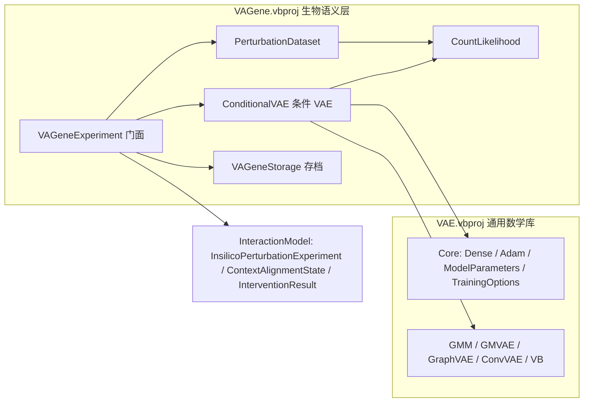

## Product Overview

将 sciBASIC# 的 VAE 库纯化为不包含任何生物信息学语义的通用数学算法库，把其中的单细胞虚拟扰动代码迁移到 GCModeller 的 VAGene 项目，并在 VAGene 中提供与 Squiiff 编码风格一致的虚拟扰动实验门面。

## Core Features

- 将 `ConditionalVAE`、`PerturbationDataset`、`CountLikelihood` 从 VAE 迁移到 VAGene，命名空间统一为 `SMRUCC.genomics.Analysis.VAGene`，原类名与公开签名保持不变。
- VAE 项目彻底移除 `Cells` 目录与 `cells` 审计，并同步清理 README、NamespaceDoc、包描述中的单细胞/扰动表述，使其只保留 GMM、GMVAE、GraphVAE、ConvVAE 与变分贝叶斯等通用模型。
- 新增 `VAGeneExperiment` 实验门面实现 `InsilicoPerturbationExperiment`：`SetContext`、`SetContextAlignmentMode`、`KnockoutGene`、`OverexpressGene`、`KnockDownGene`。
- 上下文采用与 Squiiff 一致的 `ContextAlignmentState`，默认 `Quantile` 对齐，未覆盖基因按训练均值填充；上下文以单条表达向量保存。
- 扰动映射同时支持两种方式：默认按条件名与基因名大小写不敏感匹配，另提供 `RegisterPerturbation` 显式注册覆盖；均未命中时抛 `KeyNotFoundException`。
- 反事实预测复用条件 VAE 的同一隐变量换条件能力，输出 `InterventionResult`（野生型均值、扰动后均值、fold change、百分比变化、Z 分数、显著性标记）。
- 提供模型与门面元数据的单文件存档往返（模型参数、基因名、条件名、逐基因训练统计、扰动注册表、对照条件）。
- 新建 VAGene 测试工程，使用 `DebugAudit` 生成审计报告，迁移并扩展原 Cells 审计用例。
- 为底层 `ConditionalVAE` 增加表达空间编解码接口，避免将 log1p CPM 上下文有损反变换回原始计数。

## Tech Stack Selection

- 语言与运行时：VB.NET / .NET 10，沿用现有 SDK 风格工程（`VAGene.vbproj` 已存在且已加入 `Squiiff.slnx`）。
- 数值与张量：复用 `Microsoft.VisualBasic.MachineLearning.TensorFlow`、`Core.Layers.Dense`、`Core.Numerics.RandomGaussian/LogSumExpOps`、`VBMath.LogGamma`，不新增第三方依赖。
- 生物实验契约：`core/Bio.InteractionModel/InteractionModel.vbproj` 中的 `InsilicoPerturbationExperiment`、`ContextAlignmentState`、`ContextAlignmentReference`、`InterventionResult`、`InterventionSpec`、`InterventionMode`。
- 持久化：BCL `System.IO.Compression` 单文件 ZIP，参照 `SquiiffStorage` 的条目化写法。
- 测试：`Microsoft.VisualBasic.Core` 的 `DebugAudit`，与现有 `CellsAudit` 一致。

## Implementation Approach

核心策略是“单向迁移 + 门面隔离”：

1. 把三个生物语义文件整体移动到 VAGene，仅调整命名空间与 Imports，不改算法实现，保证行为等价、改动可控。
2. VAE 保持为 VAGene 的下游通用依赖：`VAGene` 引用 `VAE`，`VAE` 绝不反向引用 `VAGene`，依赖方向单一且无环。
3. 门面 `VAGeneExperiment` 负责“实验语义”（基因名、条件名、上下文、干预结果、存档），`ConditionalVAE` 只负责“模型语义”（编码、解码、反事实、似然、参数）。
4. 为模型补充表达空间入口 `EncodeExpression` 与 `DecodeLatent`：门面上下文位于 log1p CPM 空间，直接送入编码器即可，避免 `exp` 反变换带来的数值失真；同时保留既有 `Encode/Reconstruct/Generate/PredictCounterfactual/LogFoldChange` 全部签名不动。
5. 上下文对齐复用 `ContextAlignmentState`：训练时从 `dataset.LogNormalize()` 逐基因采集均值、标准差与经验分布，构造 `ContextAlignmentReference`；`SetContext` 后通过 `ToVector(ContextMissingGeneFill.Mean)` 得到与模型基因顺序一致的稠密向量。默认 `Quantile`，与 Squiiff 的选择一致，避免假设上游归一化管线口径。
6. 干预路径统一为“同一隐变量换条件”：以对照条件编码上下文，分别在对照条件与目标条件下解码，得到野生型与扰动后均值；`Knockout/Overexpress/KnockDown` 共用该路径，差异体现在 `InterventionSpec.Mode` 与所注册的离散条件上，并在 XML 注释中明确这一离散条件语义。

### Key Decisions and Trade-offs

- **为何新增门面而非让模型实现接口**：接口属于生物实验语义，放入模型层会让通用条件 VAE 与 GCModeller 契约耦合；门面方式与 `Squiiff.vb` 完全对齐，也便于后续替换底层模型。
- **为何新增表达空间接口**：`PredictCounterfactual` 接收原始计数，而外部上下文通常是归一化后的表达值；反变换不可逆且有损，新增接口可在编码器输入空间直接工作，代价仅是模型增加两个薄封装方法。
- **为何使用 ZIP 存档**：`ConditionalVAE` 已有 `IModelPersistable` 二进制模型文件，门面元数据（基因名、条件名、群体统计、注册表）需要与模型一起原子保存；ZIP 与 `SquiiffStorage` 模式一致，且不引入新格式库。
- **兼容性取舍**：VAE NuGet 包删除 `Cells` 属于包级破坏性变更，但类名与方法签名不变，使用方只需改命名空间并引用 VAGene；建议在 VAE 包发布说明中标注迁移指引。

### Performance and Reliability

- 推理路径为单条上下文（1×G）的稠密前向，复杂度 `O(G·H + H·L)`，相对训练可忽略；门面缓存条件 one-hot 与控制条件，避免重复构造。
- 训练仍复用 `ConditionalVAE.Fit`，不引入额外训练循环；门面只在训练结束后做一次逐基因统计扫描，复杂度 `O(N·G)`。
- 存档仅在显式 `Save` 时执行一次压缩；加载通过临时文件解出模型二进制再 `TryLoad`，失败时清理临时文件并抛出带路径的异常。
- 边界处理：未注入上下文抛 `InvalidOperationException`；未拟合模型抛 `InvalidOperationException`；基因数或条件数不匹配抛 `ArgumentException`；未知扰动抛 `KeyNotFoundException`；目标条件等于对照条件抛 `ArgumentException`。
- 不修改 `Core/Dense/Adam/TrainingOptions` 等共享基础设施，避免影响 GMM、GMVAE、GraphVAE、ConvVAE 与 Squiiff。

## Architecture Design



依赖方向：`VAGene -> VAE`、`VAGene -> InteractionModel`、`VAGene test -> VAGene`；`VAE` 不依赖任何生物库。

## Directory Structure

```text
E:\codebuddy\GCModeller\src\runtime\sciBASIC#\Data_science\MachineLearning\VAE\
├── Cells\
│   ├── ConditionalVAE.vb        # [MOVE] 移至 VAGene，命名空间改为 SMRUCC.genomics.Analysis.VAGene
│   ├── PerturbationDataset.vb   # [MOVE] 移至 VAGene，命名空间改为 SMRUCC.genomics.Analysis.VAGene
│   └── CountLikelihood.vb       # [MOVE] 移至 VAGene，保留 VBMath.LogGamma 依赖
├── README.md                    # [MODIFY] 删除 ConditionalVAE 行、虚拟细胞章节与 cells 审计行，模型数 5 改 4，后续章节重编号
├── NamespaceDoc.vb              # [MODIFY] 删除 Cells 命名空间条目，摘要改为通用生成模型
├── VAE.vbproj                   # [MODIFY] 可选：在 PackageReleaseNotes 标注 Cells 迁移说明；引用无需变更
└── test\
    ├── Program.vb               # [MODIFY] 无需改 --audit 入口，确认无 Cells 引用
    └── Audit\
        ├── AuditRunner.vb       # [MODIFY] 删除 cells 分组注册
        ├── CellsAudit.vb        # [DELETE] 迁移至 VAGene 测试工程
        └── AuditSupport.vb      # [KEEP] 继续服务其余审计分组

E:\codebuddy\GCModeller\src\GCModeller\sub-system\Squiiff\VAGene\
├── VAGene.vbproj                # [MODIFY] 增加 InteractionModel.vbproj 引用；保持 RootNamespace 与 AssemblyName
├── ConditionalVAE.vb            # [NEW] 迁入；新增 EncodeExpression、DecodeLatent、MeanLibrarySize 公共成员，保留全部既有签名
├── PerturbationDataset.vb       # [NEW] 迁入；FromCounts、NormalizeLibrarySize、LogNormalize、ControlCondition、OneHot、SelectCondition 保持不变
├── CountLikelihood.vb           # [NEW] 迁入；四种计数似然与梯度实现不变
├── VAGeneExperiment.vb          # [NEW] 门面：实现 InsilicoPerturbationExperiment；上下文对齐、扰动注册、反事实预测、InterventionResult 组装、Train
├── VAGeneStorage.vb             # [NEW] 单文件 ZIP 存档：model.bin、manifest.tsv、genes.txt、conditions.txt、population.tsv、registry.tsv
└── test\
    ├── test.vbproj              # [NEW] OutputType Exe，net10.0；引用 VAGene、InteractionModel、Core、TensorFlow、machine_learning
    ├── Program.vb               # [NEW] Main + --audit 入口，调用 AuditRunner
    └── Audit\
        ├── AuditSupport.vb      # [NEW] 迁移自 VAE/test/Audit/AuditSupport.vb，命名空间调整，报告名改为 vagene-audit-report.json
        ├── AuditRunner.vb       # [NEW] 注册 dataset、likelihood、counterfactual、context、registry、persistence 分组
        └── VAGeneAudit.vb       # [NEW] 迁移并扩展 CellsAudit；全部断言使用 DebugAudit

E:\codebuddy\GCModeller\src\GCModeller\sub-system\Squiiff\
└── Squiiff.slnx                 # [MODIFY] 增加 VAGene/test/test.vbproj；VAGene/VAGene.vbproj 已存在
```

## Key Code Structures

```
' VAGeneExperiment：实验门面，与 Squiiff.vb 同构
Public Class VAGeneExperiment
    Implements InsilicoPerturbationExperiment

    Public Sub New(model As ConditionalVAE, geneNames As String(), conditionNames As String())

    Public Function Train(dataset As PerturbationDataset,
                          Optional epochs As Integer = 100,
                          Optional batchSize As Integer = 64,
                          Optional learningRate As Double = 0.001,
                          Optional beta As Double = 1.0,
                          Optional verbose As Boolean = True) As VAGeneExperiment

    Public Function RegisterPerturbation(geneName As String, conditionName As String) As VAGeneExperiment
    Public Function RegisterPerturbation(geneName As String, conditionIndex As Integer) As VAGeneExperiment

    Public Function SetContext(context As Dictionary(Of String, Double)) As InsilicoPerturbationExperiment Implements InsilicoPerturbationExperiment.SetContext
    Public Function SetContextAlignmentMode(mode As ContextAlignmentMode) As InsilicoPerturbationExperiment Implements InsilicoPerturbationExperiment.SetContextAlignmentMode

    Public Function KnockoutGene(geneName As String, Optional nSamples As Integer = 0) As InterventionResult Implements InsilicoPerturbationExperiment.KnockoutGene
    Public Function OverexpressGene(geneName As String, Optional nSamples As Integer = 0) As InterventionResult Implements InsilicoPerturbationExperiment.OverexpressGene
    Public Function KnockDownGene(geneName As String, Optional nSamples As Integer = 0) As InterventionResult Implements InsilicoPerturbationExperiment.KnockDownGene

    Public Sub Save(path As String)
    Public Shared Function Load(path As String) As VAGeneExperiment
End Class

' ConditionalVAE 新增成员：仅在模型上追加，不修改既有签名
Public Function EncodeExpression(expression As Tensor, condition As Integer) As Tensor
Public Function DecodeLatent(latent As Tensor, condition As Integer) As Tensor
Public ReadOnly Property MeanLibrarySize As Double
```

### Implementation Notes

- 迁移时保留原 XML 文档与注释中的算法说明，但把“单细胞/基因表达”表述改为“条件观测向量”，避免在 VAE 侧残留生物语义。
- 门面内部字段建议：`_model`、`_geneNames`、`_conditionNames`、`_contextState`、`_contextExpression`、`_population`、`_registry`、`_controlCondition`、`_meanLibrarySize`。
- `InterventionSpec.GeneIndex` 取 `Array.FindIndex` 的解析结果；`GeneName` 使用调用方传入值；`Undefined=False`；`WildtypeSDs` 暂不填充（模型不提供计数空间逐基因标准差），与 Squiiff 现状一致。
- 显著性阈值沿用 Squiiff：`Abs(fold) > 1.0E-09`；百分比变化在 `Abs(wildtype) > 1.0E-10` 时计算，否则保留 0。
- 存档 `manifest.tsv` 写入 schemaVersion、geneCount、conditionCount、latentDim、hiddenDim、meanLibrarySize、controlCondition、defaultAlignmentMode；加载时先读 manifest 再构造正确维度的 `ConditionalVAE`，随后调用 `TryLoad`。
- 日志复用 `ConsoleTrainingObserver` 与 `verbose` 开关，不新增日志框架；不打印上下文数值。
- `VAE/test/Audit/AuditRunner.vb` 删除 `cells` 分组后，确认 `AuditSupport` 仍被 numerics、gmm、gmvae、graphvae、convvae、compatibility、regression 使用。
- README 修改涉及 NuGet 包内容，需同步检查标题、模型表、章节编号、审计表与快速上手示例，确保不再出现 `ConditionalVAE`、`PerturbationDataset`、`Cells`、`单细胞`、`扰动` 等词。

## Agent Extensions

### Skill

- **lsp-code-analysis**
- Purpose: 在删除 `Cells` 前精确枚举全仓引用与实现关系，确认只有 VAE 内部与测试使用，避免误删被其他项目依赖的符号。
- Expected outcome: 输出 `ConditionalVAE`、`PerturbationDataset`、`CountLikelihood`、`Cells` 命名空间的引用清单，并确认 `InsilicoPerturbationExperiment` 的 4 个方法全部实现。

### SubAgent

- **code-explorer**
- Purpose: 迁移完成后对 VAE、VAGene、Squiiff 与 slnx 做彻底扫描，核查残留生物语义、失效引用与工程引用配置。
- Expected outcome: 给出零命中或逐条定位的报告，覆盖 README、NamespaceDoc、包描述、测试与工程文件。