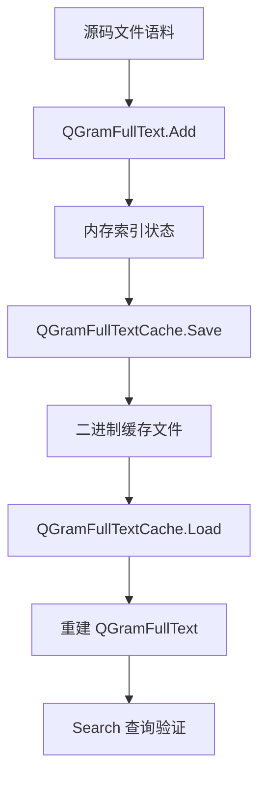

## 用户原始需求

在 `FullTextBuffer.vbproj` 项目中创建面向 `QGramFullText` 的二进制缓存数据库，用于保存已构建好的全文索引状态，并支持后续直接从缓存恢复 `QGramFullText` 对象进行查询。

## 产品概述

实现一套可持久化的全文索引缓存能力：首次从全文文本构建索引并写入缓存文件，后续从缓存文件恢复文档表、词到文档映射、q-gram 索引及必要元信息，无需重新遍历全文文本重建索引。

## 核心功能

- 提供 `QGramFullText` 索引状态的二进制保存与加载。
- 缓存内容包括文档表、词项倒排表、q-gram 索引表、q 值、分词器标识、版本与校验信息。
- 加载后得到可直接执行 `Search` 的 `QGramFullText` 对象。
- 对版本不匹配、缓存损坏、字段数量异常等情况提供可控失败。
- 新增控制台测试，使用当前代码库中的 `.vb` 源码文件作为全文文本，验证索引构建、缓存写入、缓存加载与查询结果一致性。

## Tech Stack Selection

- 技术栈沿用当前代码库：VB.NET、.NET 10、SDK 风格项目。
- 二进制读写沿用 `FullTextBuffer` 现有模式：`BinaryDataReader`、`BinaryDataWriter`、`Encoding.UTF8`、`ByteOrder.BigEndian`。
- 不采用 `BucketDb` 作为后端；采用专用不可变二进制缓存文件，避免反向依赖、KV 粒度不匹配和追加日志膨胀。
- 不新增 NuGet 依赖；测试沿用 `Darwinism/src/data/BucketDb/test` 的控制台可执行工程模式。
- 复用现有项目引用：`FullTextBuffer.vbproj` 已引用 `Microsoft.VisualBasic.Core`、`BinaryData` 和 `LINQ`。

## Implementation Approach

采用“状态精确导出、顺序写盘、顺序恢复”的方案：先让 `FullTextBuffer` 能读取 `QGramFullText` 与 `QGramIndex` 的真实内部状态，再将这些状态写入自定义二进制格式；加载时按同一格式重建内存对象，不调用 `Add`，不重新 tokenize 全部文档，也不重新生成 q-gram。

关键决策：

- 使用 `InternalsVisibleTo("FullTextBuffer")` 加 `Friend` 重建构造函数，而不是反射或直接公开可变 Dictionary。这样不扩大公共 API，不复制大对象，也不破坏现有 `Add`/`Search` 行为。
- 缓存格式采用 magic、version、q、tokenizerId、表记录数、数据区和 footer checksum。版本或校验失败时快速终止，避免加载错误索引。
- 文档、词项、q-gram 相关记录按确定性顺序写入，例如按字典序或写入顺序稳定排序，保证测试和调试可重复。
- 保存和加载均为单趟顺序 I/O。复杂度为 O(文档总文本长度 + 词项 posting 数 + q-gram posting 数)，内存主要为原索引对象和少量读写缓冲。

## Implementation Notes

- `QGramFullText.docs` 的 `docId` 当前由 `GetHashCode` 生成，应作为不透明字符串原样保存和恢复；不要尝试重建或重算 `docId`。
- `QGramIndex._index` 保存的是 `_strings` 列表的位置索引，不是 `_strings` 元素中的 `id`；缓存必须同时保留列表顺序、原始字符串、自定义 id 和 counts。
- `wordIndex.FindSimilar` 返回 `wi.text`，该文本必须与 `word2Docs` 的 key 保持一致；保存与加载时不得改变大小写或文本内容。
- `tokenlicer` 是委托，无法可靠序列化；缓存中保存 tokenizerId，加载时可传入相同分词器，默认使用 `TextSplit.MakeWords`。
- 不修改现有公开构造函数、`Add`、`Search` 和 `Tokenize` 语义；Core 层改动只增加 friend 重建入口。
- 测试中不要打印全文正文，只输出文件数量、索引数量、查询命中数和一致性断言结果。
- 当前未发现 `FullTextBuffer` 或 `BucketDb/test` 注册在 `Darwinism.sln` 中，因此计划不修改解决方案文件，新增测试工程保持可独立运行。

## Architecture Design



组件关系：

- `Microsoft.VisualBasic.Core`
- 提供 `QGramFullText` 和 `QGramIndex`。
- 增加 friend 重建构造入口，供缓存层直接恢复状态。
- `Darwinism.Repository.FullTextBuffer`
- 实现缓存格式、保存、加载、校验和异常处理。
- 不调用索引重建逻辑。
- `FullTextBuffer/test`
- 构造语料、生成基线查询结果、写缓存、读缓存、比较查询结果一致性。

## Directory Structure

### Directory Structure Summary

本次实现会在 Core 增加最小 friend 状态入口，在 FullTextBuffer 新增缓存格式与读写 API，并创建独立控制台测试工程。

```text
E:\codebuddy\GCModeller\src\runtime\
├── sciBASIC#\
│   └── Microsoft.VisualBasic.Core\
│       └── src\
│           ├── ApplicationServices\
│           │   └── Debugger.vb  # [MODIFY] 增加 InternalsVisibleTo("FullTextBuffer")，允许缓存程序集访问 friend 重建入口。
│           └── ComponentModel\DataSourceModel\Repository\TextIndex\
│               ├── QGramFullText.vb  # [MODIFY] 将内部字段调整为 Friend ReadOnly，并新增仅供缓存层使用的 friend 重建构造函数。
│               └── QGramIndex.vb      # [MODIFY] 将 q、strings、counts、gram index 调整为 Friend ReadOnly，并新增 friend 重建构造函数。
└── Darwinism\
    └── src\
        └── data\
            └── FullTextBuffer\
                ├── FullTextBuffer.vbproj  # [MODIFY] 如测试工程需要，补充测试工程相关说明或输出路径；主引用保持不变。
                ├── Buffer.vb              # [保持] 保留现有 InvertedIndex 二进制读写逻辑，不混用新缓存格式。
                ├── QGramFullTextCache.vb  # [NEW] 面向 QGramFullText 的公共缓存 API：Save、Load、TryLoad，以及文件路径重载。
                ├── QGramCacheFormat.vb    # [NEW] 定义 magic、version、tokenizerId、各数据表读写顺序、记录布局与异常类型。
                ├── QGramCacheChecksum.vb  # [NEW] 实现轻量 FNV-1a 或 CRC32 风格的流式校验和生成与验证，不引入外部依赖。
                └── test\
                    ├── FullTextBuffer.Test.vbproj  # [NEW] net10.0 控制台测试工程，引用 Core、BinaryData、FullTextBuffer。
                    └── Program.vb                  # [NEW] 读取当前代码库 .vb 文件作为语料，执行索引构建、缓存保存、缓存加载、查询一致性和损坏缓存测试。
```

## Key Code Structures

```
Public Module QGramFullTextCache
    Public Function Save(index As QGramFullText, file As String, Optional tokenizerId As String = Nothing) As Boolean
    Public Function Load(file As String, Optional tokenlicer As Func(Of String, IEnumerable(Of String)) = Nothing) As QGramFullText
    Public Function TryLoad(file As String, ByRef index As QGramFullText, Optional tokenlicer As Func(Of String, IEnumerable(Of String)) = Nothing) As Boolean
End Module
```

```
Friend Sub New(q As Integer,
               docs As Dictionary(Of String, String),
               word2Docs As Dictionary(Of String, HashSet(Of String)),
               wordIndex As QGramIndex,
               tokenlicer As Func(Of String, IEnumerable(Of String)))

Friend Sub New(q As Integer,
               strings As List(Of (str As String, id As Integer)),
               counts As Dictionary(Of String, Integer),
               index As Dictionary(Of String, HashSet(Of Integer)))
```

缓存文件逻辑布局：

- Header：magic、version、q、tokenizerId、各表记录数量。
- DocumentTable：docId、documentText。
- WordDocsTable：word、docId 数量、docId 列表。
- QGramStringsTable：位置、原始字符串、自定义 id、gram count。
- QGramIndexTable：gram、string position 数量、string position 列表。
- Footer：checksum。

## Agent Extensions

### SubAgent

- **code-explorer**
- Purpose: 复核 `QGramFullText`、`QGramIndex` 状态访问点，确认 `BinaryDataReader`/`BinaryDataWriter` 的现有用法和测试工程约定。
- Expected outcome: 输出精确修改点、可复用模式、潜在兼容性风险和验证清单，避免实现阶段依赖猜测。