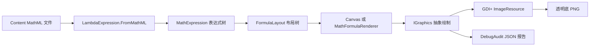

## 用户要求

在现有空白公式绘图项目中，实现从 MathML 公式对象到可视化数学公式的绘制能力；测试项目自行合成 MathML 测试文件，完成公式渲染，并输出透明底 PNG 图片。

## 产品概述

提供一个可复用的数学公式绘制模块，能够读取 Content MathML 解析后的表达式对象，按数学书写规则排版并绘制为清晰公式。测试结果以透明背景 PNG 文件呈现，同时生成测试审计报告。

## 核心功能

- 读取现有公式解析结果，支持符号、数值、四则运算、关系运算、幂、分式、函数与括号。
- 按数学排版规则绘制运算符、分式横线、上下标、函数参数及必要的分组括号。
- 通过统一绘图接口完成测量与绘制，便于切换不同绘图后端。
- 在测试项目中合成 MathML 文件，渲染多个公式并输出透明底 PNG。
- 使用 DebugAudit 记录解析、绘制、文件格式与透明背景检查结果，生成 JSON 测试报告。

## 技术栈

- 现有项目：VB.NET，.NET 10；测试项目为 net10.0-windows。
- 公式解析：复用 `mime/application%xml/xml-netcore5.vbproj` 的 `Microsoft.VisualBasic.MIME.application.xml.MathML` 命名空间。
- 绘图接口：复用 `Microsoft.VisualBasic.Core` 中的 `Imaging.IGraphics` 与 `Imaging.Driver.DriverLoad`。
- 测试后端：沿用 `test/Program.vb` 中已注册的 Windows GDI+ 驱动。
- 报告：复用 Core 项目中的 `Microsoft.VisualBasic.ApplicationServices.Debugging.DebugAudit`。
- 不新增第三方依赖，不修改 Core、xml-netcore5 或现有项目引用。

## 实现思路

采用“表达式树 → 布局树 → 抽象绘图接口绘制”的两阶段方案。先把 `MathExpression` 转成内部布局节点，再统一测量尺寸与计算基线，最后通过 `IGraphics.DrawString`、`DrawLine` 等方法绘制。这样既能隔离 MathML 解析细节，也能保持绘图后端无关。

关键决策：

- 复用 OMML 序列化器中的运算符映射、优先级和括号规则，避免重复定义数学语义。
- 仅支持现有解析器能表达的 Content MathML，不实现 Presentation MathML 节点解析。
- 数学公式绘制放在 MathDraw 项目中；GDI+ 特有的图片导出只放在测试项目中，避免污染库代码。
- 使用两遍布局与文本测量缓存，减少重复 `MeasureString` 调用；复杂度为节点数 O(n)，主要瓶颈是文本测量和绘制调用，通过缓存与一次性 Flush 缓解。

## 实现细节

- 新建 `FormulaRenderStyle`，集中保存字体、前景色、分式横线 Pen、上下标缩放、间距等样式参数。
- 新建内部 `FormulaLayout` 模型，至少包含文本、分式、上标、内联运算、括号和函数布局节点。
- `divide` 绘制为上下分子分母加中间横线；`power` 绘制为右上标；符号文本中的 `_` 与 `^` 约定分别绘制为下标与上标。
- `plus/minus/times/eq/leq/geq/neq` 映射为 Unicode 数学符号；`root` 沿用解析层约定按平方根处理。
- 子表达式是否加括号按优先级判断：关系符最低，其次加减、乘除、幂；减法和除法右操作数保留括号，幂的同级底数或指数保留括号。
- 空 `LambdaExpression`、空表达式体、未知节点类型抛出明确异常，并在测试报告中记录。
- 测试中创建透明画布：`DriverLoad.CreateDefaultRasterGraphics(size, Color.Transparent)` 或 `CreateGraphicsDevice(..., fill:="Transparent", driver:=Drivers.GDI)`。
- 测试导出使用 `DirectCast(g, GdiRasterGraphics).ImageResource.CorpBlank(blankColor:=Color.Transparent, margin:=20).SaveAs(path, ImageFormats.Png)`。
- DebugAudit 仅使用非条件编译 API：`Reset`、`Capture(name, value)`、`Test`、`Mark`、`Watch`、`FailureCount`、`SaveReport`；避免使用带 `Conditional("DEBUG")` 的 `Snapshot` 与两参数 `Check`，防止 Release 下调用被移除。

## 架构设计



## 目录结构

```text
e:/codebuddy/GCModeller/src/runtime/sciBASIC#/gr/MathDraw/
├── Canvas.vb
│   # [MODIFY] 将空类实现为公式画布门面，持有 IGraphics 与 FormulaRenderStyle，提供 Draw/Flush 方法。
├── FormulaRenderStyle.vb
│   # [NEW] 定义公式渲染样式：字体、前景色、分式线 Pen、上下标比例、运算符间距、括号间距。
├── MathFormulaRenderer.vb
│   # [NEW] 提供 Measure 与 Draw 公共方法，负责从 MathExpression/LambdaExpression 构建布局并绘制到 IGraphics。
├── FormulaLayout.vb
│   # [NEW] 内部布局树实现：文本框、分式、上标、下标、内联运算、函数、括号节点，以及优先级与括号判断。
├── MathDraw.vbproj
│   # [UNCHANGED] 现有项目引用已覆盖 Core、MathML 解析、绘图项目；SDK 默认包含新增 .vb 文件。
└── test/
    ├── Program.vb
    │   # [MODIFY] 合成测试流程：解析 MathML、创建透明画布、调用公式绘制、导出 PNG、写入 DebugAudit 报告。
    ├── test.vbproj
    │   # [MODIFY] 新增 math 目录 XML 测试资源复制到输出目录。
    ├── math/
    │   ├── formula-quadratic.xml
    │   │   # [NEW] Content MathML 测试文件，覆盖幂、乘法、加法、等式。
    │   └── formula-fraction.xml
    │       # [NEW] Content MathML 测试文件，覆盖 lambda、分式、函数、下标符号。
    └── output/
        # [GENERATED] 运行时生成透明 PNG 与 debug-audit.json，不纳入源码编译。
```

## 关键代码结构

```
Namespace Microsoft.VisualBasic.Drawing.MathDraw

    Public NotInheritable Class FormulaRenderStyle
        Public Property Font As Font
        Public Property Foreground As Brush
        Public Property FractionRule As Pen
        Public Property ScriptScale As Single
        Public Property OperatorGap As Single
        Public Property ScriptGap As Single
    End Class

    Public Class Canvas
        Public Sub New(device As IGraphics, Optional style As FormulaRenderStyle = Nothing)
        Public Function Draw(expression As MathExpression, origin As PointF) As SizeF
        Public Function Draw(lambda As LambdaExpression, origin As PointF) As SizeF
        Public Sub Flush()
    End Class

End Namespace
```