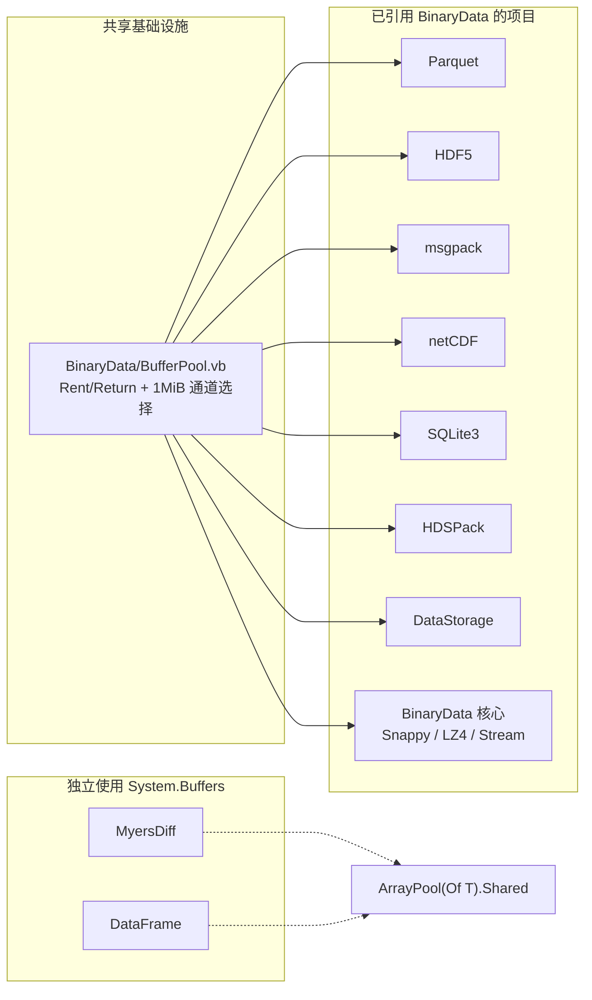

## 用户需求

通读 `Data` 目录下全部 VB.NET 项目源码（29 个 .vbproj），依据 `E:\memory_opt.txt` 描述的 `ArrayPool(Of T).Shared.Rent/Return` 技术，识别值得池化的位置，并输出一份可直接落地的开发方案。

## 产品概述

交付一份覆盖全仓库的"临时缓冲区分配审计报告"与一份分级池化改造方案。改造不改动公共 API 语义、不改变压缩/解析/序列化结果，只在内部把高频短命数组改为"租借-使用-归还"，并把能零分配消除的小数组直接消除。

## 审计结论（分级）

- **A 类 · 零分配即可消除（风险最低）**：`Parquet/Encodings/ByteReader.vb` 的 `ToLittleEndian`（小端机上每次标量读取都新建 2/4/8 字节数组）、`BitPacking.ReadRunValue`、`HDF5/device/ReadHelper.vb` 的 `readVariableSizeN`、`HDF5/device/datasetReader/DatasetReader.vb` 的 `asFloatBuffer/asDoubleBuffer/asIntBuffer/asLongBuffer/asShortBuffer`（`buffer.Split(n)` 为每个元素分配一个 Byte()，百万元素即百万次分配）、`netCDF/Utils.vb` 的 `toBE` 内层、`NpyFile.EncodeUtf32`。
- **B 类 · 生命周期封闭，可直接 Rent/Return**：Snappy 分块载荷与压缩输出暂存（最大 76490 B，紧贴 LOH 阈值下）、Snappy 哈希表（65536 B）、LZ4 块输入缓冲与 skippable 帧 scratch、Parquet 页读取与 Thrift 字符串、`MsgPackArrayIO.TryWriteArray` 写缓冲（576 KB）、`ChunkedDatasetV3` 每元素索引数组、`StreamPack.OpenBlock` 内存分支、SQLite 溢出页与页内偏移表、`NpyFile.Serialize`、`NumericTableIO.WriteDelimited` 整表字节。
- **C 类 · 需新增 into 重载（不打破公共契约）**：`BinaryDataReader.ReadBytes/ReadString/ReadMultiple`、`BinaryDataWriter` 的 5 处 `GetBytes`、`VectorStream.WriteVector` 的 LINQ 整条临时数组、`SnappyRawEncoder.Encode`、`Lz4.DecodeBlock`、`ByteReader.ReadBytes`、`ByteStreamSplit`/`DeltaEncoding` 的逐值数组、XPT 字段级解码、SQLite `RecordEncoder`。
- **D 类 · 专项**：`MyersDiff.vb` 的 `trace` 快照（`For d = 0 To maxD` 每轮 `New Integer(2*d)`，默认上限 5000 时累计约 100 MB，必然进 LOH）与 `V` 数组（约 40 KB，方法内闭环）。
- **明确不池化**：被字典/`MemoryStream`/字段长期持有的数组（`PageBuffer._data`、`ChunkedDatasetV3.dataArray`、`Lzma1Decoder._dict`、`OpenBlock(loadMemory)` 分支），以及 `header(3)`、`magic(5)`、16 字节 Decimal 等极小数组。

## 核心功能（交付物）

1. 共享池化基础设施：统一 Rent/Return 入口，区分 1 MiB 以内（Shared 池）与超过 1 MiB（自定义池或分块）两条通道。
2. 完成 A 类零分配改造与 B 类直接池化，覆盖压缩流、Parquet/HDF5/netCDF/msgpack、SQLite3/HDSPack/Numpy、DataFrame 文本导出。
3. 为 C 类高频返回型 API 增加 into 重载，旧签名行为完全不变。
4. MyersDiff 回溯表改造，把 O(D²) 分散分配收敛为可控的池化缓冲。
5. 引入基线测量与回归验证，用 DebugAudit 产出测试报告，量化 GC 次数、分配字节数与耗时变化。

## 技术栈

- 语言/运行时：VB.NET，全部生产项目已是 `TargetFrameworks = net10.0`，`System.Buffers.ArrayPool` 属于内置共享框架，无需新增 NuGet 包。
- 池化 API：`ArrayPool(Of T).Shared`；超出 1 MiB 的场景使用 `ArrayPool(Of Byte).Create(maxArrayLength, maxArraysPerBucket)` 自建实例。
- 回归验证：各项目已有 test 工程（`BinaryData/*/test`、`MyersDiff/test`），按用户规则统一通过 `Microsoft.VisualBasic.Core/src/Core.vbproj` 中的 `DebugAudit.vb` 生成测试报告。
- 度量手段：`GC.GetAllocatedBytesForCurrentThread`、`GC.CollectionCount(0)`、`Stopwatch`。

## 实施方案

### 关键事实与前提

- 全仓库目前仅 1 处使用 ArrayPool：`BinaryData/Protobuf/Wire/ProtoWriter.vb`（`Imports System.Buffers`，第 10 行；用法第 278-300 行）。该实现即为本仓库的**标准范式**：`Rent(byteCount)` → `Try/Finally` → `Return(rented)`，且写入时使用逻辑长度 `byteCount` 而非 `rented.Length`。
- `ArrayPool(Of T).Shared` 单桶上限为 1 MiB。超过该长度的 `Rent` 仍可用，但 `Return` 时被丢弃、池化失效。因此：
- 不超过 1 MiB：Snappy 76490 B、LZ4 64K/256K/1M、msgpack 576 KB、MyersDiff 40 KB、SQLite 页、Parquet 常规 page → 使用 Shared 池。
- 超过 1 MiB：LZ4 4 MB 块与 8 MB legacy 块、`PlainEncoding` 默认 RowGroup 1,000,000 行的 4 MB/8 MB 整列缓冲、整表 CSV 文本 → 使用自定义池，或改为按块循环租借（推荐后者，同时降低峰值内存）。
- 工程依赖已核实：`Parquet`、`HDF5`、`msgpack`、`netCDF`、`SQLite3`、`HDSPack`、`Feather`、`DataStorage`、`Protobuf` **全部** `ProjectReference` 了 `binarydata-netcore5.vbproj`，且各 vbproj 均为 SDK 风格（无显式 `Compile Include`）。因此在 BinaryData 项目内新增一个公共模块即可被上述所有项目直接引用，无需改任何 vbproj。
- `MyersDiff` 与 `DataFrame` 仅引用 `Core.vbproj`（不引用 BinaryData）。为避免引入新依赖或潜在循环引用，这两处直接使用 `System.Buffers.ArrayPool(Of T).Shared`。

### 分层改造策略

1. **先消除、后池化**。A 类点位不应引入池：`ToLittleEndian`、`ReadRunValue`、`readVariableSizeN`、`toBE` 内层的问题本质是"用数组做了 span 能做的事"。优先改用 `BitConverter.To*` / `BinaryPrimitives.Read*` 直接在源缓冲上读，或 `stackalloc Span(Of Byte)`（不超过 512 B 时）。零分配优于池化，且无生命周期风险。
2. **B 类直接 Rent/Return**。`Rent` → `Try` → `Finally Return`，全程使用逻辑长度。凡是 `Rent` 后会被 `New MemoryStream(buffer)` 包装或存入集合/字典的点位，一律不池化（已列入排除清单）。
3. **C 类采用 into 重载**。保持旧签名行为与语义完全不变（内部仍 `New T(n-1)` 并返回所有权），新增 `Sub X(count, buffer, ByRef written)` 形式供高频内部调用方使用；`ReadBytes`、`ReadMultiple`、`DecodeBlock`、`Encode`、`ReadString` 均适用。这样公共 API 零破坏，同时让内部热路径可复用缓冲。
4. **D 类专项**。`V` 数组改为 Rent（`For i = 0 To 2*maxD` 的 `NEG_INF` 填充必须保留，因为 Rent 不清零）；`trace` 快照改为"单个大数组 + 逐轮偏移切片"或"每轮 Rent、在 `Backtrack` 返回前统一 Return"。`Backtrack` 中 `prevV(k + d + 1)` 的下标上界正好可达 `2d`，改造后需按 `d` 收紧边界，防止依赖 `rented.Length` 的隐式越界容错。

### 关键技术决策与权衡

- **不引入 `RecyclableMemoryStream` 等第三方库**：现有 `MemoryStream` 使用点收益中等，且新增依赖会影响 sciBASIC 的打包链路与用户侧引用。改为对"必然产生大数组"的点位直接池化或改写成流式写，收益更高、依赖面不变。
- **不引入字段级长驻缓冲替代 Rent**：`Lz4Stream._out`、`SnappyOutputStream._buffer`、`MsgPackArrayIO` 的 `<ThreadStatic> scratch` 是已有做法，但它们把内存占用绑定到实例生命周期；对一次性调用场景反而抬高常驻内存。本次对"每次调用都新建且用完即弃"的点位统一走 Rent/Return，与既有字段缓冲策略并存互补，无需重构既有实现。
- **`clearBuffer` 的使用边界**：仅对可能承载用户数据的缓冲（XPT 字符串解码、SQLite 记录编码、CSV 文本）在归还时置 `True`；压缩中间缓冲（Snappy/LZ4 帧数据）不置位，避免无谓的 memset 开销。这一取舍需在代码注释中写明理由。
- **长度契约**：所有池化点一律显式传长度（`BlockCopy(src, 0, rented, 0, n)` / `Write(rented, 0, n)`），禁止出现 `rented.Length` 参与业务计算。这是本次改造最容易引入正确性缺陷的地方，需逐点审查。

### 性能与复杂度

- `Rent`/`Return` 为摊还 O(1)，桶查找与入栈常数级开销；对不小于 512 B 的缓冲，收益显著；对 2~8 字节的标量缓冲，Rent 开销大于分配收益，故此类点位明确改为 `stackalloc`/`BinaryPrimitives` 而非池化。
- 收益最大的三处按预估排序：`DatasetReader.as*Buffer` 的 `buffer.Split(n)`（O(n) 次小分配 → O(n) 次解析，无分配）、`MyersDiff.trace`（O(D²) 分散分配 → 单块或分轮复用）、`MsgPackArrayIO.TryWriteArray`（576 KB/次 → 复用）。
- 峰值内存侧收益：Parquet 整列 4 MB/8 MB 缓冲改为分块租借后，单次写入峰值从"整列 + 压缩副本"降为"一块 + 压缩副本"。

### 风险与边界

- 重复归还：同一数组实例只允许 `Return` 一次，禁止在 `Using`/异常路径中重复触发。
- 逃逸：`Rent` 的数组不得返回给调用方、不得存字段、不得被 `MemoryStream` 或 `Task` 捕获后继续使用。
- 池污染：`Rent` 不清零，依赖零值的逻辑（Snappy 哈希表填 `-1`、MyersDiff 填 `NEG_INF`、Parquet 位打包缓冲）必须保留初始化循环。
- 并发：Shared 池线程安全，但按核缓存，跨线程归还不会回到同一桶，属性能特征而非正确性问题；不做额外同步。

## 架构设计

改造不新增分层，只在 BinaryData 项目内增加一个横切基础设施模块，供所有已依赖 BinaryData 的项目复用；MyersDiff/DataFrame 独立使用 BCL 池。



数据流不变：压缩/解析/序列化仍走原有输入输出路径，仅把中间临时数组的来源从 `new T[]` 换成池租借，归还点统一在 `Finally`。

## 目录结构

```
Data/
├── BinaryData/
│   ├── BinaryData/
│   │   ├── BufferPool.vb                         # [NEW] 共享池化基础设施。定义 Rent/Return 的 Byte、Integer、Char 三个入口，内部按 1 MiB 边界选择 Shared 池或自建大块池（如 4 MiB 桶）；提供超大请求的分块租借辅助。统一在此处封装 clearBuffer 策略，作为全仓库唯一的池访问入口。
│   │   ├── ByteBuffer.vb                         # [MODIFY] compact() 第 161-167 行的 MemoryStream 复制改为租借缓冲 + SetLength，避免重复分配整块 capacity。
│   │   ├── Snappy/
│   │   │   ├── SnappyInputStream.vb              # [MODIFY] 第 136-141、165-176 行分块载荷、第 242-251 行 scratch 改为 Rent/Return；注意 SetChunk 持有的 data 不可池化，仅池化仅作中转的 payload。
│   │   │   ├── SnappyRawEncoder.vb               # [MODIFY] 第 24 行输出暂存池化（超过 1 MiB 时走大块池）、第 39-41 行收尾拷贝改为直接写有效长度；第 45-49 行 Integer 哈希表改为 Rent 并保留填 -1 循环；新增 Encode 的 into 重载。
│   │   │   ├── SnappyOutputStream.vb             # [MODIFY] FlushChunk 第 82-101 行改为调用 into 重载写入租借缓冲，去掉中间 compressed 数组。
│   │   │   └── Snappy.vb                         # [MODIFY] 第 34-42、64-72 行 MemoryStream + ToArray 双拷贝改为租借缓冲直接写出。
│   │   ├── LZ77Stream/
│   │   │   ├── Lz4Stream.vb                      # [MODIFY] 第 285-286、327-328 行块输入缓冲改为按块租借（4 MB/8 MB 走大块池或分块循环）、第 420-428 行 scratch 池化；字段 _out/_prevTail 保持不变。
│   │   │   ├── Lz4.vb                            # [MODIFY] DecodeBlock 新增 into 重载；Decompress 的 MemoryStream + ToArray 改为租借 + 有效长度输出。
│   │   │   └── Lzma.vb                           # [MODIFY] 同样处理 Decompress 的双拷贝路径。
│   │   ├── Stream/
│   │   │   ├── BinaryDataReader.vb               # [MODIFY] 新增 ReadBytes(count, buffer)、ReadMultiple into 重载；ReadBytes 旧签名内部改为调用 into 后精确裁剪；第 558-566 行 ReadString 改为租借 + GetString(span) 后归还；第 771-795 行零终止字符串改用 StringBuilder + 复用缓冲，去掉 List(Of Byte)。
│   │   │   ├── BinaryDataWriter.vb               # [MODIFY] 第 603-660 行五处 GetBytes 改为租借 + GetBytes(value, index, count, rented, 0) + Write(逻辑长度) + Return；第 344-573 行 2-8 字节的 WriteReversed 改为 stackalloc Span 或 BinaryPrimitives，不使用池。
│   │   │   └── VectorStream.vb                   # [MODIFY] 第 83-98 行 Boolean/Char/Date/SByte 的 LINQ Select().ToArray() 改为单块租借缓冲逐元素填充后一次写入。
│   │   └── PickleSerializer/
│   │       ├── MinimalPickleUnpickler.vb         # [MODIFY] 第 394-447 行中前 4 处纯临时 ReadBytes 改为 into 重载 + 租借；入栈的 3 处所有权转移保持不变。
│   │       └── MinimalPicklePickler.vb           # [MODIFY] EncodeLong 的 8 字节 BitConverter.GetBytes 改为 BinaryPrimitives，不使用池。
│   ├── Parquet/
│   │   ├── ParquetReader.vb                      # [MODIFY] 第 446-465 行 ReadBytes 改为租借 + 新增 into 变体供 page 读取；第 256-259 行 DataPageV2 尾部切片改为租借后按有效长度解码，解码完成即归还。
│   │   ├── Encodings/
│   │   │   ├── ByteReader.vb                     # [MODIFY] 第 180-190 行 ToLittleEndian 在小端机上直接 BitConverter.To* 零分配，大端分支改用 8 字节 stackalloc；第 132-144 行 ReadBytes 新增 into 重载。
│   │   │   ├── BitPacking.vb                     # [MODIFY] 第 218-230 行 ReadRunValue 改为直接从 reader.Data + Position 读取零分配；第 132 行 run 缓冲池化；第 232-252 行 WriteBitPackedRun 输出缓冲池化。
│   │   │   ├── PlainEncoding.vb                  # [MODIFY] 第 32-102 行四个 Write* 改为按块循环租借（每块 64 KB）替代整列 4 MB/8 MB 分配；元素级 BitConverter.GetBytes 改用 BinaryPrimitives。
│   │   │   ├── ByteStreamSplit.vb                # [MODIFY] 第 52-60 行内层逐值数组改为复用同一租借缓冲 + 按需拷贝，避免 For 循环内分配。
│   │   │   └── DeltaEncoding.vb                  # [MODIFY] 第 141-151 行逐值数组改为租借 previous/suffix 两块缓冲复用；第 83 行 miniblock buffer 池化。
│   │   └── Thrift/
│   │       ├── ThriftCompactReader.vb            # [MODIFY] 第 277-292 行 ReadExact 改为租借 + GetString(span)，归还于 Finally。
│   │       └── ThriftCompactWriter.vb            # [MODIFY] 第 88-91 行 WriteStringField 照搬 ProtoWriter 的 ArrayPool 范式。
│   ├── HDF5/
│   │   ├── device/ReadHelper.vb                  # [MODIFY] 第 190-204 行 readVariableSizeN 改为局部变量累加或 stackalloc Span，彻底消除数组。
│   │   ├── device/datasetReader/DatasetReader.vb # [MODIFY] 第 185-232 行五个 as*Buffer 的 buffer.Split(n).Select().ToArray 改为单次循环 + BitConverter/BinaryPrimitives 直接定位读取，零分配；第 183 行 fillFixedLengthStringData 的 Split 同样改写。
│   │   ├── device/BinaryReader.vb                # [MODIFY] 第 164-175 行 readBytes 增加 into 重载，内部直接 Read 而非逐字节，调用点去掉多余的 ToArray。
│   │   └── dataset/ChunkedDatasetV3.vb           # [MODIFY] 第 233-237 行循环内三个索引数组改为循环外租借复用；第 226 行 dataArray 因被 MemoryStream 持有，保持不变。
│   ├── msgpack/MsgPackArrayIO.vb                 # [MODIFY] 第 141 行写缓冲改为 Rent(576 KB 以内)，ensure 冲刷与 ByRef at 逻辑保持不变；第 832-849 行 readBlock 改为租借并在 AfterRead 前归还。保留已有 ThreadStatic scratch 作为逐元素路径实现。
│   ├── netCDF/Utils.vb                           # [MODIFY] 第 363-378 行 toBE 内层改为 BinaryPrimitives.Write*BigEndian 直接写目标缓冲，消除每元素临时数组。
│   ├── SQLite3/Writer/Internal/
│   │   ├── RecordEncoder.vb                      # [MODIFY] 第 147-216 行 GetSerialType 的 1-8 字节数组改 stackalloc；第 237-283 行每行两个 List + MemoryStream 改为实例级复用 List 与一页租借缓冲，ToArray 改为精确长度输出。
│   │   ├── SqliteFileSerializer.vb               # [MODIFY] 第 236-246 行溢出页 chunk 改为 Rent(pageSize) 后 Write 有效长度再归还。
│   │   └── PageBuffer.vb                         # [MODIFY] 第 167 行 offsets 数组改为租借后归还；第 95-98 行 _data 被 _pages 持有，保持不变。
│   ├── HDSPack/FileSystem/
│   │   ├── StreamPack.vb                         # [MODIFY] 第 504-553 行 loadMemory 分支改为租借缓冲写入 MemoryStream 后归还；第 417-426 行被 MemoryStream 零拷贝包装的分支保持不变；第 339-343 行 TestMagic 用 stackalloc。
│   │   └── StreamBuffer.vb                       # [MODIFY] 第 236-249 行 ToArray 整块再复制改为 TryGetBuffer 零拷贝取底层数组。
│   └── DataStorage/
│       ├── Numpy/NpyFile.vb                      # [MODIFY] 第 294-297 行 Serialize 改为租借缓冲 + BlockCopy + 写有效长度；第 359-368 行 EncodeUtf32 改为直接写目标缓冲；第 183-188、222-227 行同样处理。
│       └── XPT/
│           ├── IO.vb                             # [MODIFY] 字段级解码的临时数组改为实例级租借 scratch（每次读取结束不归还、由 reader Dispose 时归还），避免每单元格 3-4 次分配。
│           └── XPTReaderUtils.vb                 # [MODIFY] 第 89-96 行 getString 改为租借 + GetString(span)；已有的 DUMMY_BUFFER/_Row/blank_row 保持不变。
├── DataFrame/
│   ├── DataFrame/NumericTableIO.vb               # [MODIFY] 第 172-174 行 WriteDelimited 改为先 GetByteCount 再租借 + GetBytes(value, rented) + Write 有效长度（超过 1 MiB 走大块池或按行分块写出）。
│   └── DataFrame/Linq/DataStream.vb              # [MODIFY] 第 230、238 行 64 MB StreamReader 缓冲改为按文件规模自适应（属参数调优，非池化）。
├── MyersDiff/
│   └── MyersDiff.vb                              # [MODIFY] 第 302 行 V 数组改为 ArrayPool(Of Integer).Shared 租借并保留 NEG_INF 填充；第 315-327 行 trace 快照改为单块大数组 + 逐轮偏移切片，或每轮租借 + Backtrack 结束后统一归还；第 407 行下标边界按 d 收紧；第 189-193、241-253 行评估后再决定是否改造。
└── BinaryData/BinaryData/test/
    └── AllocBench.vb                             # [NEW] 池化前后对比基准。对 Snappy/LZ4/Parquet/HDF5/msgpack/Numpy/MyersDiff 各跑固定数据集，记录 GC CollectionCount(0)、GetAllocatedBytesForCurrentThread、Stopwatch 耗时，并通过 DebugAudit 输出报告。
```

## 关键代码结构

共享池入口（BinaryData 项目，命名空间 `Microsoft.VisualBasic.Data.IO`）：

```
Namespace Microsoft.VisualBasic.Data.IO

    ''' <summary>
    ''' 全仓库统一的临时缓冲租借入口。超过 1 MiB 的请求无法被
    ''' ArrayPool(Of Byte).Shared 命中，需走 LargeBytes 或按块拆分。
    ''' </summary>
    Public Module BufferPool

        ''' <summary>Shared 池单桶上限，调用方据此决定是否分块。</summary>
        Public ReadOnly Property MaxSharedLength As Integer

        ''' <summary>大块池（如 4 MiB 桶），用于 page / 整列 / 整表缓冲。</summary>
        Public ReadOnly Property LargeBytes As ArrayPool(Of Byte)

        Public Function RentBytes(minimumLength As Integer) As Byte()
        Public Sub ReturnBytes(buffer As Byte(), Optional clear As Boolean = False)

        Public Function RentInt32s(minimumLength As Integer) As Integer()
        Public Sub ReturnInt32s(buffer As Integer(), Optional clear As Boolean = False)

        Public Function RentChars(minimumLength As Integer) As Char()
        Public Sub ReturnChars(buffer As Char())

    End Module

End Namespace
```

调用契约（所有池化点必须遵循，与 `ProtoWriter.WriteString` 保持一致）：

```
Dim rented As Byte() = BufferPool.RentBytes(count)
Try
    Call stream.Read(rented, 0, count)
    Call Process(rented, 0, count)   ' 只用 count，绝不用 rented.Length
Finally
    Call BufferPool.ReturnBytes(rented)
End Try

' into 重载的契约：不做所有权转移，调用方负责缓冲生命周期
Public Sub ReadBytes(count As Integer, buffer As Byte(), ByRef written As Integer)
```

## 实施注意事项

- **执行顺序**：先落地 A 类零分配改造与 BufferPool 基础设施，再逐个模块推进 B/C/D 类。A 类改动不涉及生命周期，可先建立信心并压低基线分配量。
- **每模块独立可编译可回归**：一个模块改完立即构建并跑对应 test 工程，禁止跨模块一次性提交，避免定位困难。
- **逐点审查 `rented.Length`**：改造完成后对每个池化点做一次 grep 复查，确认无 `.Length` 参与业务计算、无重复归还、无逃逸。
- **保留既有初始化语义**：Snappy 哈希表填 `-1`、MyersDiff 填 `NEG_INF`、Parquet 位打包缓冲的零填充，一律显式保留；不要因为"池通常清零"而删除。
- **不影响公共 API**：新增重载一律追加，不修改或删除既有签名；`ReadBytes`、`DecodeBlock`、`Encode` 的旧方法行为必须逐字节一致。
- **测试与报告**：按用户规则，所有验证通过 `Core.vbproj` 中的 `DebugAudit.vb` 生成报告；`AllocBench` 需在优化前后各跑一次并对比 GC 次数与分配字节数，避免只报耗时。
- **不动无关逻辑**：`Trinity`、`GraphQuery`、`DataFrame.Extensions` 确认无 byte/char 级临时缓冲，本次不涉及；`Lzma1Decoder._dict`、`PageBuffer._data`、`ChunkedDatasetV3.dataArray` 等已论证不可池化，保持原样并在代码注释中标注原因，防止后续误改。

## Agent Extensions

### SubAgent

- **code-explorer**
- Purpose: 在改造前对每个模块做定点复核（确认行号、确认缓冲是否逃逸、确认调用方数量），并在改造后扫描全仓库验证是否残留 `New Byte(`/`ReDim`/`ToArray()` 等高分配模式、以及是否出现重复归还或 `rented.Length` 误用。
- Expected outcome: 每个模块的实施清单与风险点确认；改造后产出一份"剩余可优化点 + 已确认安全"的复核清单。

### Skill

- **lsp-code-analysis**
- Purpose: 对 `BinaryDataReader.ReadBytes/ReadString/ReadMultiple`、`SnappyRawEncoder.Encode`、`Lz4.DecodeBlock`、`ByteReader.ReadBytes` 等准备新增 into 重载的公共 API 做引用与影响面分析，确认全部调用方可一次性适配，避免遗漏造成编译失败或语义漂移。
- Expected outcome: 每个待改公共 API 的完整调用方清单与改造影响评估，确保旧签名保持兼容、新重载覆盖全部内部热路径调用点。