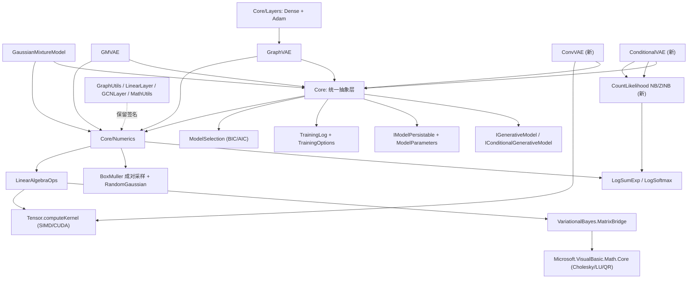

## 产品概述

将 sciBASIC# 的 VAE 生成模型包中三个算法模块（高斯混合模型、高斯混合变分自编码器、图变分自编码器）从"存在硬性数值缺陷的演示代码"提升为可用于生产环境的算法模块，并在同一体系下增量扩展条件生成、单细胞计数似然与图像卷积生成能力。对外交付形态为 .NET 类库（NuGet 包），不涉及界面。

## 核心功能

- **数值正确性修复**：消除当前训练首轮即产生 NaN、梯度方向相反、行列式符号错误、全协方差采样丢失相关性等硬缺陷；所有修复均以公开签名不变的内部重写方式实现。
- **统一模型契约**：三个模型可被同一套代码按统一接口训练、推理、保存、加载，并可用统一方式做模型选择（成分数 K 的自动选择）。
- **结果可复现**：给定随机种子，训练、评估、采样结果完全一致；评估过程不再隐式随机采样。
- **模型持久化**：训练完成的模型可保存到磁盘并完整还原，支持版本化与参数校验。
- **训练可观测**：迭代进度、各损失分量、耗时以可插拔观察者输出，默认控制台行为与现状保持一致。
- **性能可扩展**：矩阵运算走底层 SIMD 内核；批处理取代逐样本更新；大图训练不再产生多份全尺寸稠密矩阵。
- **条件生成（虚拟细胞/扰动）**：支持以实验条件（扰动标签、协变量）为输入生成表达谱，并支持反事实预测——固定同一细胞状态、仅替换条件得到响应差异。
- **计数数据似然**：支持负二项与零膨胀负二项似然及文库大小归一化，用于单细胞计数数据而非高斯近似。
- **图像生成**：支持卷积编解码的变分自编码器，输出有界像素值，可生成与重建灰度图像。
- **质量审计**：全部算法配有自动审计用例与可导出的审计报告，覆盖数值等价、梯度正确性、边界条件与性能基线。

## 边界说明

- 现有公开类型名、方法签名、属性名一律保持，旧调用代码无需修改即可编译运行。
- 新增能力以"新增类型、新增重载、新增只读属性"的方式提供，不修改既有签名。
- 现行行为中被证明产出错误数值的部分按缺陷修复处理，并提供开关以复现旧行为用于对比。

## 技术栈

- 语言/框架：VB.NET，`net10.0` 类库（`E:\codebuddy\GCModeller\src\runtime\sciBASIC#\Data_science\MachineLearning\VAE\VAE.vbproj`，RootNamespace `Microsoft.VisualBasic.MachineLearning.VariationalAutoencoder`，AssemblyName `Microsoft.VisualBasic.MachineLearning.VAE`）
- 数值容器：既有 `Tensor`（`...\TensorFlow\Tensor.vb` L78），纯托管 `Double()` + `_Shape`，**无自动微分**
- 计算内核：`Tensor.computeKernel`（L137），默认 `Compute.SIMDTensor`；`MatMul` 仅在 `m*k*n >= MatrixDotThreshold(10000)` 时走 SIMD 并行（`SIMDTensor.vb` L96、L343-378）
- 线性代数：**复用仓库内 `Microsoft.VisualBasic.Math.Core`（JAMA 移植版，非 MathNet.Numerics）**
- `...\Mathematica\Math\Math\Algebra\Matrix.NET\NumericMatrix.vb`：`Inverse()` L1650、`Determinant()` L1658、`SVD()` L1596、`Eigen()` L1606
- `...\Algebra\Matrix.NET\Decomposition\CholeskyDecomposition.vb` L69、`LUDecomposition.vb` L83、`QRDecomposition.vb` L75
- 现成桥接层 `...\VAE\VB\MatrixBridge.vb`（`Namespace VariationalBayes`）：`ToMatrix` L28、`FromMatrix` L43、`LogDet` L122（Cholesky 优先、LU 回退）、`IsPositiveDefinite` L170、`InverseOrPseudo` L192（奇异时对角线抖动回退）
- 激活/损失：复用 `...\TensorFlow\nn.vb`（`relu` L71、`sigmoid` L93、`softmax` L125、`log_softmax` L211、`sigmoid_cross_entropy_with_logits` L298）
- 卷积算子：`Compute\TensorComputeBase.vb` 的 `Conv2D` L1253、`Conv2DBackwardInput` L1314、`Conv2DBackwardFilter` L1359；SIMD 版 `SIMDTensor.vb` L508/L594/L673
- 测试框架：`...\Microsoft.VisualBasic.Core\src\ApplicationServices\Debugger\DebugAudit.vb`（`Reset` L178、`Check` L239、`Test` L279、`Require` L309、`AreEqual` L341、`CheckThrows` L377、`Watch` L418、`Mark` L436、`Dump` L469、`ToJson` L526、`SaveReport` L568）

### 关于"允许使用 Math.NET"的落地澄清

仓库内 **不存在任何 `MathNet.Numerics` 引用**（全仓 `*.vbproj` 检索 `MathNet` 命中数为 0）。`Math.NET5.vbproj` 实际是内部工程，`AssemblyName = Microsoft.VisualBasic.Math.Core`、`RootNamespace = Microsoft.VisualBasic.Math`，它本身即是一套完整的 JAMA 移植（Cholesky/LU/QR/SVD/Eigen 齐备），且已被 `VAE.vbproj` 直接引用。

因此本方案按"用经过验证的数值库替换手写实现"的意图执行，但选用**内部已验证库**而非引入新外部依赖：GMM/GMVAE 的求逆、行列式、Cholesky 全部下沉到 `VariationalBayes.MatrixBridge`。这同时满足三个约束：无需改动工程文件、无新增供应链风险、与 `VB\` 子模块既有实践一致（`VBGMM`/`VBPCA `已采用同一桥接模式，见 `MatrixBridge.vb` L1-11 的设计说明）。

## 实现策略

### 总原则

1. **零破坏**：不新增 Optional 参数（会改变 IL 签名）、不重命名任何公开类型、不改动公开成员签名；新能力一律以新类型/新重载/新只读属性提供。接口采用**显式接口实现**挂载到既有类（`Private Function X Implements IGenerativeModel.X`），使类型可见面仅增加接口列表。
2. **先立网后动刀**：在改动任何算法前，先把当前缺陷固化为可复现的审计用例，避免"修好了但没人知道原本错在哪"。
3. **单一数值边界**：`Tensor` 与 `NumericMatrix` 的转换只允许出现在 `MatrixBridge`（既有设计即如此，L4-11），模型层不直接引用 `LinearAlgebra.Matrix`。
4. **私有可改、公开不动**：所有 `Private` 字段/函数签名可自由重构（如让 `Reparameterize` 返回 `ε`），这是本次修复的主要操作空间。

### 分五次递进落地（每次独立可验收）

**第一阶段 — 回归基线**
把三个已确认缺陷写成审计用例：GMM 权重初始化产生 `Double.PositiveInfinity`（`GMM.vb` L246-251）；GMVAE 重参数化梯度用 σ 代替 ε（`GMVAE.vb` L511）；GraphVAE `Evaluate` 因调用 `Forward` 而隐式采样（`GraphVAE.vb` L986-1010）。同时把 `GraphVAE.vb` L786-794 的**正确**梯度实现固化为 GMVAE 的参照标准。测试入口在 `Program.Main` 增加 `--audit` 分支（保留既有 `--vb-only` 于 L68-71）。

**第二阶段 — 公共基础设施**
新增 `Core` 命名空间，只落基础设施不动算法：稳定的 log-sum-exp/log-softmax、成对 Box-Muller（一次生成两个独立样本，修正 `MathUtils.Randn` L189 丢弃 cos 分支的 2 倍浪费）、种子隔离的随机数服务、`LinearAlgebraOps`（对 `MatrixBridge` 的薄封装 + Cholesky 采样 + 三角求解）、`TrainingLog` 与观察者、`TrainingOptions`（含 KL 退火调度）、`IModelPersistable` 与 `ModelParameters`（JSON 清单 + 二进制数组打包，禁用已废弃的 `BinaryFormatter`）、`ModelSelection`（BIC/AIC）。

**第三阶段 — GMM 重写（优先级最高，当前完全不可用）**

- 修正权重初始化（`wData(k) = 1.0 / K`），根除 L246-251 的变量遮蔽；全文件消除 `For N = 0 To N - 1` 这类维度变量同名循环（L248-250/L372-404/L427-433 等 20 余处）。
- E 步：每个成分每轮仅做**一次** Cholesky 分解，缓存 `L`、`log|Σ|`；马氏距离用三角前代求解，替代 L544-545 的 `MatrixInverse` + `LogDeterminant` 两次 O(D³)。M 步后失效缓存。
- 删除错误的 `logDet = -logDet`（L807）；奇异时按 `MathUtils.LogDeterminant` 语义返回 `-Infinity` 并由调用方处理。
- 采样改用 Cholesky：`x = μ + L·z`，修复 L694-699 丢弃相关性的问题。
- 空簇/退化成分：`Nk` 低于下限时以最远点重新初始化；权重设下限后归一。
- 协方差类型扩展为 Full/Diag/Tied/Spherical（Full/Diag 复用既有 `_diagCovariance` 语义）。
- 新增只读属性 `BIC`、`AIC`、`NParameters`、`InputDim`；新增 `Save`/`Load`；新增输入维度校验（`Predict`/`PredictProba`/`Score`）。
- `MatrixInverse`/`LogDeterminant` 两个 `Public Shared` 保留签名，内部改为委托 `MatrixBridge`（消除与 `MathUtils.vb` L124/L72 的重复实现）。

**第四阶段 — GMVAE 修正**

- `q(z|x) → q(z|x,y)`：在私有层新增 `[2*latentDim, K]` 的 one-hot 偏置矩阵，等价于拼接 `onehot(y)`，成本 O(K·D) 而非把隐层扩 K 倍。`EncodeZ(x)` 的私有签名保持，内部按默认成分路径或全成分路径计算。
- 补全 `∂/∂logits_k` 项：`q_k·(KL_k − Σ_j q_j·KL_j)`，让类别隐变量真正由"哪个成分的高斯先验最解释该样本"驱动；同时把 `p(y)` 默认改为固定均匀分布（新增 `PriorMode` 属性，`Learned` 复现旧行为）。
- 重参数化：`Reparameterize` 私有签名改为返回 `ε`，`dL/dlogVar = dL/dz · 0.5 · ε`，修正 L511；同时修正该行对重构项多除一次 `bs` 的量纲不一致。
- 先验方差梯度改为 `0.5·(1 − (var1+Δ²)/var2)`，修正 L599-605 的反向更新；`var2` 设下限、`logVar` 夹取到 `[-10, 4]`。
- 似然：新增 `LikelihoodKind`（Gaussian/Bernoulli），重构损失按元素归一（新增 `ReconstructionScale` 属性，默认 `PerElement`，`PerBatch` 复现旧尺度）；解码器在 Bernoulli 模式下输出 logits 并走 `nn.sigmoid_cross_entropy_with_logits`。
- 优化器：`UpdateTensor` 改为可切换的 Adam（新增 `OptimizerKind` 属性，默认 `Adam`，`SGD` 复现旧行为）。
- 性能：`Linear`（L732-750）内部改走 `Tensor.MatMul`，使 SIMD/CUDA 内核生效；`Generate`（L668-699）批量化；消除 L310 的每批新分配。

**第五阶段 — GraphVAE 重构**

- 把 L564-581 的约 20 个可变字段收敛为 `GraphForwardCache` 对象，`Forward` 仍返回同样的五元组；新增 `ForwardBatch`。这解决非线程安全与无法批处理两个问题。
- `Evaluate` 改为使用 `μ` 不采样，恢复可复现性（缺陷修复）。
- `Predict` 删除重复的前向逻辑（L918-947），复用统一前向路径。
- `LinearLayer.Update` / `GCNLayer.Update` 内部委托统一 `Adam` 实现，数学完全等价。
- 反向传播不再同时持有 `dS_adj`/`dS_adj_T`/`dS_adj_sum` 三份 N×N，合并为一次「对称加法后乘」的计算，内存从约 6 份降到 3 份。
- 变节点数支持：`GraphVAEConfig` 是公开 Structure，**新增字段会破坏二进制布局**，故绝不修改它；改为新增 `GraphVAEOptions` 类 + 新构造重载 + `TrainMasked`/`ForwardMasked`，实现填充 + 掩码，`NumNodes` 作为上界 `MaxNodes` 生效，旧构造路径语义完全不变。
- 大图：新增 `SparseGraph`/`SparseAdjacency`（CSR）与 `TrainSparse` 重载，规避 O(N²) 稠密邻接。
- `GCNLayer.Backward` 增加 `AssumeSymmetricAdjacency` 属性（Class 新增字段安全），有向图显式用 `NormAdj.Transpose()`。
- 增加 KL warm-up（`beta` 随 epoch 线性升温）、梯度裁剪、验证集早停、`Save`/`Load`。

**第六阶段 — 条件生成与计数似然（虚拟细胞）**

- `ConditionalVAE`：编码器 `q(z|x,c)`、解码器 `p(x|z,c)`，`c` 为 one-hot 条件；`PredictCounterfactual(x, cFrom, cTo)` 实现"固定细胞状态、仅换条件"的潜变量迁移。
- `CountLikelihood`：负二项与零膨胀负二项，均值经文库大小缩放，离散度按基因可学习；对数似然用 `lgamma` 稳定实现。
- `PerturbationDataset`：条件 + 协变量 + 计数矩阵容器，附文库大小归一化工具。

**第七阶段 — 图像卷积 VAE**

- `ConvVAE`：编码器 `Conv2D → Conv2D → 展平 → μ/logσ²`，解码器 `全连接 → 重塑 → 上采样 → Conv2D → Conv2D → sigmoid`。
- 转置卷积不引入新内核：利用既有 `Conv2DBackwardInput`（`TensorComputeBase.vb` L1314 / `SIMDTensor.vb` L594）与步长 2 的单位核实现最近邻上采样及其反向，等价于 `stride-2` 转置卷积。
- 似然用 Bernoulli + logits，保证输出有界；`ITensorCompute.Conv2D` 的 padding/stride 参数在实现首步先行核实。

## 架构设计



要点：所有模型只依赖 `Core`，`Core` 只依赖既有 `Tensor` 与 `MatrixBridge`；`VariationalBayes.MatrixBridge` 是唯一跨入 `LinearAlgebra.Matrix` 的边界；`GraphUtils`/`MathUtils` 等历史公共类型保留为薄门面转发，不形成循环依赖。

## 关键实现说明

- **性能热点与量级**：GMM E 步由 `O(K·(D³ + N·D²))` 的两次 O(D³) 求逆/行列式降为每成分一次 Cholesky `O(D³/3)`，并用前代求解替代显式逆矩阵；每轮迭代消除 3 个 N×K 临时张量（`logProb`/`weightedLogProb`/`logResp`），改为复用缓冲。GraphVAE 反向由约 6 份 N×N 降到 3 份。GMVAE 的 `Linear` 改走 `MatMul` 后，超过 10000 次乘加即命中 SIMD 并行内核。
- **数值加固**：所有 `log`/`exp` 入口统一经 `LogSumExp` 与夹取函数，禁止再用散落的 `+0.0000001` 补丁（现状见 `GMVAE.vb` L380/L400/L507、`GMM.vb` L438/L450/L465）。Cholesky 失败一律按 `MatrixBridge.InverseOrPseudo` L192 的抖动回退策略处理，不再直接 `Throw`。
- **可复现性**：随机数一律通过注入的 `RandomGaussian` 服务获取，禁止方法内部 `New Random()`（现状见 `GMVAE.vb` L644、`GMM.vb` L664、`GMM.vb` L202）。`Reconstruct` 的随机分支必须由服务提供而非新建实例。
- **日志**：`TrainingLog` 保留现有输出文案格式（如 `Epoch 10/100 | Loss=... | Recon=... | KL(y)=...`，`GMVAE.vb` L344；`GraphVAE.vb` L903），确保 `verbose:=True` 的用户可见行为不变；新代码禁止直接 `Console.WriteLine`。
- **爆炸半径控制**：`GraphVAEConfig`（Structure，L528-541）零改动；`GaussianMixtureModel`/`GMVAE`/`GraphVAE`/`GraphUtils`/`LinearLayer`/`GCNLayer`/`MathUtils` 全部零重命名。行为变更点集中在三处并各自带开关：GMVAE 的 `PriorMode`/`OptimizerKind`/`ReconstructionScale`，GMM 的协方差类型，GraphVAE 的确定性评估。
- **序列化安全**：不引入 `BinaryFormatter`（.NET 已废弃且不安全），采用 JSON 清单 + 原始数组分块，加载时校验形状与版本号。

## 目录结构

```
VAE/
├── Core/                                        [NEW] 统一抽象与公共基础设施
│   ├── IGenerativeModel.vb                      [NEW] 定义 IGenerativeModel / IConditionalGenerativeModel / IProbabilisticClusterer。仅接口声明，由三个既有类以显式接口实现挂载，不改变其公开可见面。
│   ├── IModelPersistable.vb                     [NEW] 定义 Save(path)/TryLoad(path, out error) 与版本号契约；各模型以新增公开方法同时提供，接口用于统一调度。
│   ├── ModelParameters.vb                       [NEW] 参数容器：命名张量字典 + 形状校验 + JSON 清单 + 二进制数组分块打包。负责写入/读取 zip，禁止使用 BinaryFormatter。
│   ├── TrainingOptions.vb                       [NEW] 训练超参聚合（epochs/batch/lr/beta/gamma/patience/gradClip），含 KL 线性退火调度与学习率衰减策略。
│   ├── TrainingLog.vb                           [NEW] ITrainingObserver 接口 + ConsoleTrainingObserver（保持既有输出文案）+ NullObserver；各模型通过它输出迭代信息。
│   ├── ModelSelection.vb                        [NEW] BIC/AIC 计算与按 K 网格搜索（给定数据与候选 K 列表，返回评分表与最优 K）。
│   ├── Numerics/
│   │   ├── LogSumExp.vb                         [NEW] 稳定的 log-sum-exp / log-softmax / log1p 保护；替换散落的 epsilon 补丁。
│   │   ├── BoxMuller.vb                         [NEW] 成对正态采样（一次取 sin 与 cos 两个独立样本），供 GMM/GMVAE/GraphVAE/ConvVAE 共用。
│   │   ├── RandomGaussian.vb                    [NEW] 可复现随机数服务：种子隔离派生、正态/均匀/categorical 采样接口。
│   │   ├── LinearAlgebraOps.vb                  [NEW] 对 VariationalBayes.MatrixBridge 的薄封装：Cholesky 分解缓存、三角前代求解马氏距离、Cholesky 采样、log|Σ|。模型层只允许依赖本文件。
│   │   └── GradientCheck.vb                     [NEW] 中心差分梯度校验工具（生产代码侧不引用，仅供审计项目调用）。
│   └── Layers/
│       ├── IModule.vb                           [NEW] Forward/Backward/Parameters 的最小层契约。
│       ├── Dense.vb                             [NEW] 内部全连接层：前向走 Tensor.MatMul（命中 SIMD）、反向解析梯度、可选 ReLU。
│       └── Adam.vb                              [NEW] 统一 Adam 状态与单步更新（含偏差校正），供 GraphVAE 两个层与 GMVAE 复用。
├── GMM/
│   ├── GMM.vb                                   [MODIFY] 保留 GaussianMixtureModel 及全部公开签名。内部重写：修权重初始化、清除变量遮蔽、Cholesky 化 E 步与采样、空簇重初始化、输入校验、MatrixInverse/LogDeterminant 委托 MatrixBridge；新增 BIC/AIC/NParameters/InputDim 只读属性、Save/Load、显式接口实现。
│   └── GmmOptions.vb                            [NEW] CovarianceType（Full/Diag/Tied/Spherical）、权重下限、空簇阈值等内部选项；通过新增构造重载暴露，不改既有构造签名。
├── GMVAE/
│   └── GMVAE.vb                                 [MODIFY] 保留 GMVAE 及全部公开签名。内部重写：q(z|x,y) 条件化、补全类别 KL 梯度、ε 透传修正重参数化、先验方差梯度纠向、似然归一与 Bernoulli 模式、Adam、Linear 走 MatMul、批量 Generate、logVar 夹取；新增 PriorMode/OptimizerKind/ReconstructionScale/LikelihoodKind 属性与 Save/Load。
├── GraphVAE/
│   ├── GraphVAE.vb                              [MODIFY] 保留 GraphUtils/LinearLayer/GCNLayer/GraphVAEConfig/GraphVAE 全部公开签名。GraphForwardCache 收敛中间态、Evaluate 改确定性、Predict 去重、两层 Update 委托统一 Adam、合并冗余 N×N 临时量；新增 ForwardBatch/重载构造/TrainMasked/TrainSparse/Save/Load、GCN 对称性属性、KL 退火与早停。
│   └── GraphBatch.vb                            [NEW] GraphForwardCache（单图前向缓存）+ 填充掩码工具 + SparseGraph/SparseAdjacency（CSR）容器与稠密互转。
├── ConvVAE/
│   └── ConvVAE.vb                               [NEW] 图像卷积变分自编码器：Conv2D 编码、最近邻上采样 + Conv2D 解码（以 Conv2DBackwardInput 实现转置路径）、Bernoulli 似然、mutable 配置类 + 训练/生成/重构/评估/持久化。
├── Cells/
│   ├── ConditionalVAE.vb                        [NEW] 条件变分自编码器 q(z|x,c)/p(x|z,c)，支持条件指定生成与反事实预测（固定 z、替换 c）。
│   ├── CountLikelihood.vb                       [NEW] 负二项与零膨胀负二项似然、文库大小缩放、每基因可学习离散度、lgamma 稳定实现。
│   └── PerturbationDataset.vb                   [NEW] 条件标签 + 协变量 + 计数矩阵容器，含文库大小归一化与条件编码。
├── VB/
│   └── MatrixBridge.vb                          [MODIFY] 保持不变（作为唯一数值边界）；仅补充 XML 注释说明其已成为 GMM/GMVAE 的公共依赖，不修改任何签名。
├── MathUtils.vb                                 [MODIFY] 保留 Determinant/MatrixInverse/Randn/EuclideanDistance 全部签名；内部改为委托 MatrixBridge 与 Core/Numerics，消除重复实现。
├── NamespaceDoc.vb                              [MODIFY] 补充 Core/Cells/ConvVAE 命名空间文档，说明零破坏约束与新旧行为开关。
└── README.md                                    [MODIFY] 修正与代码不符的 API 示例（GaussianMixtureVAE→GMVAE、GaussianMixture→GaussianMixtureModel、GraphVAE 构造需 GraphVAEConfig、Train 的 lr 为必填），补充生产化使用指引与行为开关说明。

VAE/test/
├── Program.vb                                   [MODIFY] 保留 `--vb-only` 分支，新增 `--audit` 分支统一运行审计并输出报告路径。
├── Audit/
│   ├── NumericsAudit.vb                         [NEW] LogSumExp 极值、Box-Muller 矩检验、Cholesky 采样协方差还原、RandomGaussian 复现性。
│   ├── GmmAudit.vb                              [NEW] 权重初始化为有限值（固化 NaN 缺陷）、奇异协方差回退、空簇重初始化、全协方差采样相关结构、BIC 单调性、Save/Load 往返、与 NumericMatrix 参考实现的对数似然数值对齐。
│   ├── GmvaeAudit.vb                            [NEW] 有限差分梯度校验（参数 rel-err 阈值）、类别 KL 梯度存在性、先验方差不再坍缩、多峰合成数据聚类准确率、条件生成均值贴近真实簇心、同种子可复现。
│   ├── GraphVaeAudit.vb                         [NEW] 反向梯度有限差分校验（以 L786-794 正确实现为基准）、Evaluate 可复现、批量与逐图结果一致、变长图掩码正确、稀疏/稠密等价、内存未出现 N×N 膨胀（通过 Watch 记录耗时与规模）。
│   ├── CellsAudit.vb                            [NEW] NB/ZINB 对数似然闭式校验、文库大小归一化、反事实预测方向性（施加扰动后目标基因上调）、零膨胀数据下的参数恢复。
│   └── ConvVaeAudit.vb                          [NEW] 上采样与 Conv2DBackwardInput 的等价性、Bernoulli 输出有界性、小规模 MNIST 子集上的重构损失单调下降、梯度校验。
└── test.vbproj                                  [MODIFY] 确认引用 Core.vbproj（DebugAudit 所在工程）并纳入 Audit 目录编译。
```

## 关键代码结构

仅列出三个跨模块依赖、必须精确一致的契约（其余均为标准模式，用文字描述即可）。

```
Namespace Core

    ''' <summary>所有生成模型的统一契约。既有类以显式接口实现挂载，公开签名不变。</summary>
    Public Interface IGenerativeModel
        ReadOnly Property InputDim As Integer
        ''' <summary>重构输入；实现方必须保证不引入不可复现的随机性。</summary>
        Function Reconstruct(x As Tensor) As Tensor
        ''' <summary>从先验采样生成，seed 为 Nothing 时使用模型自带随机服务。</summary>
        Function Generate(n As Integer, Optional seed As Integer? = Nothing) As Tensor
        ReadOnly Property IsFitted As Boolean
    End Interface

    ''' <summary>训练过程观察者；ConsoleTrainingObserver 需复现既有控制台文案。</summary>
    Public Interface ITrainingObserver
        Sub OnEpochBegin(epoch As Integer, totalEpochs As Integer)
        Sub OnBatch(epoch As Integer, batch As Integer, losses As IReadOnlyDictionary(Of String, Double))
        Sub OnEpochEnd(epoch As Integer, losses As IReadOnlyDictionary(Of String, Double), elapsedMs As Double)
        Sub OnConverged(epoch As Integer, reason As String)
    End Interface

    ''' <summary>模型持久化契约：JSON 清单 + 二进制分块，加载时校验形状与版本。</summary>
    Public Interface IModelPersistable
        Sub Save(path As String)
        Function TryLoad(path As String, ByRef errorMessage As String) As Boolean
        ReadOnly Property SchemaVersion As Integer
    End Interface

End Namespace
```

## Agent Extensions

### SubAgent

- **code-explorer**
- Purpose: 在实施各阶段前进行针对性的代码定位与影响面核查，包括：确认 `ITensorCompute.Conv2D`/`Conv2DBackwardInput` 的完整参数签名与 padding/stride 语义；核实 `NumericMatrix` 与 `CholeskyDecomposition` 的构造函数与 `SPD`/`GetL` 成员可用性；确认 `Tensor` 的 `To2DArrayDouble`/`Data`/运算符重载是否满足新层实现需要；排查新增 `Core` 内部类型与既有 `GNN`/`DeepLearning` 同名类型的潜在冲突。
- Expected outcome: 每个阶段开始前产出一份带绝对路径与行号的接口清单与冲突清单，使代码编写不再依赖猜测；特别确保 ConvVAE 的转置卷积实现路径在动手前已被证实可行。

### Skill

- **lsp-code-analysis**
- Purpose: 对 `GaussianMixtureModel`、`GMVAE`、`GraphVAE`、`LinearLayer`、`GCNLayer`、`MathUtils` 做引用查找与调用层级分析，精确划定"公开可见面"边界，验证零破坏约束（哪些成员被 test 项目或外部可见调用），并在重构前后对比符号签名差异。
- Expected outcome: 输出经语义分析确认的公开 API 快照与差异报告；若出现预期外的签名变化或新增同名冲突，在合入前即被发现并纠正。