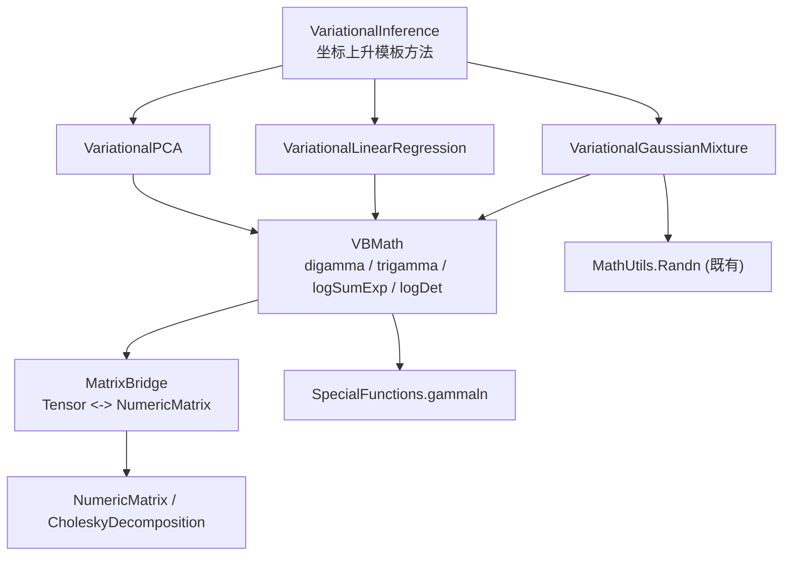

## Product Overview

在现有 VAE 算法项目内新增一套“变分贝叶斯（Variational Bayes）”模型族，以统一的变分推断（均值场坐标上升）框架为基础，提供三个可直接调用的模型：变分贝叶斯高斯混合（VB-GMM）、变分贝叶斯线性回归（VB-Linear Regression）、变分贝叶斯主成分分析（VB-PCA）。所有模型对外使用与项目现有 GMM/GMVAE 一致的张量数据接口，训练完成后暴露可读的模型参数、下界收敛曲线与预测/重构能力，可直接用于聚类、密度估计、回归与降维。

## Core Features

- 统一的变分推断基类：封装“初始化→隐变量后验更新→超参数更新→下界评估”的迭代循环，提供最大迭代次数、收敛阈值、随机种子、迭代回调、下界历史与收敛状态；子类只需实现三个钩子方法即可新增模型。
- 数值与特殊函数工具：补齐项目缺失的双伽马函数、三伽马函数、对数求和指数、对数行列式、正定矩阵安全分解与张量/矩阵互转，作为所有 VB 模型共用的数学底座。
- VB-GMM：以 Dirichlet 先验建模混合权重、以 Normal-Wishart 共轭先验建模各高斯成分，输出每个样本的成分责任度、硬聚类标签、混合权重、均值与协方差、变分下界；先验设置得当时可自动把多余成分的权重压到接近零，实现成分数自动剪枝，并给出“有效成分数”。
- VB 线性回归：对权重、噪声精度、权重精度同时做均值场近似，输出后验均值与协方差、噪声精度估计、对新设计矩阵的预测均值与预测方差，并输出下界曲线。
- VB-PCA：对载荷矩阵、隐变量、逐维精度与噪声精度做均值场近似，输出载荷矩阵、隐变量得分、重构数据、逐维有效性与自动确定的有效维度（ARD 剪枝效果）。
- 演示与验证：在测试工程中提供完整演示，覆盖合成三簇数据的聚类与成分剪枝、合成线性关系的系数恢复、低秩加噪数据的有效维度恢复与重构误差，并在运行结束时输出可读的审计报告文件（含所有指标快照、检查项与失败计数）。

## Tech Stack Selection

- 语言/运行时：VB.NET，.NET 10（沿用 `VAE.vbproj` 的 `net10.0`）
- 公共数据接口：`Microsoft.VisualBasic.MachineLearning.TensorFlow.Tensor`（与项目内 GMM/GMVAE/GraphVAE 保持一致）
- 内部线性代数：`LinearAlgebra.Matrix.NumericMatrix`（`Inverse/Determinant/Solve/Dot/Identity/Diagonal/ArrayPack`）+ `CholeskyDecomposition`（`SPD/GetL/Solve`）+ `LUDecomposition`
- 特殊函数：`SpecialFunctions.gammaln/gamma`（全局命名空间，`stats-netcore5.vbproj` 已引用）
- 采样与初始化：`MathUtils.Randn`、`MersenneTwisterFast.nextGamma`、KMeans 的 K-Means++ 初始化思路
- 测试报告：`Microsoft.VisualBasic.ApplicationServices.Debugging.DebugAudit`（`Mark/Snapshot/Watch/Check/AreEqual/Dump/SaveReport`）

`VAE.vbproj` 已引用 Core、DataMining、stats、Math.NET5、DeepLearning、machine_learning、TensorFlow，因此**无需新增任何 ProjectReference**；`VAE.slnx` 也无需改动。

## Implementation Approach

### 总体策略

采用“模板方法 + 三个独立模型 + 一个共享数学层”的结构：基类固定坐标上升的迭代骨架与收敛/日志职责，各模型只负责自身隐变量后验与超参数更新以及下界解析式；矩阵分解统一下沉到 `NumericMatrix`，而对外参数统一以 `Tensor` 暴露，避免调用方为两种矩阵类型写两套代码。

### 关键决策与权衡

1. **Tensor 对外 / NumericMatrix 内部**：Tensor 是项目既有约定（GMM/GMVAE 均如此），保持 API 一致；而 VB 模型频繁需要 `log|Σ|`、`Σ⁻¹`、Cholesky 判定，Tensor 侧只有 `MathUtils.Determinant/MatrixInverse` 这两个手写实现（O(n³) 无主元稳定性保障），改用 `NumericMatrix`/`CholeskyDecomposition` 更稳健。桥接只在参数更新与下界评估的边界发生（每次迭代 O(K·D²) 次转换），不在逐样本循环内转换，因此不构成热点。
2. **下界在“两阶段更新之后”统一计算**：基类循环固定为 `Expectation → Maximization → ComputeELBO`，避免“用旧超参数算新责任度”的口径混乱，保证下界序列单调不减（数值噪声处留 `1e-9` 容差）。
3. **对数域计算**：责任度用 `ln ρ_nk` + 行 `logSumExp` 归一化，杜绝下溢；`exp` 前统一减行最大值。
4. **正定性与数值安全**：`W_k` 更新后强制对称化 `(W+W')/2`，必要时做 `tr(S_k W_k)` 截断为非负；`ν_k > D-1` 加保护；Cholesky 失败则回退到 LU/加性抖动 `1e-8·I`，并记录一次警告而不中断训练。
5. **不做无谓抽象**：不引入自动微分、不引入计算图；VB 各模型的下界与更新全部是闭式解，YAGNI。
6. **性能**：VB-GMM 每次迭代 `O(N·K·D²)`（M 步用 `Σ r_nk x_n`/`Σ r_nk x_n x_n'` 一次扫描聚集充分统计量，避免 N×K×D×D 的三重分配）；VB-PCA 每次迭代 `O(N·D·L² + N·L³ + D·L³)`；VB 线性回归每次迭代 `O(M³ + N·M²)`。均按行优先访问 `Tensor.Data`，预分配 `Double()` 缓冲并复用，不在循环内 `New Tensor`。

### 数学要点（实现依据）

- **VB-GMM**（Bishop PRML 10.2）
- E 步：`ln ρ_nk = E[ln π_k] + ½E[ln|Λ_k|] − (D/2)ln(2π) − ½(D/β_k + ν_k(x_n−m_k)'W_k(x_n−m_k))`
- 期望项：`E[ln π_k] = ψ(α_k) − ψ(Σα)`；`E[ln|Λ_k|] = Σ_{d=1..D} ψ((ν_k+1−d)/2) + D ln2 + ln|W_k|`
- M 步：`α_k = α0 + N_k`，`β_k = β0 + N_k`，`ν_k = ν0 + N_k`，`m_k = (β0 m0 + N_k x̄_k)/β_k`，`W_k⁻¹ = W0⁻¹ + N_k S_k + (β0 N_k/β_k)(x̄_k−m0)(x̄_k−m0)'`
- 下界：按 10.70–10.77 的七项分解（`E[ln p(X|Z,μ,Λ)]`、`E[ln p(Z|π)]`、`E[ln p(π)]`、`E[ln p(μ,Λ)]` 减去 `E[ln q(Z)]`、`E[ln q(π)]`、`E[ln q(μ,Λ)]`），其中 `H[q(Λ_k)] = −ln B(W_k,ν_k) − ((ν_k−D−1)/2)E[ln|Λ_k|] + ν_k D/2`，`ln B(W,ν)` 用 `gammaln` 展开
- 剪枝：`α0` 取小值（默认 `1e-3`）时，无数据支撑的成分 `α_k → α0`，其 `E[π_k] → 0`；`EffectiveComponents` 以 `α_k > α0 + 1` 判定
- **VB 线性回归**（Bishop 10.3）：`q(w)=N(m_N,S_N)`、`q(α)=Gamma(a_N,b_N)`、`q(β)=Gamma(c_N,d_N)`
- `S_N⁻¹ = E[α]I + E[β]Φ'Φ`，`m_N = E[β]S_NΦ't`
- `b_N = b0 + ½E[‖w‖²]`，`d_N = d0 + ½E[‖t−Φw‖²]`，`a_N = a0 + M/2`，`c_N = c0 + N/2`
- 期望量用 `ψ(a)−ln b`、`ψ(c)−ln d`；预测分布为 Student-t 近似，输出均值与方差
- **VB-PCA**（Bishop 12.2，逐行载荷分解，避免 `D·L × D·L` 的系统矩阵）
- `Σ_zn = (I + E[β]E[W'W])⁻¹`，`m_zn = E[β]Σ_zn E[W]'(x_n−μ)`
- `Σ_wd = (diag(E[α]) + E[β]E[Z'Z])⁻¹`（与 d 无关，只算一次），`m_wd = E[β]Σ_wd E[Z]'(x_d−μ_d)`
- `q(α_l)=Gamma`、`q(β)=Gamma` 用 `gammaln`/`ψ` 更新；`EffectiveDimension` 以 `E[α_l]` 相对量级判定

## Architecture Design



数据流：调用方传入 `Tensor [N,D]` → 基类 `Fit` 驱动迭代 → 模型内部经 `MatrixBridge` 转为 `Double()()` 交给 `NumericMatrix` 做分解 → 结果回写为 `Tensor` 供调用方读取责任度/均值/协方差/载荷。

## Implementation Notes

- 严格复用既有符号：`MathUtils.Determinant/MatrixInverse/Randn`、`Tensor.Zeros/RandomNormal/MatMul/Transpose/To2DArrayDouble`、`NumericMatrix.ArrayPack`（`GeneralMatrix` 接口成员，`Optional deepcopy As Boolean = False`）。**不要**臆造 `Tensor.Slice/Tile`（不存在），需要子块时用索引器逐元素或先转 `Double()`。
- `Tensor.RandomNormal` 的 `mean/stdDev` 形参为 `Single`，调用处需 `CSng(...)`；`Tensor` 内部为 `Double()`，不要在循环内做 `Single` 往返转换。
- 日志：沿用 `VBDebugger.log` 风格仅用于警告（Cholesky 回退、`W_k` 抖动、无效成分剪枝），每类警告**每次训练最多一条**并带尝试次数，避免迭代内刷屏；不下栈大矩阵。
- 空值与退化输入校验：`X.Rank <> 2`、`N < K`、`D < 1`、`null` 形状直接 `Throw New ArgumentException`（与 `GaussianMixtureModel.Fit` 一致），不静默返回。
- 影响面控制：`VB/` 为新目录，不改动 `GMM.vb`/`GMVAE.vb`/`GraphVAE.vb`；`VAE.vbproj` 的 `<Compile Remove="test\**" />` 已保证 test 不进入库；`Program.vb` 只新增一行调用，原有 GMM/GraphVAE 演示顺序保持不变。
- 测试注意：`DebugAudit.Check/Snapshot` 带 `<Conditional("DEBUG")>`，因此演示必须以 **Debug** 配置构建才能产生审计记录；`SaveReport` 无该限制，输出为 JSON。

## Directory Structure

```
Data_science/MachineLearning/VAE/
├── VB/
│   ├── NamespaceDoc.vb  # [NEW] 命名空间文档。声明 Namespace VariationalBayes 的空 NamespaceDoc 类，概述均值场变分推断模型族，风格对齐既有 NamespaceDoc.vb（含 XML summary）。
│   ├── VBMath.vb  # [NEW] VB 共享数学层。实现 Digamma(x)（递推降到 x>=6 后用渐近展开 1/x+1/(2x²)-...）、Trigamma(x)、LogSumExp(Double())、LogSumExpRows(Tensor)、LogDetSPD(Tensor)（先 ArrayPack→NumericMatrix→CholeskyDecomposition，非 SPD 时回退 LU 并记警告）、SafeInverseSPD(Tensor, jitter) 与 Vectorize/Symmetrize 辅助。所有函数对 x<=0、非方阵、NaN/Inf 做显式校验；提供与 SpecialFunctions.gammaln 的一致性自检函数。
│   ├── MatrixBridge.vb  # [NEW] 张量与矩阵互转。ToNumericMatrix(Tensor)（用 To2DArrayDouble 生成 Double(,) 再按 jagged 传入 NumericMatrix）、FromNumericMatrix(GeneralMatrix)（ArrayPack→Tensor）、ToJagged(Double(,))、TensorFromRows/Dot/InverseOrPseudo 等薄封装，全部为 Shared、无状态、无分配泄漏。仅在此处出现 LinearAlgebra.Matrix 引用，模型层不直接依赖。
│   ├── VariationalInference.vb  # [NEW] 变分推断抽象基类 + 事件参数。定义 MaxIter=200、Tolerance=1e-6、Seed、Verbose、ELBO、ELBOHistory、Converged、NIter、IterationCompleted 事件与 VariationalIterationEventArgs（Iteration、ELBO、Delta）；Fit(X As Tensor) 作为 NotOverridable 模板方法执行 InitializeModel→循环(Expectation/Maximization/ComputeELBO/收敛判定)→OnConverged；三个 MustOverride 钩子（InitializeModel、Expectation、Maximization、ComputeELBO）；参数非法与 ELBO 出现 NaN 时立即抛出并保留历史，便于定位。
│   ├── VBGMM/
│   │   └── VariationalGaussianMixture.vb  # [NEW] VB-GMM 模型。构造参数 NComponents、DirichletAlpha0=1e-3、PriorMean、PriorBeta0=1e-3、WishartScale W0、WishartDof nu0=D、RegCovar；实现 E 步对数责任度与 logSumExp 归一化、M 步充分统计量聚集与五个超参数更新、七项 ELBO；输出 Responsibilities [N,K]、PredictProba、Predict(硬标签)、Weights(由 E[π] 归一化)、Means、Covariances(由 ν_k,W_k 导出)、EffectiveComponents、PruneThreshold；提供 Score(X) 返回平均下界；K-Means++ 初始化复用现有 InitMethod 思路，RNG 用 Seed 固定。
│   ├── VBLinearRegression/
│   │   └── VariationalLinearRegression.vb  # [NEW] VB 线性回归。设计矩阵 Φ [N,M] 与目标 t [N] 或 [N,1]；实现 q(w)/q(α)/q(β) 的均值场更新、Gamma 超参数的 gammaln/ψ 项、闭式 ELBO；输出 Mean(M-vector)、Covariance(M×M)、Alpha、Beta、PredictiveMean(Φnew)、PredictiveVariance(Φnew)、Predict(Φnew)；内置 Intercept 开关与标准化辅助方法，便于演示。
│   ├── VBPCA/
│   │   └── VariationalPCA.vb  # [NEW] VB-PCA。输入 X [N,D]、LatentDim L；逐行载荷分解实现 Σ_wd 只算一次、Σ_zn 与 m_zn 的批式更新、q(α_l)/q(β) Gamma 更新与 ELBO；输出 Components(W, [D,L])、Scores(Z, [N,L])、Reconstruct(X)、ResidualVariance、AlphaPerLatent、EffectiveDimension、ReconstructionError(X)；支持缺失值掩码（NaN 视为缺失，仅用观测维参与更新）。
│   └── README.md  # [NEW] 模型族说明。列出三个模型的目标函数、先验设置、关键参数含义、复杂度与使用示例片段。
└── test/
    ├── VBDemo.vb  # [NEW] 演示与自检（Public Class VBDemo，Public Shared Sub Main3(args As String())）。包含：合成三簇 2D 数据训练 K=8 的 VB-GMM（断言下界单调、责任度行和≈1、Permutation 匹配后的聚类准确率≥0.95、有效成分≈3）；合成 y=2+3x1-1.5x2+噪声训练 VB 回归（断言系数相对误差<5%、预测 R²≥0.95）；合成秩 2 加噪数据训练 VB-PCA（断言有效维度=2、重构 RMSE 低于噪声标准差）。全程用 DebugAudit.Mark 记录阶段、Snapshot 记录指标、Watch 包裹每个训练阶段计时、Check/AreEqual 断言，最后打印 Dump() 并 SaveReport 到 bin 目录下的 vb_test_report.json。
    └── Program.vb  # [MODIFY] 在 Main 中新增 VBDemo.Main3({}) 调用（置于 GMMDemo.Main2 之后、GraphVAE 演示之前），并保持既有输出分隔风格。
```

## Key Code Structures

```
' VariationalInference.vb（接口级契约，不实现细节）
Public MustInherit Class VariationalInference
    Public Property MaxIter As Integer
    Public Property Tolerance As Double
    Public Property Seed As Integer?
    Public ReadOnly Property ELBO As Double
    Public ReadOnly Property ELBOHistory As List(Of Double)
    Public ReadOnly Property Converged As Boolean
    Public ReadOnly Property NIter As Integer
    Public Event IterationCompleted As EventHandler(Of VariationalIterationEventArgs)

    Public NotOverridable Sub Fit(X As Tensor)

    Protected MustOverride Sub InitializeModel(X As Tensor)
    Protected MustOverride Sub Expectation()          ' 更新隐变量后验 q(Z)
    Protected MustOverride Sub Maximization()         ' 更新超参数后验 q(θ)
    Protected MustOverride Function ComputeELBO() As Double
    Protected Overridable Sub OnConverged()
End Class
```

```
' MatrixBridge.vb（转换边界契约）
Public Module MatrixBridge
    Public Function ToNumericMatrix(x As Tensor) As NumericMatrix
    Public Function FromNumericMatrix(a As GeneralMatrix) As Tensor
    Public Function ToJagged(a As Double(,)) As Double()()
    Public Function InverseOrPseudo(a As Tensor, Optional jitter As Double = 0.00000001) As Tensor
End Module
```

## Agent Extensions

### SubAgent

- **code-explorer**
- Purpose: 在实现阶段批量核对跨项目 API 的真实签名，避免臆造。具体用于确认 `NumericMatrix` 构造重载与 `Inverse/Solve/Dot/Identity/Diagonal/ArrayPack` 的精确签名、`CholeskyDecomposition.SPD/GetL/Solve` 的可用成员、`Tensor` 的工厂与索引器实际形态，以及 `SpecialFunctions` 中 `gammaln` 的可见性。
- Expected outcome: 产出一份带绝对路径与行号的 API 清单，确保 `VBMath.vb` 与 `MatrixBridge.vb` 里每一处调用都真实存在且参数类型匹配，编译一次通过。

### Skill

- **lsp-code-analysis**
- Purpose: 在落盘 `VariationalInference` 基类与三个模型后，用语义分析核对继承关系与符号引用：确认 `Protected MustOverride` 钩子在三个子类中全部实现、无遗漏的 `Imports`、无对 `Tensor` 不存在成员的引用，并检查 `Program.vb` 中 `VBDemo.Main3` 的引用能被正确解析。
- Expected outcome: 得到零错误级别的符号解析结果与完整的实现/引用清单，作为提交前的静态校验环节。