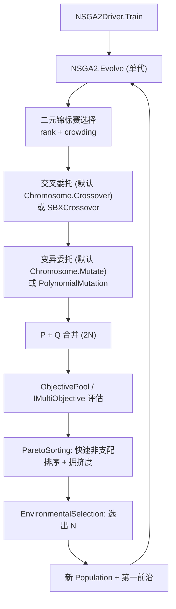

## 需求说明

在现有 VB.NET 机器学习库的 `Darwinism` 遗传算法框架之上，于 `Darwinism/NSGA-II` 目录内实现一套可复用的 NSGA-II（带精英保留的快速非支配排序遗传算法）多目标优化框架，并配套示例与可运行验证工程。

## 核心功能

- **快速非支配排序**：基于支配关系（全目标不劣且至少一个严格更优）分层，维护支配解集与被支配计数，复杂度 O(MN²)，输出 F1、F2……
- **拥挤度距离**：层内按各目标排序，边界解距离为 +∞，中间解累加归一化邻差；目标最大最小相等时跳过该目标，避免除零。
- **拥挤度比较算子**：rank 小者优先，rank 相同则拥挤度大者优先，供二元锦标赛选择与环境选择共用。
- **精英保留环境选择**：父代 P 与子代 Q 合并为 2N，按前沿等级整层填充，放不下的前沿按拥挤度降序截取，恰好选出 N 个。
- **主循环驱动**：初始化种群 → 排序 → 重复（二元锦标赛 → 交叉 → 变异 → 父子合并 → 环境选择）→ 输出第一前沿；支持最大代数与进度回调。
- **多目标目标函数接口**：新增返回目标向量的评估接口，并额外提供把现有单目标 `Fitness`（Double）适配为单目标向量的适配器（含方向处理，统一为最小化）。
- **内置实数编码算子**：SBX 模拟二进制交叉与多项式变异，支持搜索上下界、分布指数 ηc/ηm、交叉概率与每基因变异概率。
- **复用现有框架**：沿用现有 `Chromosome`（Crossover/Mutate/MutationRate/Identity）、`Population`/`PopulationCollection`、`Model`/`IterationReporter` 抽象与随机源约定，保持代码风格一致。
- **可运行验证**：提供 ZDT1（30 维、双目标）示例个体与目标函数，校验最终前沿互不支配、与真实前沿的世代距离在阈值内，并以退出码表示通过与否。
- **文档补充**：在 `NSGA-II/readme.md` 末尾追加本库 API 与用法示例章节，不改动原有算法描述。

## 技术栈

- 语言/运行时：VB.NET，Sdk 风格工程，`TargetFrameworks=net10.0`（与 `machine_learning-netcore5.vbproj` 一致），无新增第三方依赖
- 复用依赖：`Microsoft.VisualBasic.Core`（`IReadOnlyId`、`IRandomSeeds`、`RandomExtensions.seeds`、`App`、`LinqAPI`）、`Math.NET5`、`DataMining.NET5`（已有 ProjectReference）
- 命名空间：`Microsoft.VisualBasic.MachineLearning.Darwinism.NSGA2`（目录名 `NSGA-II` 含连字符，不能直接作为命名空间；沿用 `Darwinism.GAF`、`Darwinism.Models` 的层级习惯）
- 并行：`System.Threading.Tasks.Parallel.For`（现有 `ParallelComputeFitness` 仅支持 Double 单目标，不适配目标向量，故不强行复用）

## 实现方案

1. **评估层与框架解耦**：新增 `IMultiObjective(Of Chr)`（与现有 `Fitness(Of Chr)` 一样不加 `Chromosome` 约束，保持与 DE 等模块的可组合性）；`SingleObjectiveAdapter(Of Chr)` 包装 `Fitness(Of Chr)`，用方向系数向量把最大化转成最小化；`ObjectivePool(Of Chr)` 按 `Identity` 缓存 `Double()`，`SyncLock` 保护字典，命中/写回均 `Clone()` 防止目标向量被排序代码改写污染。
2. **纯算法层**：`Module ParetoSorting` 只处理 `Double()()` 目标矩阵（`Dominates`、`FastNonDominatedSort`、`CrowdingDistance`），不依赖 `Chromosome`，便于单测与复用；排序前把 NaN 目标映射为 `Double.MaxValue`，避免 NaN 使支配判定恒 False 而产生虚假前沿。
3. **环境选择**：`EnvironmentalSelection` 接收「父子合并后的目标矩阵 + 对应的染色体」，按前沿顺序构建新的 `Population(Of Chr)`；由于 `Population` 未暴露重排序 API，采取「新建 `PopulationList` + 按选择顺序 `Add`」的方式，不修改既有类。
4. **引擎**：`NSGA2(Of Chr As {Class, Chromosome(Of Chr)}) : Inherits Model` 持有 `Population(Of Chr)`、`IMultiObjective(Of Chr)`、`IRandomSeeds`、交叉/变异委托（默认 `a.Crossover(b)` / `a.Mutate()`，保持对现有框架零侵入）；`Evolve()` 单代推进，内部维护 `Rank`/`Crowding` 平行数组做锦标赛（按索引取值，避免用对象引用做字典键）；`ParetoFront` 返回第一前沿。
5. **驱动**：`NSGA2Driver(Of Chr) : Inherits IterationReporter(Of NSGA2(Of Chr))` 负责多代循环与进度回调，`DoReport` 的 `error` 仅作「归一化等权和」标量进度指标，明确不参与选择。
6. **实数算子**：`IRealVector(Of Chr)` 暴露 `Genes As Double()` 与 `Create(genes) As Chr`（用于生成子代，避免反射克隆）；`SBXCrossover` 支持带边界修正的 Deb SBX 与 `pc`（未交叉时返回父本副本），`PolynomialMutation` 支持 `pm`（默认取 `MutationRate`，无效时取 1/D）、`ηm` 与边界裁剪；同时在 `Double()` 粒度提供核心函数供自定义编码复用。
7. **性能**：每代 2N 规模排序为 O(MN²)（N=100~200、M=2~3 时为数十万次比较，可接受）；拥挤度 O(MN log N)；目标评估按代并行（外层并行时内部 `parallel:=False`，遵循 `Fitness.Calculate` 的既有约定）；默认关闭缓存以避免依赖 Identity 正确性，开启后以 `cacheSize` 限制容量。
8. **健壮性**：交叉返回 0 个子代时回退为父本变异并累计尝试次数，防止死循环；N=1、空前沿、目标数不一致（`Objectives` 与实际向量长度不符）均显式校验并抛出带上下文的异常。

## 架构设计



## 目录结构

```
MachineLearning/
├── machine_learning-netcore5.vbproj                       # [MODIFY] ItemGroup 追加 Darwinism\NSGA-II\test\** 的 Compile/EmbeddedResource/None Remove，防止测试入口被类库编译
└── Darwinism/NSGA-II/
    ├── NamespaceDoc.vb                                   # [NEW] 命名空间文档（Darwinism.NSGA2），说明算法定位与目标方向约定
    ├── MultiObjective.vb                                 # [NEW] IMultiObjective(Of Chr)（Cacheable/Objectives/Evaluate(chr, parallel)）与 SingleObjectiveAdapter(Of Chr)：包装 Fitness(Of Chr)，按 orientation 系数统一最小化，Objectives=1
    ├── ObjectivePool.vb                                  # [NEW] ObjectivePool(Of Chr) : Implements IMultiObjective(Of Chr)：按 Identity 缓存 Double()，SyncLock 读写，clone 存取值，容量上限裁剪，cacheSize<=0 或 Cacheable=False 时直通
    ├── ParetoSolution.vb                                 # [NEW] ParetoSolution(Of Chr)：Chromosome、Objectives、Rank、CrowdingDistance 只读承载类型，供前沿输出与结果展示
    ├── ParetoSorting.vb                                  # [NEW] Module ParetoSorting：Dominates(a,b)（NaN 返回 False）、FastNonDominatedSort(objectives) 返回 List(Of Integer())、CrowdingDistance(objectives, front) 返回 Double()（边界 +∞、退化目标跳过）
    ├── EnvironmentalSelection.vb                          # [NEW] 合并种群按 rank 整层填充，末层按拥挤度降序截取至 N，返回新 Population(Of Chr) 与对应 rank/crowding 数组
    ├── NSGA2.vb                                          # [NEW] NSGA2(Of Chr) : Inherits Model 引擎：population/Generation/ParetoFront、Evolve()、EvaluateAll(parallel)、Tournament(rnd)、UpdateMutationRate、Clear；构造参数含 objectives、seeds、crossover/mutate 委托、cacheSize
    ├── NSGA2Driver.vb                                    # [NEW] NSGA2Driver(Of Chr) : Inherits IterationReporter(Of NSGA2(Of Chr))：Generations、Train(parallel)、Terminate、CreateReport(iter, scalarError, model)
    ├── Operators/
    │   ├── IRealVector.vb                                # [NEW] IRealVector(Of Chr) : Inherits Chromosome(Of Chr)：Genes As Double()、Create(genes) As Chr
    │   ├── SBXCrossover.vb                                # [NEW] Module 扩展：Double() 级 SBX 核心（含边界修正、β 采样、ηc）与 Chr 级 SBXCrossover(parent1,parent2,rnd,lower,upper,pc,etaC) 返回两个子代
    │   └── PolynomialMutation.vb                          # [NEW] Module 扩展：Double() 级多项式变异（δq、ηm、边界裁剪）与 Chr 级 PolynomialMutation(parent,rnd,lower,upper,rate,etaM)
    ├── readme.md                                          # [MODIFY] 末尾追加「VB.NET API 与示例用法」章节：接口实现示例、参数取值、ZDT1 运行方式与结果解读
    └── test/
        ├── NSGA2_test.vbproj                              # [NEW] net10.0 控制台工程，OutputType=Exe、StartupObject=NSGA2_test.Program，ProjectReference 指向 ..\..\..\machine_learning-netcore5.vbproj
        ├── Zdt1Model.vb                                   # [NEW] Zdt1Chromosome（实现 IRealVector(Of Zdt1Chromosome)，内容哈希 Identity、默认 Crossover/Mutate 走内置算子）与 Zdt1Objectives（实现 IMultiObjective(Of Zdt1Chromosome)，2 目标，Cacheable=True）
        └── Program.vb                                     # [NEW] 固定随机种子运行 N=100、250 代；断言前沿两两互不支配、GD<=0.01（对 g=1 解析前沿采样）；打印 spacing/极值；Exit(0/1)
```

## 关键接口定义

```
' 多目标评估：与 Fitness(Of Chr) 保持同样的宽松约束，便于适配器与自定义评估混合使用
Public Interface IMultiObjective(Of Chr)
    ReadOnly Property Cacheable As Boolean
    ReadOnly Property Objectives As Integer
    Function Evaluate(chromosome As Chr, parallel As Boolean) As Double()
End Interface

' 实数向量染色体：引擎/算子通过这些成员取放基因并生成子代，避免反射克隆
Public Interface IRealVector(Of Chr As {Class, Chromosome(Of Chr)})
    Inherits Chromosome(Of Chr)

    ReadOnly Property Genes As Double()
    Function Create(genes As Double()) As Chr
End Interface
```

```
' 引擎公开面（构造参数均为可选，默认委托等价于现有 GA 行为）
Public Class NSGA2(Of Chr As {Class, Chromosome(Of Chr)}) : Inherits Model
    Public Sub New(population As Population(Of Chr), objectives As IMultiObjective(Of Chr),
                   Optional seeds As IRandomSeeds = Nothing,
                   Optional crossover As Func(Of Chr, Chr, Random, IEnumerable(Of Chr)) = Nothing,
                   Optional mutate As Func(Of Chr, Random, Chr) = Nothing,
                   Optional cacheSize% = 0)
    Public ReadOnly Property Population As Population(Of Chr)
    Public ReadOnly Property Generation As Integer
    Public ReadOnly Property ParetoFront As ParetoSolution(Of Chr)()
    Public Sub Evolve()
    Public Sub EvaluateAll(Optional parallel As Boolean = False)
End Class
```

## 执行要点

- 构造 `Population(Of Chr)` 统一使用 `New Population(Of Chr)(New PopulationList(Of Chr), parallel:=False) With {.capacitySize = N}`；`Population.Pcompute` 不参与 NSGA-II 评估，避免误用单目标并行管线。
- 锦标赛按索引比较平行的 `ranks()`/`crowding()` 数组，不将 `Chr` 用作字典键（同一基因组可能以不同对象重复出现）。
- SBX/多项式变异的 `pc`/`pm` 放在算子内部处理，引擎委托保持「总是被调用」，与 readme 的算子语义一致；`pm<=0` 时取 `MutationRate`，再无效则取 1/D。
- 评估传入的 `parallel` 语义与 `Fitness(Of Chr).Calculate` 一致：外层 `Parallel.For` 时内部传 `False`。
- 除 `machine_learning-netcore5.vbproj` 的排除项与 `readme.md` 追加章节外，不修改任何既有 Darwinism 文件；不使用现有的 `GeneticAlgorithm`/`IStrategy`，避免把单目标排序语义混入多目标流程。
- 编译与验证：`dotnet build Darwinism/NSGA-II/test/NSGA2_test.vbproj -c Debug`，再 `dotnet run --project ...` 检查退出码为 0；若本机无 net10.0 SDK，则以 `dotnet build machine_learning-netcore5.vbproj` 的语法/类型检查结果作为最低验收线并如实报告。

## Agent 扩展

### Skill

- **lsp-code-analysis**
- Purpose: 在接入 `Population(Of Chr)`、`Chromosome(Of Chr)`、`IterationReporter(Of T)`、`IRandomSeeds` 等既有类型时，通过符号查找与引用定位确认成员签名与可见性，避免凭记忆写出不存在的 API
- Expected outcome: 输出确认后的真实成员签名清单（构造参数、可访问性、返回类型），并据此核对新增代码的调用点全部可解析

### SubAgent

- **code-explorer**
- Purpose: 检索仓库内既有的实数向量染色体/多目标相关实现（如 `IIndividual`、`GAF_test2` 示例、`GeneticProgramming`），确认可复用的写法与命名约定，避免重复造轮子或命名冲突
- Expected outcome: 给出可复用实现清单与命名冲突结论，用于确定 `IRealVector` 设计与 ZDT1 示例的编码方式